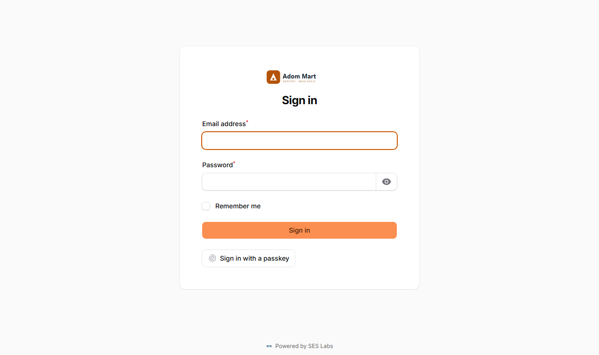

# 4. Installing the server on Windows (setups A, B and branch servers)

Follow every step in order. Allow about two hours the first time. You need an internet connection during installation.

In this chapter the software goes in `C:\Synclytics` and PHP in `C:\php`. If you choose other folders, change them in every command.

## 4.1 Prepare the computer

1. **Install all Windows updates** (Start → Settings → Windows Update), restart, and repeat until none are left.
   **Why:** updates fix security holes and avoid restarts in the middle of trading later.
2. **Set the clock to update automatically:** Settings → Time & language → Date & time → switch on *Set time automatically* and *Set time zone automatically* (or choose *(UTC+00:00) Monrovia, Reykjavik* for Ghana).
   **Why:** receipts, shifts and sync depend on the correct time. Tills more than 10 minutes ahead of the server are refused.
3. **Stop the PC from sleeping:** Settings → System → Power → *Screen and sleep* → set *When plugged in, put my device to sleep after* to **Never**.
   **Why:** a sleeping server cannot answer the tills.
4. **Setup B only — give the PC a fixed address on the network.** In your router's settings, find *DHCP reservation* (sometimes *Address reservation* or *Static lease*) and reserve an address for this PC, for example `192.168.1.10`. Ask whoever installed your router if unsure. Write the address down.
   **Why:** tills find the server by its address. If the address changes after a restart, the tills cannot connect.

**Check:** open PowerShell and type `ipconfig`. The *IPv4 Address* of your network adapter shows the address (for setup B it must be the reserved one).

## 4.2 Install PostgreSQL (the database)

1. Download the **PostgreSQL 17 Windows installer** from `https://www.postgresql.org/download/windows/` (the *Download the installer* link goes to EDB).
2. Run it and accept the defaults, with these choices:
   - **Components:** keep *PostgreSQL Server* and *Command Line Tools*. *pgAdmin 4* is optional (a graphical tool). Untick *Stack Builder*.
   - **Password:** type a strong password for the *postgres* administrator account. **Write it down** in your safe place.
   - **Port:** keep `5432`.
   - **Locale:** keep *Default locale*.
3. Finish. PostgreSQL now runs as a Windows service and starts with the computer.

**Why:** PostgreSQL is where every sale, product and account is stored. It is designed never to lose committed data, even in a power cut.

Now create the database and its own user. Open **PowerShell** and type (replace `<db-password>` with a new long random password, different from the *postgres* one, and write it down):

```
& "C:\Program Files\PostgreSQL\17\bin\psql.exe" -U postgres -c "CREATE ROLE erp LOGIN PASSWORD '<db-password>';"
& "C:\Program Files\PostgreSQL\17\bin\psql.exe" -U postgres -c "CREATE DATABASE erp OWNER erp ENCODING 'UTF8';"
```

Each command asks for the *postgres* password you chose in step 2.

**Why:** the software uses its own database user (`erp`) that can only reach its own database, not the administrator account.

**Check:** both commands answer `CREATE ROLE` and `CREATE DATABASE`.

## 4.3 Install PHP

1. Install the **Microsoft Visual C++ Redistributable (x64)** for Visual Studio 2015–2022 from Microsoft's website (`https://aka.ms/vs/17/release/vc_redist.x64.exe`). **Why:** PHP for Windows is built with it and will not start without it.
2. Go to `https://windows.php.net/download/` and download **PHP 8.4, VS17 x64 Non Thread Safe, Zip**.
3. Create the folder `C:\php` and extract the ZIP **into** it, so that `C:\php\php.exe` exists.
4. In `C:\php`, copy `php.ini-production` and rename the copy to `php.ini`.
5. Open `php.ini` in Notepad and change these lines (search with Ctrl+F; remove the `;` at the start of a line to switch it on):

```
extension_dir = "ext"
extension=curl
extension=fileinfo
extension=gd
extension=intl
extension=mbstring
extension=openssl
extension=pdo_pgsql
extension=pgsql
extension=sodium
extension=zip
memory_limit = 512M
upload_max_filesize = 20M
post_max_size = 25M
date.timezone = Africa/Accra
upload_tmp_dir = "C:\Synclytics\tmp"
sys_temp_dir = "C:\Synclytics\tmp"
```

   Create the folder `C:\Synclytics\tmp` (it holds files while they are being uploaded, e.g. CSV imports).

   **Why:** these extensions let PHP talk to PostgreSQL (`pdo_pgsql`), handle money and text in every language (`bcmath`, which is built in, `intl`, `mbstring`), and protect secrets (`sodium`, `openssl`).
6. Add PHP to the system path, so Windows finds `php` from any folder: Start → type `environment` → **Edit the system environment variables** → **Environment Variables…** → under *System variables* select **Path** → **Edit** → **New** → type `C:\php` → **OK** three times.
7. Close PowerShell and open it again (it reads the new path only when it starts).

**Check:** type `php --version`. It shows `PHP 8.4…`. Then type `php -m` and make sure the list contains `bcmath`, `intl`, `pdo_pgsql`, `pgsql` and `sodium`.

## 4.4 Install Composer and Node.js

1. Download and run **Composer-Setup.exe** from `https://getcomposer.org/download/`. When it asks for PHP, choose `C:\php\php.exe`. Leave the proxy empty.
2. Download and run the **Node.js LTS** Windows installer (`.msi`) from `https://nodejs.org/`. Accept the defaults. You do not need the *Tools for native modules* option.
3. Close PowerShell and open it again.

**Check:** `composer --version` shows `Composer version 2…`, and `node --version` shows `v22…` or later.

**Why:** Composer downloads the server's building blocks; Node.js builds the till app. Both are only used during installation and updates.

## 4.5 Put the software in place

Synclytics gives you the software as a ZIP file named like `synclytics-<your-company>-<build>.zip`.

1. Create the folder `C:\Synclytics`.
2. Extract the ZIP into it, so that `C:\Synclytics\server\artisan` exists.

**Note:** If you were given the **source code** (for example through Git) instead of a release ZIP, place it so that `C:\Synclytics\server` and `C:\Synclytics\pos` exist, and also do step 4.7 (*Build the till app*).

## 4.6 Configure the server

Open PowerShell and go to the server folder:

```
cd C:\Synclytics\server
```

1. **Download the server's libraries:**

   ```
   composer install --no-dev --optimize-autoloader
   ```

   **Why:** the release contains only Synclytics' own code; this downloads the open-source libraries it builds on, at the exact versions it was tested with. `--no-dev` leaves out testing tools.

2. **Create the settings file** from the example:

   ```
   copy .env.example .env
   notepad .env
   ```

   Change these lines and save:

   ```
   APP_ENV=production
   APP_DEBUG=false
   APP_URL=http://<server-address>:8010
   DB_PASSWORD=<db-password>
   ERP_NODE_ROLE=hq
   ERP_NODE_ID=HQ
   ```

   - `<server-address>`: `localhost` for setup A; the fixed address from 4.1 (e.g. `192.168.1.10`) for setup B.
   - For a **branch server**, use `ERP_NODE_ROLE=branch` and the branch server's id (e.g. `B01`) as given in Chapter 10.

   **Why:** `.env` tells the software where its database is, what address it is reached on, and that it is a live system (`APP_DEBUG=false` hides technical error details from users).

   **Warning:** `.env` will hold your secret keys. Never e-mail it, never put it on a shared drive, and include it in your backups (Chapter 12).

3. **Create the secret keys:**

   ```
   php artisan key:generate
   php artisan erp:audit-key
   ```

   **Why:** `key:generate` creates `APP_KEY`, which encrypts sessions and stored secrets. `erp:audit-key` creates `ERP_AUDIT_KEY`, which seals the audit log so changes to history can be detected. **Never change either key after this.**

4. **Create the database tables and the standard data** (roles, permissions, units, tax templates, chart of accounts):

   ```
   php artisan migrate --seed --force
   ```

   **Why:** this builds the empty structure of the database. `--force` confirms you are on a live system.

   **Check:** it ends with lines saying `DONE` and no red errors.

5. **Create your company and the owner account:**

   ```
   php artisan erp:install
   ```

   It asks for the company name, the owner's full name, a username (for till sign-in), email and a password of at least 12 characters.

   **Why:** the owner is the first person who can sign in; they create everyone else.

   **Note:** Skip this step on a **branch server**: its company and people come from head office (Chapter 10).

6. **Build the files for the online shop's live updates** (optional, but harmless):

   ```
   npm install
   npm run build
   ```

7. **Speed up the server** (run again after every change to `.env`):

   ```
   php artisan optimize
   ```

## 4.7 Build the till app (source code only)

Skip this if your release ZIP already contains `C:\Synclytics\server\public\pos\index.html`.

```
cd C:\Synclytics\pos
npm install
npm run build:server
```

**Why:** this turns the till's source code into the app the server hands out at `/pos/`, including the offline files that let tills keep selling without the server.

**Check:** the file `C:\Synclytics\server\public\pos\index.html` now exists.

## 4.8 Start the server automatically

The server needs two programs running all the time:

- the **web server**, which answers the back office and the tills;
- the **scheduler**, which runs the routine jobs every minute (sending to online stores, syncing branches, posting to the accounts, reminders, the daily licence check-in).

We register them with Windows **Task Scheduler** so they start with the computer, even when nobody is signed in, and restart if they stop.

Open **PowerShell as administrator** and paste this whole block. For setup A, change `0.0.0.0` to `127.0.0.1` on the second line (only this PC may reach the server).

```
$app = "C:\Synclytics\server"; $php = "C:\php\php.exe"
$listen = "0.0.0.0"
$settings = New-ScheduledTaskSettingsSet -ExecutionTimeLimit ([TimeSpan]::Zero) -RestartCount 999 -RestartInterval (New-TimeSpan -Minutes 1) -StartWhenAvailable -AllowStartIfOnBatteries -DontStopIfGoingOnBatteries
$principal = New-ScheduledTaskPrincipal -UserId "SYSTEM" -LogonType ServiceAccount -RunLevel Highest
$trigger = New-ScheduledTaskTrigger -AtStartup
Register-ScheduledTask -TaskName "Synclytics Web" -Trigger $trigger -Settings $settings -Principal $principal -Action (New-ScheduledTaskAction -Execute $php -Argument "artisan serve --host=$listen --port=8010" -WorkingDirectory $app)
Register-ScheduledTask -TaskName "Synclytics Scheduler" -Trigger $trigger -Settings $settings -Principal $principal -Action (New-ScheduledTaskAction -Execute $php -Argument "artisan schedule:work" -WorkingDirectory $app)
Start-ScheduledTask "Synclytics Web"; Start-ScheduledTask "Synclytics Scheduler"
```

**Why:** `ExecutionTimeLimit 0` stops Windows from ending the tasks after three days (its default). `SYSTEM` runs them without anyone signed in.

**Setup B only — let the tills through the Windows firewall:**

```
New-NetFirewallRule -DisplayName "Synclytics server" -Direction Inbound -Protocol TCP -LocalPort 8010 -Action Allow -Profile Private,Domain
```

**Why:** Windows blocks incoming connections by default. This opens only port 8010, and only on private (shop) networks, not public Wi-Fi.

**Check:**
1. In a browser on the server, open `http://localhost:8010/up` — it shows a page saying *Application up*.
2. Open `http://localhost:8010/admin` — the sign-in page appears:

   

3. Setup B: on another PC on the network, open `http://<server-address>:8010/admin` — the same page appears.

**Tip:** To stop or restart the server, open **Task Scheduler**, click *Task Scheduler Library*, right-click *Synclytics Web* or *Synclytics Scheduler* and choose **End**, then **Run**.

## 4.9 Optional: live updates (instant price and stock changes on tills)

Without live updates, tills check for changes every 60 seconds, which is enough for most shops. To make changes appear within seconds:

1. In `.env`, set three random values of your own (letters and digits, at least 20 characters each):

   ```
   REVERB_APP_ID=<random-1>
   REVERB_APP_KEY=<random-2>
   REVERB_APP_SECRET=<random-3>
   REVERB_HOST=<server-address>
   REVERB_PORT=8080
   ```

2. Run `php artisan optimize` again.
3. In PowerShell as administrator, add a third task:

   ```
   Register-ScheduledTask -TaskName "Synclytics Live" -Trigger (New-ScheduledTaskTrigger -AtStartup) -Settings (New-ScheduledTaskSettingsSet -ExecutionTimeLimit ([TimeSpan]::Zero) -RestartCount 999 -RestartInterval (New-TimeSpan -Minutes 1)) -Principal (New-ScheduledTaskPrincipal -UserId "SYSTEM" -LogonType ServiceAccount -RunLevel Highest) -Action (New-ScheduledTaskAction -Execute "C:\php\php.exe" -Argument "artisan reverb:start --host=0.0.0.0 --port=8080" -WorkingDirectory "C:\Synclytics\server")
   Start-ScheduledTask "Synclytics Live"
   New-NetFirewallRule -DisplayName "Synclytics live" -Direction Inbound -Protocol TCP -LocalPort 8080 -Action Allow -Profile Private,Domain
   ```

**Check:** sign in on a till, change a price in the back office, and the till shows the new price within a few seconds.

## 4.10 Next steps

- Activate the licence: **Chapter 6**.
- First-time set-up in the back office: **Chapter 7**.
- Set up the tills: **Chapter 9**.
- Set up backups **before** you go live: **Chapter 12**.
