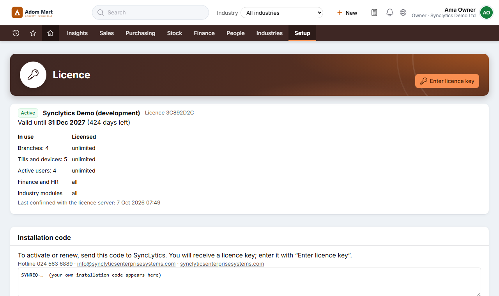

# 6. Activating the licence

Every installation needs a **licence key from SyncLytics** (hotline 024 563 6889, info@synclyticsenterprisesystems.com). Until it is activated, only the Licence page works.

## 6.1 What the licence controls

- How many **branches**, **tills and devices** and **active users** you may have. Logins in the practice company (copies of your staff, for training) and the SyncLytics support account do not count.
- Which **industry modules** you may switch on (Grocery, Pharmacy, Restaurant, Electronics, Fashion, Services…).
- Whether **Finance** (accounts) and **HR & payroll** are included.
- Until when it is valid.

Parts that are not licensed are hidden from the menus.

**Reading the licence page (System → Licence):**

- **In use** beside **Allowed** shows how much of the licence you are using. **Limit reached** means nothing more can be added, so ask for a new key first. Why: a new branch, till or user is refused once its limit is full.
- **Branches** include head office. A company with head office and one shop is already using 2.
- **Features** and **Paid add-ons** list what is included. Anything not listed stays out of the menus.
- **Industry modules** list the kinds of business you may switch on. *Not available yet* means the licence covers it but it has not been built, so choose another module. A supermarket uses **Grocery / Supermarket**.

## 6.2 Activate

1. Open the back office at `https://<server-address>/admin` (Windows) or `https://<your-domain>/admin` (Ubuntu) and sign in as the **owner** (Chapter 7, steps 1–2 explain the first sign-in and two-factor set-up).
2. You are taken to **System → Licence**. It shows the **installation code** (also as a QR code), which starts with `SYNREQ-`.
3. Send that code to SyncLytics: copy and paste it into an e-mail to info@synclyticsenterprisesystems.com, or a WhatsApp message to the hotline 024 563 6889. The Licence page shows these contacts too. Tell them which modules and how many branches, devices and users you need.
4. You receive a **licence key** starting with `SYN1-`. On the Licence page click **Enter licence key**, paste it and confirm.

**Why:** the key is signed by SyncLytics and checked on your server without the internet. It is tied to this installation, so a copied server or database asks to be activated again.

**Check:** the Licence page shows **Active**, your company name, the expiry date and the limits:

## 6.3 Daily check-in

Head office contacts the SyncLytics licence server once a day (03:15, by the scheduler). It collects renewals automatically, so you normally never paste a key again.

- If the server cannot reach the internet for **30 days**, a yellow banner appears; after another **14 days** the software becomes read-only until it checks in.
- **Branch servers** receive the licence from head office; they do not check in themselves.

### Hourly health report (support console)

Every hour head office also sends SyncLytics support a short **health report**: the checks on **System → Health** (backups, restore check, disk, memory, server load, scheduler, licence…), tills with problems, the numbers of open problem reports, and whether support access is open. **No sales, customers, prices, stock or staff details are sent.**

**Why:** support sees a failed backup, a full disk or a silent till on its console and can call you before it becomes a problem. To stop it, ask IT or SyncLytics support: **System → Settings → Security → Share system health with SyncLytics support** → off (the daily licence check-in stays).

**For SyncLytics (licence server):** **Licences → Support console** lists every client, worst first: *Needs attention* (a red check), *Not reporting* (no report for 3 hours: server, internet or scheduler down), *Warning*, *OK*. **Details** shows every check, the tills with problems and the open problem reports; the dashboard's *Needs attention* list includes the same red and silent servers.

**For SyncLytics (issuing licences):** licences are made with the **SES Licensing** desktop app on the owner's PC, which works without internet. Its own guide is the README in the `SES-Licensing` folder. If the licence server is running, connect the app once so the two stay the same:

1. On the licence server, open **/vendor → Set-up → Sync devices → New device**, name the PC and copy the one-time code. **Why:** only a PC you allow can change licences, and the code works once, for 15 minutes.
2. In the app, open **Sync**, type the server's address and the code, and click **Connect**. **Why:** the app makes its own private key and sends only the public half, so no password travels or sits on the server.
3. To stop a lost PC from syncing, click **Revoke** beside it on the same page.

Customers, plans, add-ons, licences, invoices and payments then stay the same in both places. **Why:** a payment recorded on either side shows on both, so nobody chases a client who has paid.

**Check:** the device shows *Active* and a recent *Last seen*, and the licences issued in the app appear under **Licences**.

To update the app itself, copy `latest.json` and the installer that `npm run release` made into `storage/app/ses-licensing/` on the licence server. **Why:** connected copies of the app find the new version there and offer it under **Settings → Updates**.

## 6.4 Licence states

| State | When | What works |
|---|---|---|
| **Not activated** | New installation | Only the Licence page |
| **Active** | Normal | Everything you bought |
| **Attention** (yellow banner) | 30 days before expiry; no check-in for 30 days; software moved to another server | Everything |
| **Grace** | Up to 14 days after expiry | Everything, with a banner |
| **Read-only** | After the grace period; licence withdrawn; no check-in for 44 days; moved and not re-activated within 14 days; software modified | You can **view** everything, but nothing can be changed, sold or printed. Tills keep their unsent sales until the licence is renewed. **Nothing is deleted.** |

## 6.5 Renewing, adding branches or modules

Ask SyncLytics for a new key. It reaches head office at the next daily check-in, or paste it on the Licence page straight away.

## 6.6 Moving to a new server

The licence is tied to the server it was activated on. After moving (Chapter 12), the Licence page shows *Attention: moved*. Send the new installation code to SyncLytics and enter the new key within **14 days**.

**Warning:** Do not try to copy or alter the software to get around the licence. Modified copies stop working and are reported at check-in; printed documents carry hidden references to the licence they were made with.
