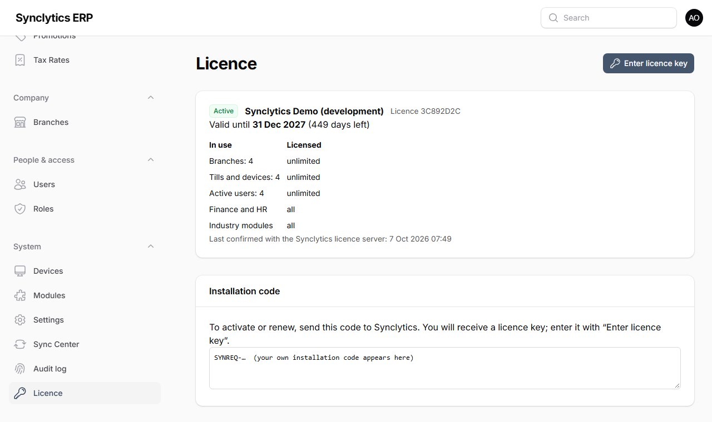

# 6. Activating the licence

Every installation needs a **licence key from Synclytics**. Until it is activated, only the Licence page works.

## 6.1 What the licence controls

- How many **branches**, **tills and devices** and **active users** you may have.
- Which **industry modules** you may switch on (Grocery, Pharmacy, Restaurant, Electronics, Fashion, Services…).
- Whether **Finance** (accounts) and **HR & payroll** are included.
- Until when it is valid.

Parts that are not licensed are hidden from the menus.

## 6.2 Activate

1. Open the back office at `http://<server-address>:8010/admin` (Windows) or `https://<your-domain>/admin` (Ubuntu) and sign in as the **owner** (Chapter 7, steps 1–2 explain the first sign-in and two-factor set-up).
2. You are taken to **System → Licence**. It shows the **installation code**, which starts with `SYNREQ-`.
3. Send that code to Synclytics (copy and paste it into an e-mail or WhatsApp message). Tell them which modules and how many branches, devices and users you need.
4. You receive a **licence key** starting with `SYN1-`. On the Licence page click **Enter licence key**, paste it and confirm.

**Why:** the key is signed by Synclytics and checked on your server without the internet. It is tied to this installation, so a copied server or database asks to be activated again.

**Check:** the Licence page shows **Active**, your company name, the expiry date and the limits:

## 6.3 Daily check-in

Head office contacts the Synclytics licence server once a day (03:15, by the scheduler). It collects renewals automatically, so you normally never paste a key again.

- If the server cannot reach the internet for **30 days**, a yellow banner appears; after another **14 days** the software becomes read-only until it checks in.
- **Branch servers** receive the licence from head office; they do not check in themselves.

## 6.4 Licence states

| State | When | What works |
|---|---|---|
| **Not activated** | New installation | Only the Licence page |
| **Active** | Normal | Everything you bought |
| **Attention** (yellow banner) | 30 days before expiry; no check-in for 30 days; software moved to another server | Everything |
| **Grace** | Up to 14 days after expiry | Everything, with a banner |
| **Read-only** | After the grace period; licence withdrawn; no check-in for 44 days; moved and not re-activated within 14 days; software modified | You can **view** everything, but nothing can be changed, sold or printed. Tills keep their unsent sales until the licence is renewed. **Nothing is deleted.** |

## 6.5 Renewing, adding branches or modules

Ask Synclytics for a new key. It reaches head office at the next daily check-in, or paste it on the Licence page straight away.

## 6.6 Moving to a new server

The licence is tied to the server it was activated on. After moving (Chapter 12), the Licence page shows *Attention: moved*. Send the new installation code to Synclytics and enter the new key within **14 days**.

**Warning:** Do not try to copy or alter the software to get around the licence. Modified copies stop working and are reported at check-in; printed documents carry hidden references to the licence they were made with.
