# 7. First-time set-up in the back office

Do these steps once, at head office, in this order. Allow a day for a single shop, longer for a chain (most of the time goes into products and prices).

**Tip:** Practise first on a **test installation** with made-up products: `php artisan erp:demo-catalog --as=<owner-email>` fills it with sample products and stock. Never run that command on your live system.

## Step 1 — Sign in for the first time

1. Open the back office: `https://<server-address>/admin` (Windows server) or `https://<your-domain>/admin` (Ubuntu).
2. Sign in with the owner's **email (or username) and password** (from `erp:install`). Everyone can type either their e-mail address or the username they use on the till.

## Step 2 — Set up two-factor sign-in

You are asked to set up an **authenticator app**:

1. Install an authenticator app on your phone (Google Authenticator, Microsoft Authenticator or similar).
2. In the app choose *Add account* → *Scan a QR code* and scan the code on the screen.
3. Type the 6-digit code the app shows.
4. **Save the recovery codes** shown next: print them or write them down and keep them somewhere safe, **not** on the same phone.

**Why:** a stolen password alone is then not enough to get in. Everyone from security level L3 (supervisors and above) must use two-factor sign-in.

**Tip:** the back office can be **Light**, **Dark** or follow your device (**System**): open your profile menu (top right) and choose the sun, moon or screen icon. Each person's choice is kept in their browser.

**Note:** Later you can add a **passkey** (fingerprint or face) under your profile. Passkeys work only on an HTTPS address or `localhost`.

## Step 3 — Activate the licence

See **Chapter 6**.

## Step 4 — The setup wizard

The wizard opens by itself the first time.

1. **Deployment** — how the system runs: *Standalone single PC* (setup A/B), *Central on-premise server* (setup C), or *Cloud HQ* (setups D/E). This records your starting layout; you can grow later.
2. **Company** — trading name, country, base currency and time zone. Optionally the **legal entity**: registered name, **TIN** and **VAT number**, needed for VAT invoices (you can add it later under *Company*).
3. **Your brand** (optional) — the company **logo**, a **square icon** and the **brand colour** (leave the colour empty and it is taken from the logo). You can do this later under *Company → Branding* (below).
4. **Branches & modules** — one row per branch:
   - **Code** (1–6 letters/digits, e.g. `HQ`, `KSI`). It appears in every receipt number and **cannot be changed later**.
   - **Name**, the number of **tills**, and whether it is the **head office** (exactly one).
   - **Modules** for that branch (Grocery, Pharmacy, Restaurant, Electronics, Fashion, Services, Online Storefront…). You can change these later (Chapter 8).
5. Click **Finish setup**.

**Why:** each branch automatically gets a main warehouse and the tills you asked for. Receipt numbers look like `HQ-T01A-000123`: branch, till, device series and number.

**Check:** *Company → Branches* lists your branches with their warehouses and tills.

### Your brand: logo, icon and colour

**Which name prints:** receipts, dosage labels, drawer slips and invoices carry the name of the company the branch trades as — its industry's legal entity (Company → Legal entities and Company → Industries), e.g. *Asante Pharmacy Ltd*, not the group *Asante Holdings*. The receipt top is short: that name, the branch and its phone on one line, the TIN and VAT number. In the back office the same name shows at the top for people who work in one industry (or after choosing one at the top); people who see several industries see the group name.

**Company → Branding.** Your brand is what staff and customers see: the back office's top bar, the till, printed receipts, invoices, statements, PDF exports and your online shop.

1. **Logo** — your logo with the name, on a transparent background (PNG) or as SVG, at least 600 pixels wide. Choose **Upload**.
2. **Logo for dark backgrounds** (optional) — a light version for dark mode and dark headers. Without it, the normal logo is used.
3. **Square icon** — the symbol alone, at least 256 × 256 pixels. It is the browser-tab icon and the small icon on the till. Until you add one, your **initials on your colour** are used.
4. **Brand colour** — pick it, type it (`#0F766E`), or press **Use … from your logo**. If the colour is too light to read on white, the page says so: choose a darker shade.
   **Menu colour** (optional) — the colour of the menu band, the side menu and each page's banner. Leave it empty and it is a dark shade of your brand colour, so it always goes with your logo; or pick your own dark colour (white writing must read on it). **Automatic** goes back to the shade.
5. **Print the logo on till receipts** — receipt printers print it in black and white (it is converted for them).
6. Press **Save colour and receipts**, and look at the **Preview**: the till accent, a receipt and an invoice.

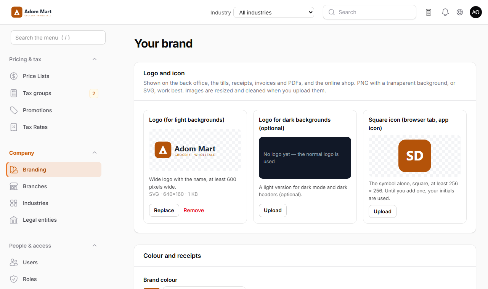

**Why:** customers trust a receipt or invoice that carries the shop's own logo, and staff recognise their own system. The images are checked and made smaller when you upload them, and they reach branch servers and backups like the rest of your data.

**Note:** a small line *“Powered by ZionEX”* stays at the bottom of the back office, receipts and documents. A **white-label licence** removes it (ask SyncLytics).

## Step 4b — Industries (if you run more than one kind of business)

Each branch runs one industry (Pharmacy, Grocery, …), switched on per branch in the wizard or under Company → Modules. Head office can stay company-level. See **Chapter 8.0** for the industry switcher, separate catalogues and industry managers.

**Books:** by default each industry gets **its own company and books**. Fill in each company's registered name and TIN under **Company → Legal entities** before the first sale, so receipts print them. For one set of books instead, switch off **System → Settings → Finance → Separate books for each industry** now, before anything is posted (Chapter 8.0, *Accounts by industry*).

## Step 5 — People and access

For each staff member:

1. **People & access → Users → New user**: name, username, email (for back-office users), and a **Security level (ceiling)** (the highest level of what they can ever be given — see Chapter 18).
2. On the next screen, **Grant access**: choose a **role** (Cashier, Supervisor, Branch Manager, Storekeeper, Stock Controller, Accountant, Pharmacist, Waiter, Stylist / Therapist…) and **where it applies** (a till, a branch, a warehouse or the whole company).
   A person's own **security level** must be at least the role's (e.g. Stock Controller L3, Warehouse Manager L4); raise
   the level on the user's page first if the role is refused. **Products** (create and edit, categories, brands, units)
   need Stock Controller, Warehouse Manager or a manager role — for one branch or the whole company; there is one product
   list for all branches. **Prices** need a manager role (*Change prices, price lists and tax set-up*), for the whole company.
3. For anyone who sells or clocks in on a till: **Set POS PIN** (4–8 digits; simple PINs like 1234 are refused).
4. **How the person signs in to the back office** (on the user's page):
   - **Company rule** (default): the authenticator app from the level set under System → Settings → Security (L3 unless you change it), password only below it;
   - **Password and the authenticator app** — always, whatever the level;
   - **Password and a code by WhatsApp or e-mail** — a 6-digit code is sent at each sign-in, works once for 10 minutes. It goes to the **Mobile (WhatsApp) number** when your WhatsApp Business provider is set up (16.3), otherwise to the e-mail address. *Send it by e-mail instead* is on the code screen;
   - **Password only** — allowed for staff up to supervisors (L3).

**Why:** a second step stops someone who learned a password. People without a smartphone app can get a code by WhatsApp or e-mail instead; low-risk staff who only look things up can use the password alone — your choice, person by person, and every change is in the audit log.

**Why:** people see and do only what their role allows, only where it applies. A cashier with access to *Till 1* cannot sell on *Till 2* or open the back office.

**Tip:** For temporary cover (e.g. a supervisor on leave), grant access **with an end date and a reason**: it stops by itself.

**The SyncLytics support account:** the list may show *SyncLytics support (Superadmin)* at level L7. SyncLytics adds it on your server so support can help you; nobody in the company can change it. It always signs in with an authenticator app, it does not count as one of your licensed users, and the owner and general manager get a notification each time it signs in. Everything it does is in the audit log (System → Audit log).

**Check who can do what:** **People & access → Who can do what** lists the risky combinations first — one person who orders from suppliers and also receives the goods, adds suppliers and pays them, collects customer payments and can write debts off, sells and approves till shortages, adds staff and pays wages, or changes what roles allow — with what each risk means, what to do, and who has it where. Below: people switched off or not signed in for 60 days who still have access, temporary access with its end date, and everyone's roles. **Download (CSV)** keeps a copy.

**Why:** most thefts in a small business need one person to hold two jobs that should check each other. In a small team some overlap cannot be avoided; then look at that person's work in **System → Audit log** now and then. Look at this page every few months and after staff changes.

**Warning:** Do not share one account between several people. Every sale, refund and change is recorded under the person who signed in.

**Finding a page:** at the top of the side menu, **Search the menu** — type part of a name (*adjust*, *expiry*, *momo*, *po*) and only the matching pages stay; **Enter** opens the first, **Esc** clears. Press `/` anywhere to jump there. To find a record (a product, a customer, a receipt), use the search at the top (Ctrl+K).

## Step 6 — Settings

**System → Settings** — the page lists the groups (click one to open it), and **Find a setting** at the top shows only the settings with the words you type (e.g. *receipt*, *momo*, *expiry*), whatever group they are in. **Save settings** is at the top and the bottom. Leaving the page (or any form in the back office) with changes not saved asks first, so nothing typed is lost by mistake; the till does the same for a sale on screen, and the handheld for a delivery or count not yet posted. Review each group. The most important:

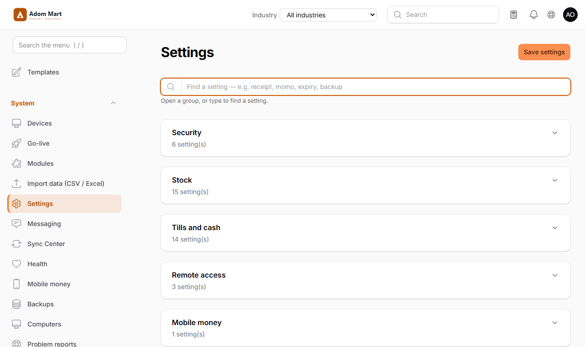

| Setting | Why it matters |
|---|---|
| Require two-factor sign-in from security level | Default L3. Lower it for more security. |
| Wrong POS PINs before the PIN is locked / POS PIN lockout (minutes) | Stops PIN guessing at the till. |
| Offline till sign-in lasts (hours) | How long a cashier can sign in on a till without the server (default 72). Shorter is safer, longer helps during long outages. |
| Stop sales when the system shows no stock | Off by default (tills can sell items the system thinks are out of stock, and you count them later). |
| Show stock left on the till while selling | On by default (switch off if cashiers should not see stock). On: each item in the sale, and in the till's search list, shows how many are left at that till's store (e.g. *14 TAB left*), counting what is already in the sale. Useful where cashiers should tell customers what is available. Tills pick it up at their next sign-in. |
| Message at the bottom of receipts | A thank-you line and your returns policy. Each line you type, and each sentence, prints on its own line (*Thank you for shopping with us.* then *Goods sold are not returnable.*). **Why:** short separate lines read easily on narrow receipt paper. |
| Returns accepted within (days, with receipt) | How long after a sale a return with the receipt is accepted. |
| Each teller sells from their own vault / How each teller's cash is kept | Off by default. On: each teller has their own vault (cash tray) and a till opens only on theirs (Step 13b). **Why:** nobody can sell in someone else's name. |
| Lock the till after this many idle minutes | Default 5; 0 = never. **Why:** a till left signed in cannot be used by the next person: it locks with the name on it, and only that person's PIN unlocks it (the sale on screen stays). |
| Cash control with vaults | Off: whoever closes a till counts the drawer. On: tellers, a Cashier and an Income Controller check the cash at every step (Step 14). |
| Automatic shifts / Till trading hours / Straight day from (hours) | Off by default. On: each till session is named by the shift it opens in (Morning, Afternoon… from **Cash → Shifts and vaults**; by default Morning 07:00–15:00 and Afternoon 14:00–23:00, shifts may overlap by at most 1 hour), and one of 10 hours or more is a **Straight day**. A till opens only within the trading hours (default 07:00–23:00) and once per shift per person: outside the hours, or when the same person opens again after closing their shift, a manager (Branch Manager or above) types their username, PIN and the reason on the till. Another teller taking over the till (a handover) opens their own shift without a manager. The till shows who is signed in on the *Open shift* screen and above every manager's PIN, with a *Sign out* link, so the manager sees whose shift they allow. Closing and counting are always allowed. A branch can choose differently. **Why:** every session is in the right shift for the reports, and nobody sells after closing time or reopens a counted till without a manager knowing, while a normal handover between tellers needs nobody's PIN. |
| Payment alerts (group) | Off by default. *Each payment*, *each payment and a daily summary* or *the summary only*, for mobile money and/or card; single alerts only from an amount you choose; also by e-mail, SMS or WhatsApp (to each person's e-mail and **Mobile (WhatsApp) number**); the summary time (default 21:00). Who gets them: anyone with *receive payment alerts* — the Owner, General Manager, Finance Manager and Accountant by default. Alerts show on the bell in the back office. **Why:** the owner sees MoMo and card money arrive without asking the till, and the evening summary is checked against the MoMo statement. |

Module settings (Grocery, Pharmacy, Restaurant, Fashion, Services) are explained in Chapter 8.

## Step 6b — How the back office looks, favourites and profile photos

The back office has three looks. **Tabs across the top** is the standard one:
- **Tabs across the top** (standard): like a desktop accounting program. The top row has your logo, a wide **Search**
  (for records: products, customers, orders…), **+ New** (create any record you are allowed to create, e.g. an order
  or a product, without looking for its page first) and your name with your role. Under it, a band in your menu colour
  starts with three icons, then the tabs (Insights, Sales, Purchasing, Stock, Finance, People, your industry, Setup).
  Point at a tab and its pages open in a panel.
  - **Clock — recent pages and Find a page:** the pages you opened last; type part of a page's name to find any page.
    The **/** key opens it from anywhere.
  - **Star — favourites:** open a page you use often, click the star, then *Add this page to favourites*. Your
    favourites follow you to any computer (up to 20).
  - **House — home:** your home page.
- **New look: side menu:** a menu in your menu colour down the whole left side, with your logo at the top and one row
  per area (Dashboard, Insights, Sales, Purchasing…); click an area to open its pages. The **‹** button folds it to
  icons for more room.
- **Classic:** the original layout.

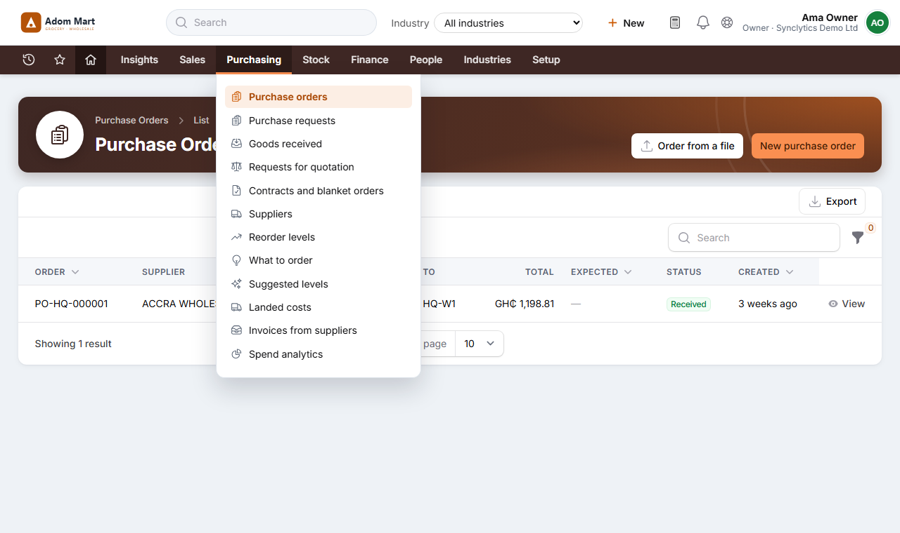

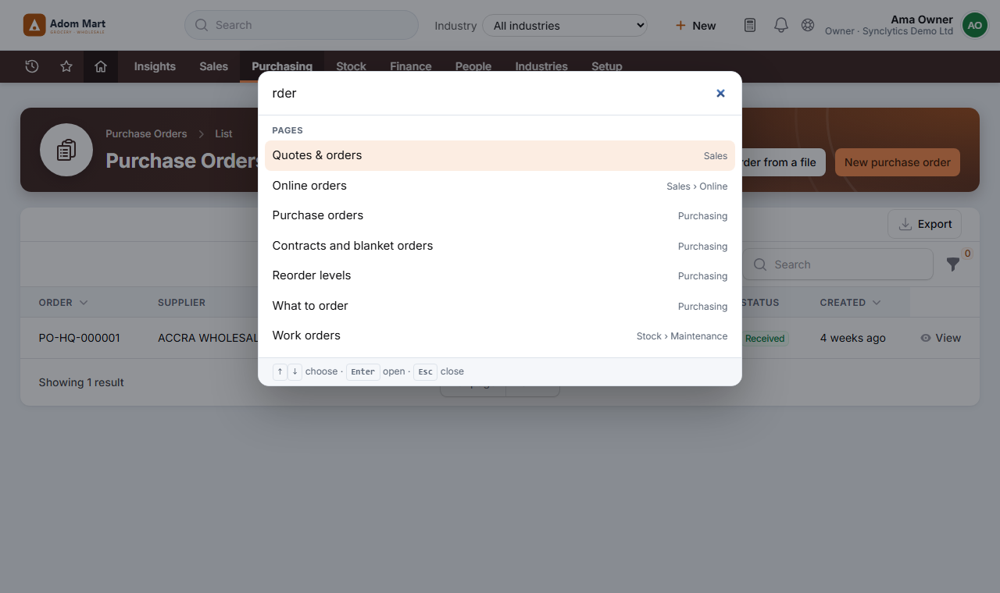

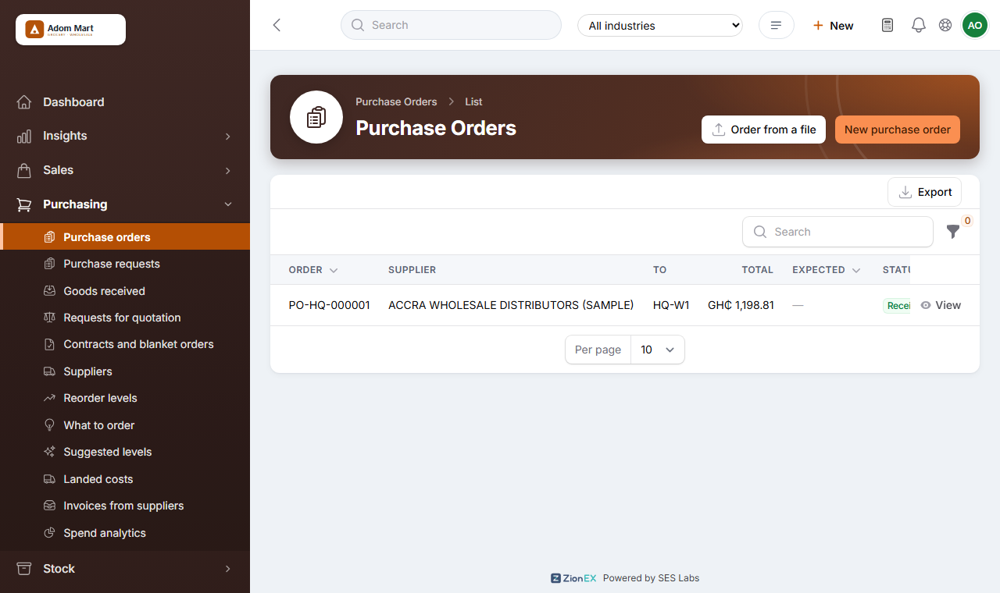

In both new looks each page opens with a banner in your menu colour (the page's icon, its name and its buttons), and
sections are white cards, so every page looks the same way. All colours follow your brand (Step 4, *Your brand*).

**Where the menu sections are in the tabs:** this guide names pages by their menu section, e.g. *System → Settings*.
With the tabs, the sections are grouped like this: **Insights** (Insights, Reports) · **Sales** (Sales, Cash, Online)
· **Purchasing** · **Stock** (Stock, Catalog, Pricing & tax) · **Finance** · **People** (HR & payroll, People &
access) · your **industry** (e.g. Pharmacy) · **Setup** (Company, Messages, System). So *System → Settings* is
**Setup → Settings**. Or press **/** and type *settings*.

**Why a choice:** most people find the tabs faster, and they fit more on the screen. Anyone who prefers another look
can keep it.

1. **Each person, for themselves:** top right, click your photo or initials → **Profile** → **Look** → choose →
   **Save changes**. *As the company chose* follows the company's choice.
2. **For everyone:** **System → Settings → Appearance → How the back office looks**. This applies to everyone who has
   not chosen for themselves.
3. **On a phone** the side menu is always used, because the tabs do not fit.

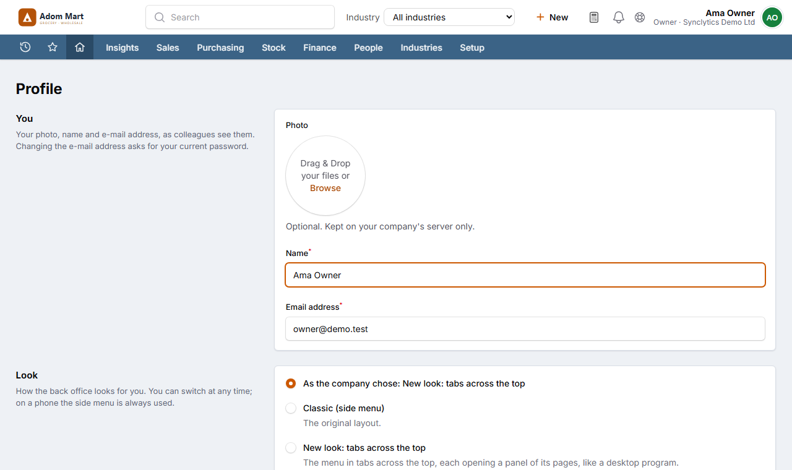

The **Profile** page lists its parts on the left (Your profile, Look, Security) with SyncLytics' support contacts, and
shows a card for each on the right: your photo and details, the look (pictures of each, in your colours), your
password (with how strong it is), two-factor sign-in and passkeys.

**Profile photo:** on the same **Profile** page, drop a photo on the circle (or click *Browse*), adjust it with the
pencil if you like, and **Save changes**. It shows beside your name in the top bar and in the list of users.
**Why:** colleagues see at a glance who did what. The server keeps only a small square copy, with the hidden details
of the original removed (where and when it was taken, the camera). It stays on your company's server and is shown only
to people signed in to your company. People without a photo show their initials, drawn on your own server (no name is
sent to an outside website).

## Step 6c — Your dashboard, preferences and notifications

**The dashboard** (the house icon, or *Dashboard*) is each person's home page: panels with figures, charts and lists —
sales today and this month, the sales trend, how customers paid, sales by branch, best sellers, stock to act on, buying,
spend by month, what customers owe by how late, cash, pharmacy, people, and **Waiting for you** (orders, stock
adjustments, expense claims and leave waiting for your approval) with **Shortcuts** (your favourite pages and quick
*new* links).

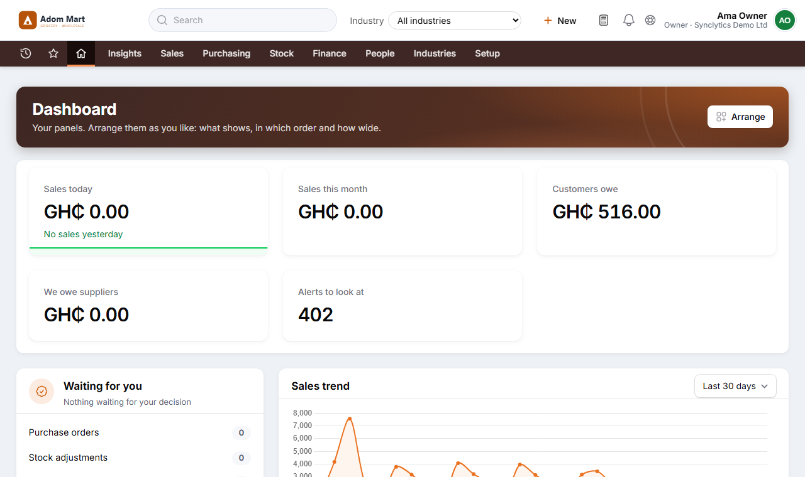

**Why:** each person sees first what they act on. A cashier sees the cash and shortcuts; a buyer sees buying and stock;
the owner sees the whole business. Panels show only what the person may see, for their own branches.

1. Each role starts with its own set of panels.
2. **Arrange** (top right of the dashboard): switch panels on or off, drag them into order (⇅) and choose how wide each
   is (a third, half, two thirds, full width) → **Save my dashboard**.
3. **Back to my role's** brings the role's panels back.

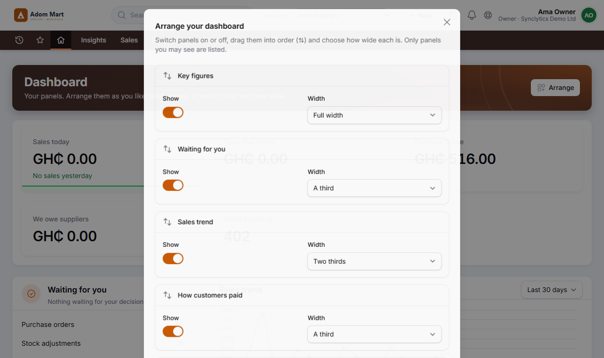

**Preferences** (top right → **Profile** → *Preferences*) — they follow you to any computer:
- **Home page:** the dashboard, *Today*, or one of your favourite pages — opened when you sign in and by the house icon.
- **Rows a list shows at first:** 10, 25, 50 or 100.
- **How dates are written:** *2 Nov 2026*, *02/11/2026* or *2026-11-02*.
- **Light or dark**, and **Lists**: comfortable or compact (more rows on the screen).

**Notifications** (Profile → *Notifications*): for each kind of notification — waiting for your approval, buying, stock,
prices to review, customers and deals (CRM), projects, service desk and maintenance, sensor alarms, cash, pharmacy, payments received, the daily summary, server and devices — tick how it reaches you: the bell in the back
office and, where the company uses them, e-mail, SMS or WhatsApp. **Why:** people get what they act on, not everything.
The company still decides which channels are used at all (System → Settings → *Payment alerts*, *Daily summary*), and
security notices (SyncLytics support signing in) always reach the owner.

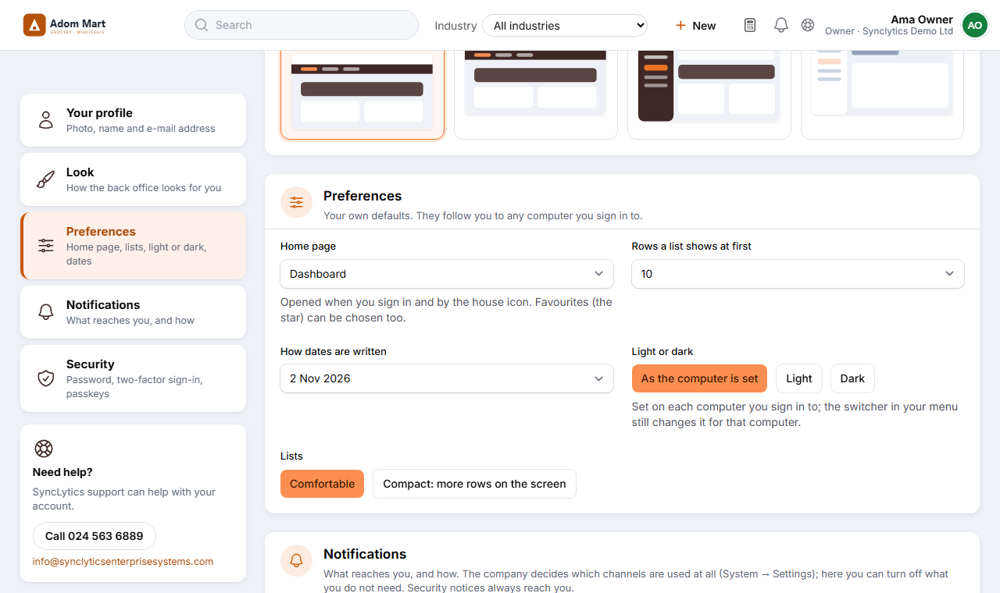

## Step 7 — Tax set-up (with your accountant)

**Pricing & tax → Tax groups** and **Tax rates.** The starter Ghana set-up (VAT 15 %, NHIL 2.5 %, GETFund 2.5 %, all on the price before tax) is marked **Not verified**.

1. Ask a qualified accountant to confirm the rates and the method against current GRA rules.
2. They (or you, on their advice) adjust the rates, then use **Record accountant check** on each group.

**Warning:** Do not go live until the tax groups show the accountant's check. Wrong tax set-up means wrong receipts and wrong tax returns.

## Step 8 — Price lists

**Pricing & tax → Price lists.** You start with **Retail** (default) and **Wholesale**, both including tax. Add lists for special customers if needed. Tick *Cashier can switch to it at the till* only for lists cashiers may use.

**Note:** whether a list's prices include tax cannot change once it has prices.

## Step 8b — Pricing rules (selling prices worked out for you)

If your selling prices come from what you pay (for example *cost × 1.40*), let the system work them out instead of using a calculator. **Why:** every delivery at a new cost would otherwise mean typing new prices by hand, and a missed one means selling below cost or overcharging.

1. **Pricing & tax → Pricing rules → New rule.**
2. **Applies to:** *Whole company* for your usual rule. Add more rules later for a **category** (e.g. a lower markup on baby milk) or a single **product**; the most specific rule wins (product, then its category or the one above it, then the company). A rule set to **Manual** keeps a product or category out of automatic pricing.
3. **Price list it sets:** usually *Retail*. A second rule can set *Wholesale* with a lower figure.
4. **How the price is worked out:**
   - **Multiply the cost** — e.g. 1.40 (a cost of 10.00 gives 14.00);
   - **Markup** — a percentage added to the cost (40 % gives the same as × 1.40);
   - **Margin** — the percentage of the selling price you keep (25 % margin on a cost of 10.00 gives 13.33);
   - **Cost + a fixed amount.**
   The form shows an example as you type.
5. **The result is:** *Shelf price* (VAT and levies inside — the price the customer pays, usual) or *Before tax* (taxes are added on top for taxable items).
6. **Rounding:** to 10 pesewas (usual), 50 pesewas or a whole cedi; *to the nearest* or *always up*. **Why:** prices like 13.37 are awkward at the till and on shelf labels.
7. **When a delivery changes the cost:**
   - *Rises at once, drops for approval* (recommended) — you never sell below the new cost, and a manager decides whether to lower prices;
   - *Always at once*; or *Always for approval*.
   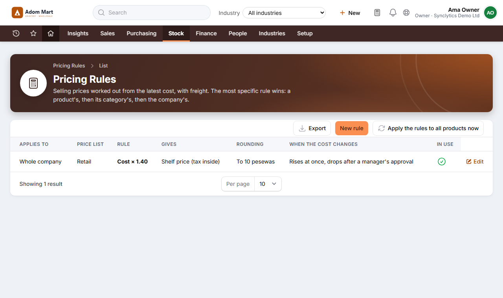
8. **Save**, then **Apply the rules to all products now**. **Why:** the rule otherwise starts with the next delivery; this sets every product with a cost straight away.

**What "cost" means:** the cost of one piece on the **latest posted delivery**, with its share of freight, duty and clearing once a landed cost is posted. Before the first delivery, the average cost of the stock is used. Every unit for sale (piece, strip, carton…) is priced from it.

**Prices to review** (Pricing & tax, also on the dashboard under *Waiting for you* and in the bell): prices waiting for approval, with the cost, the current price and the new one. **Approve** them (several at once with the boxes) or **Keep current**.

**On the product form**, the *Prices* part says which rule sets the price and the latest cost, and warns in red when a price is below the cost.

**Note:** only the standard price of each unit (from quantity 1, no dates) is set by a rule; bulk prices and dated promotions stay as you typed them. With branch servers, prices are set at head office: deliveries posted at a branch are priced within the hour after they reach head office.

**Tip:** need people to set rules? They need a manager role with *Change prices, price lists and tax set-up* for the whole company.

## Step 9 — Products

1. **Catalog → Categories** and **Brands**: create the groups you want for reports.
2. **Catalog → Units of measure**: check the units (PC, CTN, KG with 3 decimals…). A wrong code can be corrected (**Edit**); two codes for the same thing (PCS and PC) are joined with **Merge into…**, which moves every product over.
3. **Catalog → Products → New product** for each item:
   - **Name**, category, brand, **tax group**, **base unit** (the unit stock is counted in, usually PC). The **SKU** (product code) is given by the system when you save, so no two products can share one: an industry's products get its code and a number (`PHARMA-000123`), products shared by every industry a plain number (`100123`). It does not change, except when the product is moved to another industry (it then takes that industry's series).
   - **Barcodes** — scan them into the field.
   - **Other units** — e.g. a carton of 24 with its own barcode.
   - **Prices** — one row per list and unit. Add rows with *From qty* for bulk prices or with dates for promotions.
   - Industry details (medicine, serial numbers, sizes and colours, services) appear when the module is on — see Chapter 8.

**Why:** products are never deleted (old receipts refer to them). Untick *For sale* instead.

**Tip:** with many products, use **Import products (CSV)** instead of typing them one by one: download the template, fill it in Excel (name, category, barcodes, a price column per list; leave SKU empty for new products) and import it. Chapter 14.2 explains how.

## Step 10 — Opening stock

**Stock → Stock on hand → Opening stock / adjustment**, choosing *Opening balance*, for each product and warehouse: the quantity you counted and the **cost per unit**.

**Why:** the cost is used for the value of your stock and the cost of goods sold in the accounts. If you do not have the costs, leave them empty and use a **cost run** afterwards (14.3b), so nothing stays at zero.

**Tip:** count on a day you are closed, enter the counts, then start selling. For many products use **System → Import data (CSV / Excel) → Opening stock** (warehouse, SKU, quantity, unit cost per row). Medicines and other batch-tracked products: **one row per batch**, with its `batch_no` and `expires_on`; a medicine with three batches on the shelf has three rows. Each batch can be loaded once; once a product has been sold, received or adjusted, further changes go through a stock adjustment.

## Step 11 — Customers and suppliers

- **Sales → Customers**: customers who buy on credit or collect loyalty points. Credit limits and payment terms are set at head office. Customers who owe you money get an **opening balance**.
- **Purchasing → Suppliers**: suppliers you buy from, with an **opening balance** if you owe them.
- Both can be imported from CSV files (**Import customers / suppliers (CSV)** on their lists).

## Step 12 — Finance and HR (if licensed)

- **Finance → Chart of accounts:** the Ghana SME template is already installed. Your accountant can rename and add accounts.
- **Opening balances** on the go-live date: customers and suppliers (step 11), stock (step 10), and everything else (bank, cash, MoMo, assets, loans, capital) under **Finance → Journals → Opening balances**. The account *Opening balances (to clear)* must end at zero.
- **Withholding tax on supplier payments** (System → Settings → *Withholding tax*): off until you switch it on. **Why:** Ghana's Income Tax Act makes a business keep back part of what it pays suppliers (by default 3 % for goods, 7.5 % for services, 5 % for works, on the amount before VAT, nothing below GHS 2,000) and pay it to GRA by the 15th of the next month. Have your accountant confirm the rates and the threshold there. Then:
  1. On each supplier, set **They supply** to goods, services or works, and enter their **TIN**.
  2. A supplier with a GRA exemption adds it as a document (*Withholding tax exemption certificate*, with its expiry); nothing is kept back while it is in date.
  3. **Pay a supplier:** type the amount to settle; the form shows the tax kept back and what to pay them. The bill is settled in full; the bank goes down by what you paid; the tax waits in *Withholding tax payable*. Press **WHT certificate** on the payment and give it to the supplier.
  4. **Finance → Withholding tax:** last month's list with every supplier's TIN, the base, the rate and the tax, and the total to pay GRA. **Download for GRA (CSV)** for the return. Pay GRA from the bank against the *Withholding tax payable* account.
- **HR & payroll → Employees:** add staff with their pay and link each to their sign-in. Check **Payroll profile** (PAYE and SSNIT rules) with your accountant.

## Step 13 — Set up the devices

Register and enrol the tills, handhelds and kitchen screens: **Chapter 9**.

## Step 13b — Each teller's own vault (recommended with several tellers)

**Why:** with one shared drawer, a teller who signs in on a till left open by a colleague can sell under the colleague's name, and nobody can say whose cash is short. With her own vault, each teller only ever sees and opens her own.

1. **Switch it on:** **System → Settings → Tills and cash → Each teller sells from their own vault**:
   - *a manager recounts each closed vault* (recommended): after the teller closes and counts, a manager counts the tray again without seeing the teller's figure; the manager's count is the one booked.
   - *the teller's own count stands*: no second count.
2. **How the cash is kept** (same page): *own removable cash tray* (default: each teller has a tray they put in the drawer, on any till of the branch), *own till and drawer each*, or *one shared drawer* (the vault is then a record of whose cash is whose).
3. **Give each teller a vault:** **Cash → Shifts and vaults → Add a vault**: a name (*Vault 1*), the teller who holds it, the till (only for *own till*), and the standard float. One vault per person.
4. **On the till:** at *Open shift* the teller sees only their own vault, confirms they counted its float, and sells. Their name and vault show in their own colour at the top of the till.
5. **Someone away?** A manager lends the absent teller's vault to the person covering, for today only: on the till (*Covering for someone?*, the manager's username and PIN) or in **Cash → Shifts and vaults → Lend for today**. **Why:** the cover is recorded with the manager's name and reason, and ends at midnight.
6. **Closing:** the teller counts blind and is signed out. With *a manager recounts*, the shift shows *Waiting for the manager's count* in **Sales → Shifts**; the manager presses **Count the vault** and counts the tray (one recount if the two counts differ). Only then is the over/short booked.

**Staff cards (optional, faster sign-in).** **System → Users → (person) → Staff card** prints a card with a QR code. At the till the teller scans it instead of typing her username, then types her PIN. **Why:** no shared or mistyped usernames; a lost card alone cannot sign anyone in (the PIN is still needed); **Card lost** stops it at once.

**Check:** sign in as one teller: only her vault is offered; open, sell, close; as a manager, **Count the vault** in Sales → Shifts.

## Step 14 — Cash control: vaults, Cashier and Income Controller (optional)

A shop with several tellers can check its cash at every step, as banks do.
- **Teller:** sells at a till and counts the tray at the end of the shift.
- **Cashier:** gives each teller a cash tray with a float (a **vault**), receives it back and counts it again.
- **Income Controller** (accounts): receives the day from the Cashier, counts it again, decides any difference and records the bank deposit.

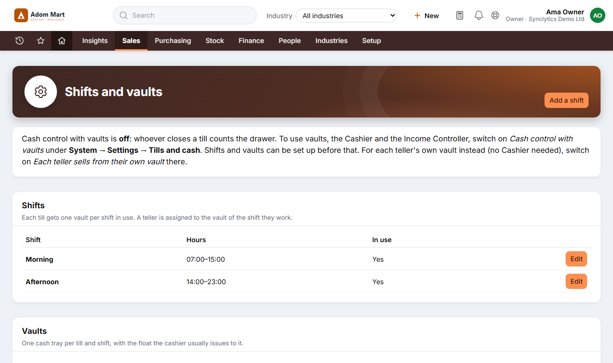

Nobody sees the figure they are checking against before they have counted: these are **blind counts**.

**Why:** a difference is found at the step where it happened and is tied to the person responsible. Cash never moves without a second person checking it.

1. **Switch it on:** **System → Settings → Tills and cash → Cash control with vaults**.
2. **Shifts:** **Cash → Shifts and vaults** lists the shifts, *Morning* (07:00–14:00) and *Afternoon* (14:00–21:00). Change the times, or **Add a shift** (e.g. *Evening*). Each till gets one vault per shift, e.g. *T01 · Morning*.
3. **Standard floats:** on the same page, **Edit** each vault and enter the float the Cashier usually puts in it. It is suggested every day, and the Cashier can change it.
4. **People** (**People & access → Users**, Step 5):
   - give each till person the **Teller** role, at their till or branch;
   - give one or more people the **Cashier** role, at their branch;
   - give the **Income Controller** role (security level 4) to someone in accounts, usually company-wide.

   The Cashier and the Income Controller do not sell, so they must not also have the Teller role.
5. **Every day:**
   1. The Cashier opens **Cash → Cash desk** and clicks **Issue float** on each vault, choosing the teller.
   2. The teller signs in at that till, ticks *I have counted the float* and opens the shift.
   3. At the end of the shift the teller counts the tray note by note and closes the till, then hands the tray to the Cashier.
   4. The Cashier clicks **Receive and count** and counts again. If the two counts differ, they are asked to count once more; the second count stands.
   5. At the end of the day the Cashier clicks **Hand over to the income controller**.
   6. The Income Controller opens **Cash → Income control**:
      - **Receive and count** the bundle;
      - **Decide** each difference: *cash over/short*, or *charged to the staff member*, recovered from pay through HR & payroll;
      - **Record deposit** with the bank slip number.

**Check:** on a test day, issue a float, sell, close, receive, hand over and receive again. *Income control* then shows the day's reconciliation (system, teller, cashier, income controller), and *Finance → Trial balance* shows *Cash on hand – tills* and *Cash with cashiers* back at zero.

The full guides for each person are in the training material (Chapter 17.7).

**The till drawer (with or without vaults).** In **System → Settings → Tills and cash**:
- **Expenses paid from the till: a supervisor approves above** — default 10000 pesewas (GHS 100). **Why:** small shop expenses (water, a taxi) can be paid on the spot, while larger ones need a second person.
- **Cash limit in a till drawer** — off by default; for example 200000 (GHS 2,000). **Why:** above it the till asks for a *cash drop* to the safe and supervisors are told, so little cash sits in the drawer.
- **One shift per person on a till** — on by default. **Why:** each person's sales and cash stay apart. When someone signs in on a till where another person's shift is still open, the till asks them to close it (count the drawer) and open their own; sales into someone else's shift are refused (and flagged in **Sales → Review** when made offline). **Sales → Till shifts** shows *Sold by …* under *Opened by* when more than one person sold in a shift. Switch it off where several people share one till and one drawer (e.g. waiters).
- **Opening the drawer without a sale needs a manager** — on by default. **Why:** an open drawer with no sale is the easiest way to take cash unseen, so a manager types their username and PIN each time. Who counts as a manager is the permission *Approve opening a till drawer without a sale* (Branch Manager, General Manager and the owner unless you change the roles in **System → Roles**); supervisors cannot approve it. If the till is offline, the PIN is checked on the till and anything the person was not allowed to approve appears in **Sales → Review**.

Each pay-out is also recorded under **Expenses → Expense claims** as paid from the till, against an operating-expense account (the categories the till offers). **Check:** on the test day, pay out a small amount for transport, do a cash drop with a supervisor's PIN (a slip prints each time; check it on the receipt printer), and open the drawer once without a sale with a manager's PIN (a supervisor's PIN is refused). Then **Sales → Till drawer** lists all three, and the cash still balances at the close.

## Step 15 — Test before going live

Do a full test day with made-up sales:

1. Open a shift on a till, sell with cash, MoMo and card, print receipts, do a return, close the shift (count the cash, and type the MoMo, card, voucher and coupon totals: each should show as balanced).
2. Unplug the till's network cable (or switch off Wi-Fi), sell two items, reconnect, and watch the sales arrive (*Sales → Till sales*).
3. Check *Sales → Review queue*, *Stock → Stock on hand* and, if licensed, *Finance → Reports → Trial balance*.
4. Take a backup and **restore it on another PC** (Chapter 12).

**Check:** when all four work, remove the test data the easy way — make a fresh installation for go-live, or ask SyncLytics for help — and enter your real opening figures.
