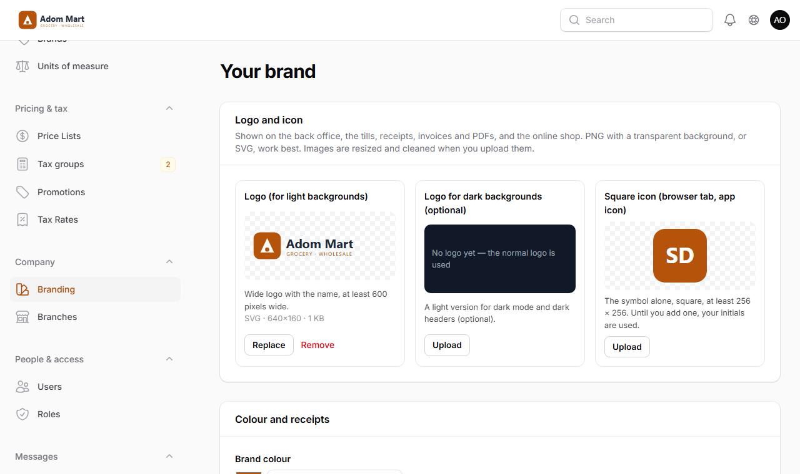
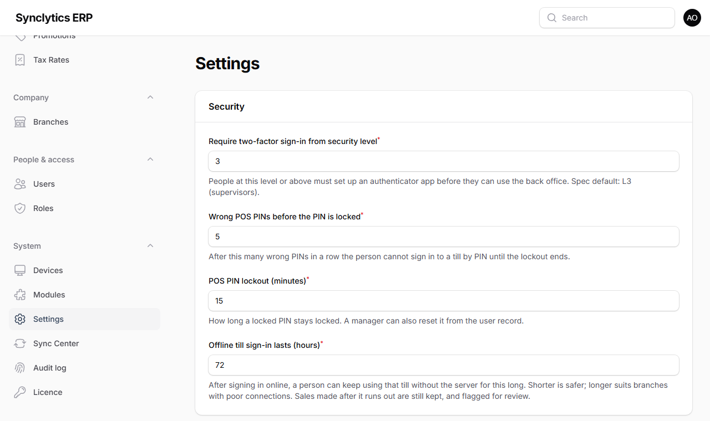

# 7. First-time set-up in the back office

Do these steps once, at head office, in this order. Allow a day for a single shop, longer for a chain (most of the time goes into products and prices).

**Tip:** Practise first on a **test installation** with made-up products: `php artisan erp:demo-catalog --as=<owner-email>` fills it with sample products and stock. Never run that command on your live system.

## Step 1 — Sign in for the first time

1. Open the back office: `https://<server-address>/admin` (Windows server) or `https://<your-domain>/admin` (Ubuntu).
2. Sign in with the owner's **email and password** (from `erp:install`).

## Step 2 — Set up two-factor sign-in

You are asked to set up an **authenticator app**:

1. Install an authenticator app on your phone (Google Authenticator, Microsoft Authenticator or similar).
2. In the app choose *Add account* → *Scan a QR code* and scan the code on the screen.
3. Type the 6-digit code the app shows.
4. **Save the recovery codes** shown next: print them or write them down and keep them somewhere safe, **not** on the same phone.

**Why:** a stolen password alone is then not enough to get in. Everyone from security level L3 (supervisors and above) must use two-factor sign-in.

**Tip:** the back office can be **Light**, **Dark** or follow your device (**System**): open your profile menu (top right) and choose the sun, moon or screen icon. Each person's choice is kept in their browser.

**Note:** Later you can add a **passkey** (fingerprint or face) under your profile. Passkeys work only on an HTTPS address or `localhost`.

## Step 3 — Activate the licence

See **Chapter 6**.

## Step 4 — The setup wizard

The wizard opens by itself the first time.

1. **Deployment** — how the system runs: *Standalone single PC* (setup A/B), *Central on-premise server* (setup C), or *Cloud HQ* (setups D/E). This records your starting layout; you can grow later.
2. **Company** — trading name, country, base currency and time zone. Optionally the **legal entity**: registered name, **TIN** and **VAT number**, needed for VAT invoices (you can add it later under *Company*).
3. **Your brand** (optional) — the company **logo**, a **square icon** and the **brand colour** (leave the colour empty and it is taken from the logo). You can do this later under *Company → Branding* (below).
4. **Branches & modules** — one row per branch:
   - **Code** (1–6 letters/digits, e.g. `HQ`, `KSI`). It appears in every receipt number and **cannot be changed later**.
   - **Name**, the number of **tills**, and whether it is the **head office** (exactly one).
   - **Modules** for that branch (Grocery, Pharmacy, Restaurant, Electronics, Fashion, Services, Online Storefront…). You can change these later (Chapter 8).
5. Click **Finish setup**.

**Why:** each branch automatically gets a main warehouse and the tills you asked for. Receipt numbers look like `HQ-T01A-000123`: branch, till, device series and number.

**Check:** *Company → Branches* lists your branches with their warehouses and tills.

### Your brand: logo, icon and colour

**Company → Branding.** Your brand is what staff and customers see: the back office's top bar, the till, printed receipts, invoices, statements, PDF exports and your online shop.

1. **Logo** — your logo with the name, on a transparent background (PNG) or as SVG, at least 600 pixels wide. Choose **Upload**.
2. **Logo for dark backgrounds** (optional) — a light version for dark mode and dark headers. Without it, the normal logo is used.
3. **Square icon** — the symbol alone, at least 256 × 256 pixels. It is the browser-tab icon and the small icon on the till. Until you add one, your **initials on your colour** are used.
4. **Brand colour** — pick it, type it (`#0F766E`), or press **Use … from your logo**. If the colour is too light to read on white, the page says so: choose a darker shade.
5. **Print the logo on till receipts** — receipt printers print it in black and white (it is converted for them).
6. Press **Save colour and receipts**, and look at the **Preview**: the till accent, a receipt and an invoice.

**Why:** customers trust a receipt or invoice that carries the shop's own logo, and staff recognise their own system. The images are checked and made smaller when you upload them, and they reach branch servers and backups like the rest of your data.

**Note:** a small line *“Powered by SES Labs”* stays at the bottom of the back office, receipts and documents. A **white-label licence** removes it (ask SyncLytics).

## Step 4b — Industries (if you run more than one kind of business)

Each branch runs one industry (Pharmacy, Grocery, …), switched on per branch in the wizard or under Company → Modules. Head office can stay company-level. See **Chapter 8.0** for the industry switcher, separate catalogues and industry managers.

**Books:** by default each industry gets **its own company and books**. Fill in each company's registered name and TIN under **Company → Legal entities** before the first sale, so receipts print them. For one set of books instead, switch off **System → Settings → Finance → Separate books for each industry** now, before anything is posted (Chapter 8.0, *Accounts by industry*).

## Step 5 — People and access

For each staff member:

1. **People & access → Users → New user**: name, username, email (for back-office users), and a **Security level (ceiling)** (the highest level of what they can ever be given — see Chapter 18).
2. On the next screen, **Grant access**: choose a **role** (Cashier, Supervisor, Branch Manager, Storekeeper, Accountant, Pharmacist, Waiter, Stylist / Therapist…) and **where it applies** (a till, a branch, a warehouse or the whole company).
3. For anyone who sells or clocks in on a till: **Set POS PIN** (4–8 digits; simple PINs like 1234 are refused).

**Why:** people see and do only what their role allows, only where it applies. A cashier with access to *Till 1* cannot sell on *Till 2* or open the back office.

**Tip:** For temporary cover (e.g. a supervisor on leave), grant access **with an end date and a reason**: it stops by itself.

**Warning:** Do not share one account between several people. Every sale, refund and change is recorded under the person who signed in.

## Step 6 — Settings

**System → Settings** — review each group. The most important:

| Setting | Why it matters |
|---|---|
| Require two-factor sign-in from security level | Default L3. Lower it for more security. |
| Wrong POS PINs before the PIN is locked / POS PIN lockout (minutes) | Stops PIN guessing at the till. |
| Offline till sign-in lasts (hours) | How long a cashier can sign in on a till without the server (default 72). Shorter is safer, longer helps during long outages. |
| Stop sales when the system shows no stock | Off by default (tills can sell items the system thinks are out of stock, and you count them later). |
| Message at the bottom of receipts | Your returns policy or a thank-you line. |
| Returns accepted within (days, with receipt) | How long after a sale a return with the receipt is accepted. |
| Cash control with vaults | Off: whoever closes a till counts the drawer. On: tellers, a Cashier and an Income Controller check the cash at every step (Step 14). |

Module settings (Grocery, Pharmacy, Restaurant, Fashion, Services) are explained in Chapter 8.

## Step 7 — Tax set-up (with your accountant)

**Pricing & tax → Tax groups** and **Tax rates.** The starter Ghana set-up (VAT 15 %, NHIL 2.5 %, GETFund 2.5 %, all on the price before tax) is marked **Not verified**.

1. Ask a qualified accountant to confirm the rates and the method against current GRA rules.
2. They (or you, on their advice) adjust the rates, then use **Record accountant check** on each group.

**Warning:** Do not go live until the tax groups show the accountant's check. Wrong tax set-up means wrong receipts and wrong tax returns.

## Step 8 — Price lists

**Pricing & tax → Price lists.** You start with **Retail** (default) and **Wholesale**, both including tax. Add lists for special customers if needed. Tick *Cashier can switch to it at the till* only for lists cashiers may use.

**Note:** whether a list's prices include tax cannot change once it has prices.

## Step 9 — Products

1. **Catalog → Categories** and **Brands**: create the groups you want for reports.
2. **Catalog → Units of measure**: check the units (PC, CTN, KG with 3 decimals…).
3. **Catalog → Products → New product** for each item:
   - **Name**, category, brand, **tax group**, **base unit** (the unit stock is counted in, usually PC). The **SKU** (product code) is given by the system when you save, for example `PHARMA-000123` (the industry's code and a number), so no two products can share one. It never changes.
   - **Barcodes** — scan them into the field.
   - **Other units** — e.g. a carton of 24 with its own barcode.
   - **Prices** — one row per list and unit. Add rows with *From qty* for bulk prices or with dates for promotions.
   - Industry details (medicine, serial numbers, sizes and colours, services) appear when the module is on — see Chapter 8.

**Why:** products are never deleted (old receipts refer to them). Untick *For sale* instead.

**Tip:** with many products, use **Import products (CSV)** instead of typing them one by one: download the template, fill it in Excel (name, category, barcodes, a price column per list; leave SKU empty for new products) and import it. Chapter 14.2 explains how.

## Step 10 — Opening stock

**Stock → Stock on hand → Opening stock / adjustment**, choosing *Opening balance*, for each product and warehouse: the quantity you counted and the **cost per unit**.

**Why:** the cost is used for the value of your stock and the cost of goods sold in the accounts.

**Tip:** count on a day you are closed, enter the counts, then start selling. For many products use **System → Import data (CSV / Excel) → Opening stock** (warehouse, SKU, quantity, unit cost per row).

## Step 11 — Customers and suppliers

- **Sales → Customers**: customers who buy on credit or collect loyalty points. Credit limits and payment terms are set at head office. Customers who owe you money get an **opening balance**.
- **Purchasing → Suppliers**: suppliers you buy from, with an **opening balance** if you owe them.
- Both can be imported from CSV files (**Import customers / suppliers (CSV)** on their lists).

## Step 12 — Finance and HR (if licensed)

- **Finance → Chart of accounts:** the Ghana SME template is already installed. Your accountant can rename and add accounts.
- **Opening balances** on the go-live date: customers and suppliers (step 11), stock (step 10), and everything else (bank, cash, MoMo, assets, loans, capital) under **Finance → Journals → Opening balances**. The account *Opening balances (to clear)* must end at zero.
- **HR & payroll → Employees:** add staff with their pay and link each to their sign-in. Check **Payroll profile** (PAYE and SSNIT rules) with your accountant.

## Step 13 — Set up the devices

Register and enrol the tills, handhelds and kitchen screens: **Chapter 9**.

## Step 14 — Cash control: vaults, Cashier and Income Controller (optional)

A shop with several tellers can check its cash at every step, as banks do.
- **Teller:** sells at a till and counts the tray at the end of the shift.
- **Cashier:** gives each teller a cash tray with a float (a **vault**), receives it back and counts it again.
- **Income Controller** (accounts): receives the day from the Cashier, counts it again, decides any difference and records the bank deposit.

Nobody sees the figure they are checking against before they have counted: these are **blind counts**.

**Why:** a difference is found at the step where it happened and is tied to the person responsible. Cash never moves without a second person checking it.

1. **Switch it on:** **System → Settings → Tills and cash → Cash control with vaults**.
2. **Shifts:** **Cash → Shifts and vaults** lists the shifts, *Morning* (07:00–14:00) and *Afternoon* (14:00–21:00). Change the times, or **Add a shift** (e.g. *Evening*). Each till gets one vault per shift, e.g. *T01 · Morning*.
3. **Standard floats:** on the same page, **Edit** each vault and enter the float the Cashier usually puts in it. It is suggested every day, and the Cashier can change it.
4. **People** (**People & access → Users**, Step 5):
   - give each till person the **Teller** role, at their till or branch;
   - give one or more people the **Cashier** role, at their branch;
   - give the **Income Controller** role (security level 4) to someone in accounts, usually company-wide.

   The Cashier and the Income Controller do not sell, so they must not also have the Teller role.
5. **Every day:**
   1. The Cashier opens **Cash → Cash desk** and clicks **Issue float** on each vault, choosing the teller.
   2. The teller signs in at that till, ticks *I have counted the float* and opens the shift.
   3. At the end of the shift the teller counts the tray note by note and closes the till, then hands the tray to the Cashier.
   4. The Cashier clicks **Receive and count** and counts again. If the two counts differ, they are asked to count once more; the second count stands.
   5. At the end of the day the Cashier clicks **Hand over to the income controller**.
   6. The Income Controller opens **Cash → Income control**:
      - **Receive and count** the bundle;
      - **Decide** each difference: *cash over/short*, or *charged to the staff member*, recovered from pay through HR & payroll;
      - **Record deposit** with the bank slip number.

**Check:** on a test day, issue a float, sell, close, receive, hand over and receive again. *Income control* then shows the day's reconciliation (system, teller, cashier, income controller), and *Finance → Trial balance* shows *Cash on hand – tills* and *Cash with cashiers* back at zero.

The full guides for each person are in the training material (Chapter 17.7).

## Step 15 — Test before going live

Do a full test day with made-up sales:

1. Open a shift on a till, sell with cash, MoMo and card, print receipts, do a return, close the shift.
2. Unplug the till's network cable (or switch off Wi-Fi), sell two items, reconnect, and watch the sales arrive (*Sales → Till sales*).
3. Check *Sales → Review queue*, *Stock → Stock on hand* and, if licensed, *Finance → Reports → Trial balance*.
4. Take a backup and **restore it on another PC** (Chapter 12).

**Check:** when all four work, remove the test data the easy way — make a fresh installation for go-live, or ask SyncLytics for help — and enter your real opening figures.
