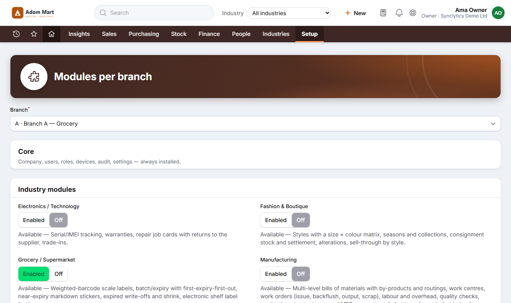
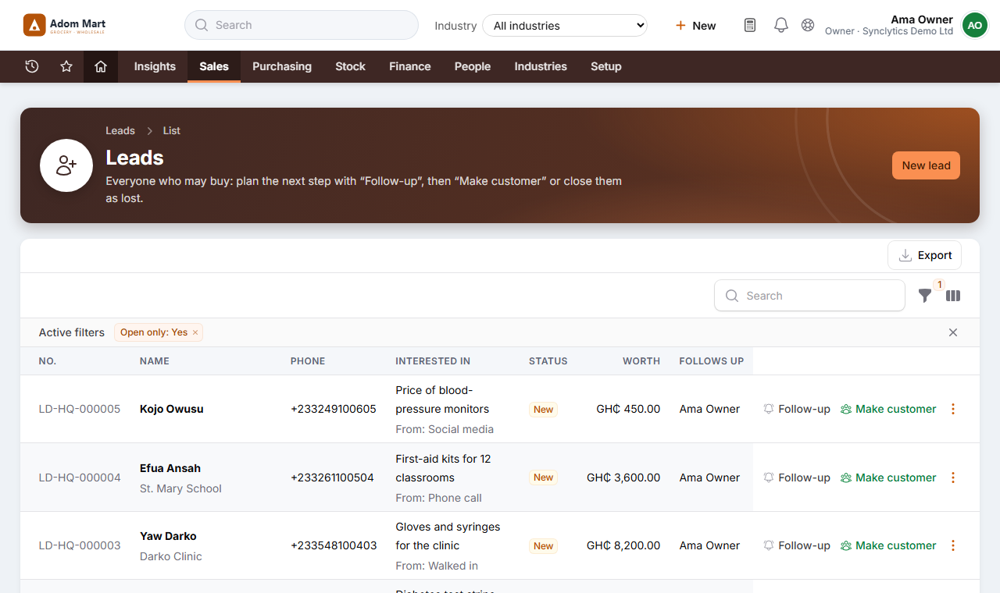
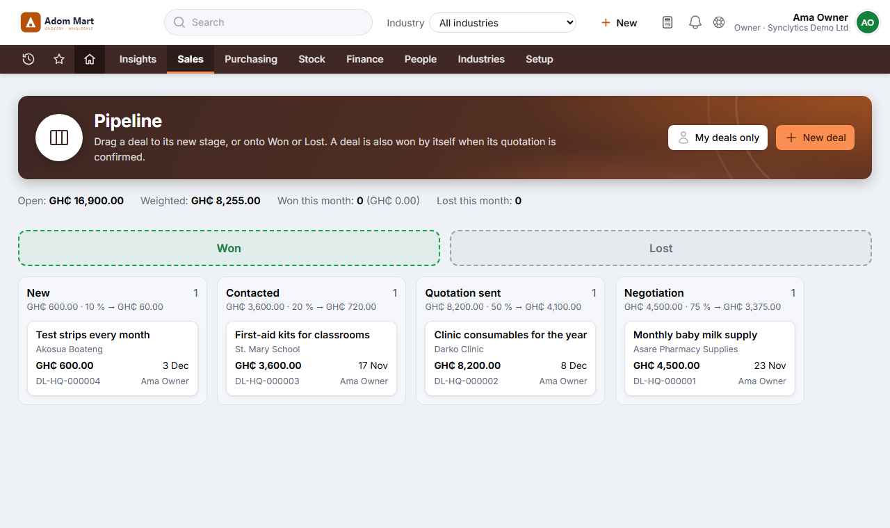
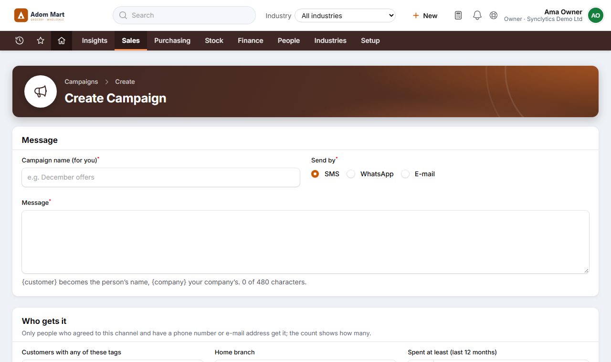
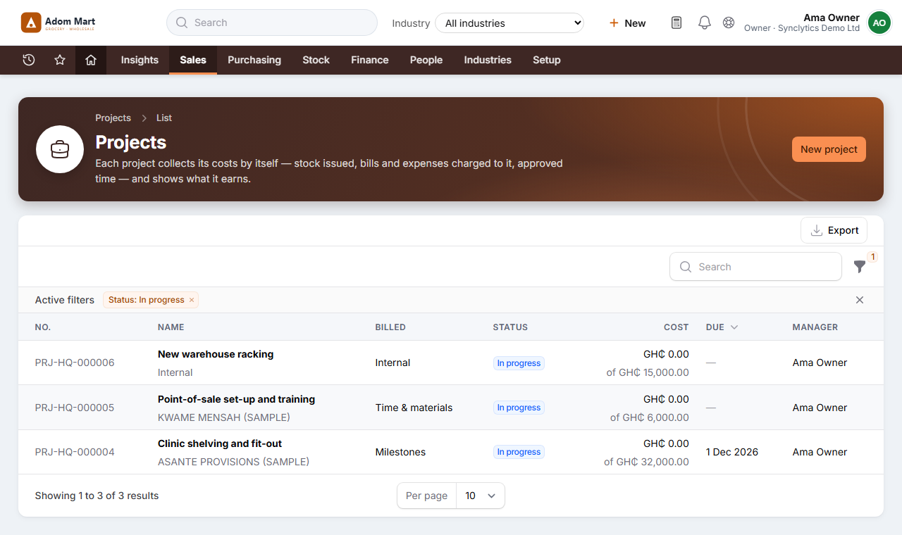
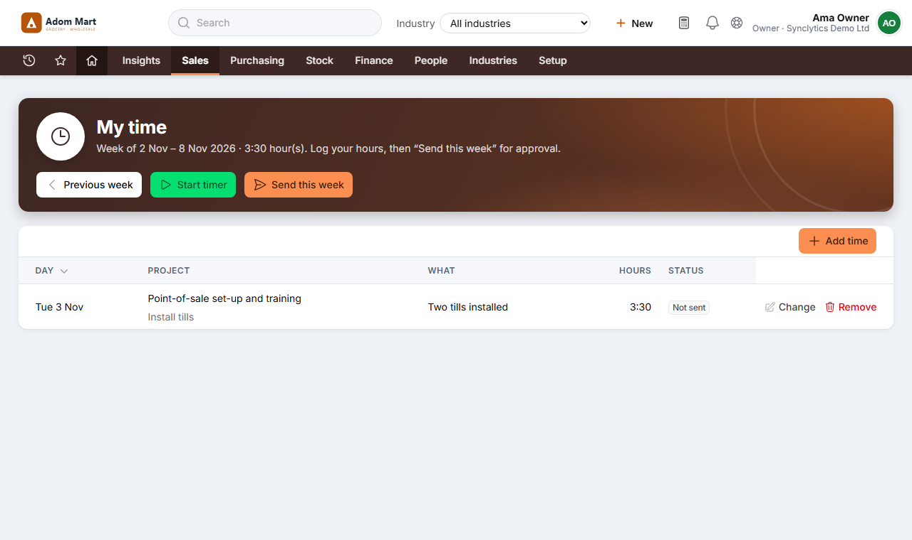
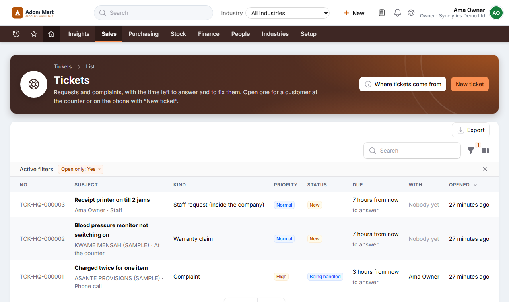
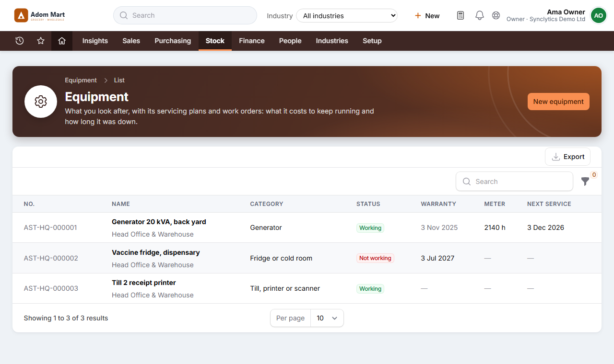
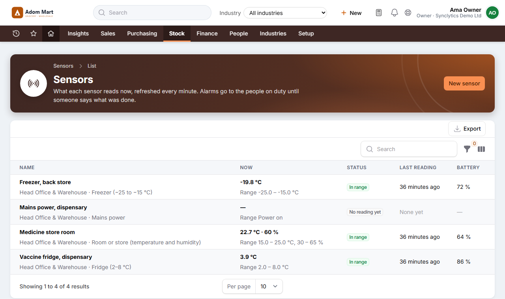
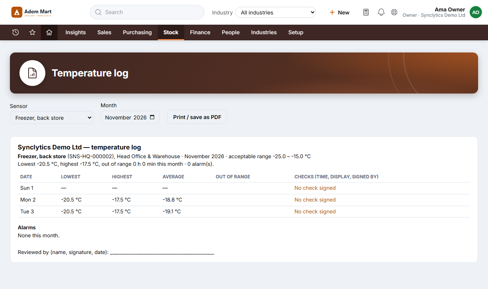

# 8. Installing and setting up modules

Modules add the features of a type of business. They are **already part of the software** — "installing" a module means three things:

1. your **licence** includes it (Chapter 6);
2. it is **switched on for each branch** that needs it;
3. its **set-up checklist** below is done.

A branch runs **one industry module** (Pharmacy, Grocery, Restaurant, …), plus any company-wide features and add-ons such as Sales & Distribution. A supermarket with a pharmacy counter is set up as two branches at the same address, so each keeps its own stock, staff and figures.

## 8.0 Industries

When a company runs more than one kind of business, each kind is an **industry**: for example *Pharmacy* with the branches Pharmacy Osu and Pharmacy Tema, and *Grocery* with Grocery Spintex.

**Why:** each industry has its own staff, products and figures. Separating them keeps a pharmacist's screens free of grocery items, and gives the owners each industry's results on its own as well as the whole company's.

- **An industry appears by itself** when its module is switched on for a branch (8.1). The branch then belongs to it. *Company → Industries* lists the industries, and new ones can be added there.
- **Head office or a central warehouse** can belong to no industry (*company-level*). Only people with company-wide access see it.
- **The industry switcher** at the top of the back office (*All industries*, *Pharmacy*, *Grocery*, …) is shown to people who can see more than one industry.
  - With an industry chosen, every screen shows only that industry: branches, stock, prices, purchasing, sales, reports, and its own dashboard. The pharmacy dashboard shows prescriptions and expiring batches.
  - With *All industries*, the dashboard shows each industry's sales side by side.
- **Each industry has its own catalogue.**
  - When you create a product or price list, choose its industry; the industry chosen at the top is filled in for you.
  - That industry's tills sell only its products.
  - Products created before industries are *shared* (sold everywhere) until you give them an industry (Catalog → Products → edit → Industry).
- **Staff:**
  - give a person a role **at their branch** (People & access → Users → Grant access → Applies to: *Branch*). A pharmacist at Pharmacy Osu then sees that pharmacy only;
  - an **industry manager** gets the role with *Applies to: Industry*, and sees every branch of that industry, and nothing of the others.

**Only what the business runs is offered.** Roles (such as *Waiter* or *Tailor*), settings sections, message templates and device types that belong to an industry appear only where that industry is switched on. A pharmacy, for example, is never offered a kitchen display.

**Menus follow the choice.** With an industry chosen, only its own module menus show (for example *Pharmacy* but not *Restaurant*). With *All industries*, every installed industry's menus show. Grocery's menu has **Markdowns** (near-expiry stickers and expired write-offs at the grocery stores) and **Scale items** (the weighed products to load into the scales).

**Check:** choose *Pharmacy* at the top. *Stock → Stock on hand* shows only the pharmacy branches, and *Catalog → Products* shows only pharmacy (and shared) products. Choose *All industries* to go back.

### Stock between branches and industries

- **Sister branches** (Pharmacy Osu and Pharmacy Tema), or head office and a branch: use a normal transfer (*Stock → Transfers*), or let the branch that needs stock ask for it (*Stock → Stock requests → Ask for stock*). The branch asked clicks **Send** (entering 0 for anything it cannot spare), or **Reject** with a reason. Sending creates the transfer; the asking branch receives it as usual.
- **Between two industries** (a grocery branch asking a pharmacy for bottled water) only a stock request works, and it needs two approvals before anything moves:
  1. a manager of the asking branch, other than the person who asked;
  2. a manager of the supplying branch.

  The supplier then clicks **Send** and, for each item, chooses **its own product** that matches (the two catalogues are separate). The goods leave at the supplier's cost and arrive as the asking branch's product, with the same batch numbers and expiry dates.

**Why:** each industry keeps its own stock and figures. Two approvals mean neither side's stock leaves or arrives without a manager knowing, and moving at cost means neither side makes a profit on the other.

**Who:** storekeepers, supervisors, pharmacists and managers can ask (*Ask another branch for stock*). Branch, warehouse and general managers can approve (*Approve stock requests between industries*). Sending needs the transfer permission at the supplying branch.

### Accounts by industry

**Two ways, chosen per installation** under **System → Settings → Finance → Separate books for each industry**:

| Setting | What it means | Suits |
|---|---|---|
| **On (the default)** | Each industry is its own company with its own books, TIN and VAT return. See *Separate books* below. | Groups whose industries are registered separately, or will be. |
| **Off** | **One set of books** (one TIN, one VAT return); each industry is a profit centre. | A single registered company running several kinds of shop. |

**Change it only at the start of a financial year**, because switching moves the branches' future postings to other books. Companies already running when this option arrived were left on *Off*.

With either choice, everything a branch posts is labelled with its industry:

- **Finance → Reports → Profit by industry** shows each industry's income, costs and profit side by side. A *Company* column holds head office and shared costs.
- The **Industry** filter on the other reports (trial balance, profit and loss, balance sheet, account ledger, budget) shows one industry, or *Company* for head office lines. It starts on the industry chosen at the top of the screen.
- **Stock moved between industries** leaves one industry's stock and joins the other's at cost, so neither makes a profit on it.

**Why:** the owners see what each line of business earns, without the cost and paperwork of separate companies.

**Sharing head office costs (optional).** By default head office costs (rent, admin salaries, the accountant) stay in the *Company* column.
1. To share them, switch on **System → Settings → Finance → Share head office costs between industries by sales**.
2. At month end open **Profit by industry** with the *To* date in that month, and click **Share head office costs**. The window shows each industry's share of that month's sales.
3. Click **Post the journal**.

One journal moves each cost from *Company* to the industries in proportion to their sales, to the pesewa; the company's total profit does not change. A month can be shared only once. To redo it, reverse that journal (*Finance → Journals*) and share again.

**Note:** an industry's balance sheet on its own does not balance, because bank accounts, money owed and stock in transit sit partly at company level. Use *All industries* for the company's balance sheet.

### Separate books (the default)

When an industry is first switched on, the system creates its company under **Company → Legal entities**, named after it (for example *Demo Ltd – Pharmacy*), and a **head office company** if there is none.

1. **Company → Legal entities:** open each company and enter its **registered name, registration number, TIN, VAT number and address**.
   - Its branches' receipts and invoices print that name and TIN.
   - Their sales go to GRA E-VAT under that TIN.
2. **Head office company:** head office lines, and branches without an industry, are booked there. Only one company can be head office at a time; ticking *Head office company* on another moves it.
3. **Two industries under one registered company:** choose the same company for both under **Company → Industries → Books**. To give an industry no company of its own, choose the head office company.
4. Changing an industry's company is a **start-of-year** step. Balances from before (stock, money owed) stay in the old books; ask your accountant to move them with a journal on the first day.

**What changes:**
- **Every entry balances inside each company.** When one company pays for another, for example head office paying the pharmacy's electricity, the system records what the pharmacy now owes head office on **Due from / to group companies**, in both sets of books. Stock sent between the companies at cost is recorded the same way.
- **Finance → Reports → Books:** choose a company for its own trial balance, profit and loss, balance sheet and ledger. *Whole group (consolidated)* adds them together, and what they owe each other cancels out.
- **VAT return:** each company files its own. Choose it under *Books*.
- **Settling up:** when one company pays the other, enter a journal with each company's bank line (*Company* on lines without a branch). The amount owed clears by itself.
- **Ledger check** (*Finance → Reports → Ledger check*) also proves that each entry balances in every company's books, and that both sides agree on what they owe each other.

**Why:** a separately registered company must keep its own books and file its own returns. Recording what they owe each other automatically means no entry is ever missed or one-sided.

## 8.1 Switching a module on or off

1. **System → Modules.**
2. Choose the **Branch**, then for each module choose **Enabled** (or **Off**; a planned module offers **Reserved**).
3. Type the **Reason for change** and click **Save modules**.

**Why:** modules are per branch so that, for example, only the pharmacy branch shows medicine screens. Every change is recorded in the audit log.

| Status shown | Meaning |
|---|---|
| **Available** | Released: can be switched on now. |
| **Planned · Phase N** | Not built yet. You may **reserve** it for a branch; it switches on by itself when that phase is released. Nothing is shown as working before it exists. |

**Only modules you have bought are shown.** The set-up wizard, this screen and the industry choices list only the modules in your licence, and the industry switcher and dashboards list only industries switched on at a branch.

**Why:** staff never see, or try to set up, a business type the company has not bought. To add one, ask SyncLytics for a new licence key (Chapter 6); the module then appears here, ready to switch on. If a licence renewal drops a module, its screens are hidden but its records are kept, and they come back if it is added again.

**Note:** switching a module **off** hides it and stops new work. It **never deletes** data; switching it on again brings everything back.

**Who can do it:** the owner and the IT Admin (permission *Manage modules*).

**Check:** after switching a module on, the module's menu appears in the back office (you may need to refresh the page), and its buttons appear on that branch's tills after their next catalog refresh (within 60 seconds, or press *Refresh* on the till).

## 8.2 Available modules and their checklists

### Online Storefront (built-in online shop)

1. Switch it on for the branch that will fulfil online orders.
2. **Online → Channels → New channel**, type *Built-in online shop*: choose the fulfilling branch, the stock warehouse, the price list and the shop's web address (`/shop/<address>`).
3. Set **safety stock** on products that sell fast in the shop too.
4. Click **Activate**.

**Why:** safety stock is held back from the shop so walk-in and offline sales do not oversell online.

**Check:** open `https://<your-domain>/shop/<address>` — your products appear with prices and availability.

### Grocery / Supermarket

1. Products with use-by dates: tick **Batches and expiry dates** (works in any shop, but essential for grocery).
2. **Weighed items:** give each its **scale code (PLU)** and sell it in **KG** (3 decimals). Set the label scale to print EAN-13 labels: `21` · item code (5 digits) · weight in grams (5 digits) · check digit.
3. **System → Settings → Grocery:** check the scale label prefixes. The markdown rules (default 30 % off at 7 days left, 50 % at 3 days) are under **System → Settings → Stock**.
4. Electronic shelf labels (optional): enter their gateway address in System → Settings → Grocery.
5. **Grocery → Scale items** lists every weighed product with its scale code, unit and retail price. **Export** it to load the scales, and again after price changes.
6. **Grocery → Markdowns** (daily): apply the suggested markdowns, print the stickers, and write off what has expired.

**Why:** the till reads the weight and item from the scale label, and sells the batch expiring first, so old stock does not go to waste.

**Check:** print a test label on the scale and scan it at a till: the item appears with its weight and price.

### Pharmacy

1. On each medicine (Catalog → Products → **Medicine**): **schedule** (OTC, Prescription only, Controlled), generic name, strength, form, FDA registration number, **active ingredients**. Switch on **Batches and expiry dates** (required for medicines).
2. **Pharmacy → Drug interactions → Add the starter list:** about 55 well-known interactions between common medicines (warfarin with painkillers and some antibiotics, methotrexate with co-trimoxazole, sildenafil with nitrates, statins with some antibiotics, antacids and iron with ciprofloxacin or doxycycline, the pill with rifampicin…). Pairs already in your table are left alone. The superintendent pharmacist then reads the list, changes or deletes rows, and adds others. The top of the page says how many medicines have **neither a generic name nor active ingredients**: warnings cannot work for those, so fill them in on the products. **Why:** the till warns only about pairs in this table, and it recognises a medicine by its generic name or active ingredients. The starter list is a beginning, not a complete reference.
3. **System → Settings → Pharmacy:** the Pharmacy Council premises licence number and the superintendent pharmacist, printed on the controlled-drug register.
4. Give pharmacists the **Pharmacist** role (and technicians **Pharmacy Technician**) at the branch.
5. **Dosage:** on each medicine, **Usual dosage (directions)** — e.g. *1 TABLET 3 TIMES DAILY AFTER MEALS FOR 5 DAYS* (or the `dosage` column of the products file). At the till the directions appear under the medicine on the sale and can be changed for that patient. They print on the receipt and on a **dosage label** for each medicine: the pharmacy's name and phone, the patient (from *Details*), the medicine and quantity, the directions in large letters, the date, the receipt number and *Keep out of reach of children*. The desktop till prints the labels by itself on the receipt printer (each one cut); in a browser, **Print dosage labels** on the receipt screen. **Why:** patients take medicines correctly when the directions are on the pack, not only told at the counter.

6. **System → Settings → Pharmacy → Selling prescription-only / controlled medicines:** by default a pharmacist approves every such sale with the prescription. If tellers sell them in your pharmacy, choose *Prescription details only*, *Patient only* or *Sell freely* (a branch can differ: Company → Branches → the branch → *Pharmacy rules for this branch*), and how they are checked afterwards (a pharmacist signs them off on Pharmacy → Sales to sign off, or a daily summary). A quantity limit, major warnings and *Controlled drugs always need a pharmacist* keep the riskiest sales with a pharmacist.

7. **Refill reminders** (medicines taken every day — blood pressure, diabetes, asthma…):
   - On each such medicine, **Used a day (refill reminders)**: how much one patient takes a day in the base unit — *1* for one tablet a day, *2* for twice a day (or the `daily_use` column of the products file).
   - Sell it to a **named customer** (choose the customer on the till) who agreed to **WhatsApp or SMS** messages (the customer's consent ticks). The quantity sold tells how long it lasts: 30 tablets at 1 a day last 30 days.
   - **System → Settings → Refill reminders:** switch on; *Days before it runs out* (3) and *Send at* (09:00). A few days before the medicine runs out the customer gets one message listing every medicine due, with the branch's phone number. Buying again replaces the old reminder.
   - **Pharmacy → Refill reminders** lists what is waiting and what was sent; **Send now** or **Cancel** (patient changed medicine, asked not to be reminded). *No phone or consent* shows customers to ask next time.
   - It needs an SMS or WhatsApp provider (Chapter 16). The wording is under Messaging → Templates (*Refill reminder*); WhatsApp needs the approved template `refill_reminder`.

   **Why:** patients on long-term medicine who run out often stop taking it, or buy elsewhere. A reminder before it runs out helps them stay on treatment and brings them back to your pharmacy. Only customers who agreed are texted, as the Data Protection Act requires.

8. **NHIS at the till** (NHIS-accredited pharmacies):
   - On each medicine on the NHIS Medicines List, **NHIS price (per base unit)**: what the NHIS pays for one tablet, capsule or bottle (or the `nhis_price` column of the products file, Chapter 14). Empty means the NHIS does not cover it.
   - The patient's **NHIS membership no.** and **NHIS card expires** on their customer record (Patient details).
   - **System → Settings → Pharmacy → Take NHIS at the till:** switch on (a branch can differ).
   - At the till, choose the patient and add the medicines. In **Payment**, **NHIS pays …** shows what the NHIS covers: the NHIS price of each listed medicine, never more than the line. Press it, and the patient pays the rest as usual. Without a valid card (missing or expired) the button does not appear. Keep the NHIS prescription form and the patient's signature as the NHIA requires.
   - **Pharmacy → NHIS claims → Prepare a claim** (e.g. monthly): the branch, and *Sales up to and including* (the last day of the month). It gathers every NHIS part not claimed yet; returns come off. **Download the list (CSV)** and send it to the NHIA with your claim forms, then **Mark as sent** with the NHIA's reference.
   - When the NHIA pays: **Record what the NHIA paid** (amount, date, bank or cheque). Whatever it did not pay is written off as *NHIS claims not paid*. A claim not sent yet can be **withdrawn**; its sales go back for the next claim.
   - Who: the owner, managers, the accountant and the superintendent pharmacist (*NHIS claims* permission).

   **Why:** the NHIS part of a sale is money the NHIA owes you, not cash in the drawer. The books show it as *Due from NHIS* until the NHIA pays, so you can see how much you are owed and how much was cut at vetting.

9. **Near-expiry markdowns:** **Pharmacy → Near-expiry markdowns** (daily or weekly) lists batches close to expiry with a suggested discount (rules under System → Settings → Stock). **Apply**, print the stickers, stick them on the packs; the till sells the sticker at its price from that batch. Expired stock is written off from the same page. Pharmacists can do this; for staff whose role was set up before this release, the owner adds *Mark down near-expiry batches* to their role (People & access → Roles). **Why:** a medicine sold at a discount before it expires is better than a medicine thrown away after.

**Why:** the Pharmacy Council expects a pharmacist to approve prescription-only and controlled medicines, and the prescription is recorded; controlled drugs go into the Controlled Drug Register. Where a pharmacy works otherwise, the system still records who sold what so a pharmacist can check it.

**Check:** sell a POM medicine on a till: with the default setting the till asks for the patient, the prescription and the pharmacist's PIN. With NHIS on, sell a listed medicine to a patient with a valid card: **NHIS pays …** appears in Payment.

### Restaurant / Café / Bar

1. **Restaurant → Kitchen stations:** e.g. `KITCHEN`, `BAR`. Tick *Print tickets* for a station that has a printer instead of a screen.
2. **Restaurant → Floor plan:** each table with its number, area, seats and position.
3. **Restaurant → Modifiers:** groups of choices (e.g. *Spice: Mild / Hot*). A choice can be charged as a product.
4. On each **dish** (Catalog → Products → **Restaurant**): the station, the choices offered, and the **recipe** (ingredients per portion). Switch **Track stock** off for the dish itself; the ingredients are stocked products.
5. **System → Settings → Restaurant:** service charge rate and its product (create a *Service charge* product with *Track stock* off, and copy the SKU the system gives it into this setting), tips on/off, booking reminders and the SMS gateway address (only with your own SMS provider's details).
6. Give staff the **Waiter / Bartender** or **Kitchen Staff** role.
7. Set up the **kitchen screens** (Chapter 9).

**Why:** bills live on the server so every till, waiter tablet and kitchen screen shares the same tables. For a restaurant with unreliable internet, use a **branch server** (Chapter 10) so this keeps working during outages.

**Check:** open a table on a till, send a dish, and see it on the kitchen screen.

### Electronics / Technology

1. On serial-numbered products (Catalog → Products → **Serial numbers and warranty**): tick **Serial / IMEI numbers**, enter the **warranty** in months.
2. Stock already on hand: **Electronics → Serial numbers → Register numbers for stock on hand**.
3. Create a **labour** product (no stock) for repair charges.
4. Give technicians the **Repair Technician** role.

**Why:** every unit is then traced from receipt to sale, warranties are checked by number, and stolen or wrong units cannot be sold.

**Check:** add a serial-numbered product at a till: it asks for the number and refuses one that is not in stock there.

### Fashion & Boutique

1. **Fashion → Styles → New style:** code, name, tax, season, collection, sizes, colours and price. Then **Create sizes and colours** to make one product per size and colour, each with SKU and barcode.
2. **Consignment** (goods owned by a supplier): on the product, choose the consignor and their share.
3. **Alterations:** create an *Alteration* product with *Track stock* off, and copy the SKU the system gives it into System → Settings → Fashion.
4. Give tailors the **Tailor** role.

**Check:** pick any variant of a style at the till: the size × colour grid opens with the stock at that till.

### Sales & Distribution (vans, routes, reps)

1. **Distribution → Vans → New van:** branch, van code (e.g. `V01`), name, registration, rep and the warehouse it is loaded from. The van is created as a warehouse **with its own till**.
2. Register the rep's phone as a **POS till** device on that van's till and enrol it (Chapter 9.4/9.5). It works **fully offline**.
3. Give the rep the **Van Sales Rep** role at the branch and a PIN; in **HR & payroll → Employees** set their **Commission %** if they earn commission.
4. **Routes:** Distribution → Routes → New route — the van, rep, weekdays and customers in visiting order.
5. **Targets:** Distribution → Rep targets — monthly sales target per rep.
6. **Returnable containers** (crates, bottles, gas cylinders): mark the container products as *returnable containers* (their price is the deposit) and choose the container on each product sold in them (Product → Returnable containers).
7. Daily: **Load van** in the morning; in the evening **Start end-of-day settlement**, count, submit, and a supervisor approves (Chapter 14 and `docs/distribution.md`).

**Why:** a van as a warehouse with its own till means every sale, receipt, shift and cash count works exactly as in a shop — offline too — and the daily settlement catches shortages the same day.

**Check:** load a van, sell from the phone, then settle: the van's stock in *Stock on hand* matches what is left on it.

### Manufacturing (factories, bakeries, workshops, food processing)

1. **Switch it on** for the branch that produces (System → Modules → Manufacturing). *Why:* the screens and work orders only work where the module is on.
2. **Work centres:** Manufacturing → Work centres → New — each machine or bench (e.g. `MIX` Mixer, `OVEN` Oven), its **cost per hour** (wages of the people there plus running costs such as power) and the hours a day it runs. *Why:* every minute worked there is charged to the product, so its cost is real; the hours show how full each machine is.
3. **Bills of materials:** Manufacturing → Bills of materials → New — the product made, how many one batch makes, the **materials** per batch (with any expected loss %), **by-products** (e.g. bran from milling), and the **operations** in order with their work centre and minutes. Then **Put in use**. *Why:* a BOM in use is locked so open orders and history stay true; to change it, start a **New revision**.
   - A material that has its own BOM is a **sub-assembly** (e.g. dough for bread): it is made on its own work order.
   - **Backflush** (default) means the material or time is charged automatically when output is reported; switch it off for items you issue by hand or time you record.
   - Tick **Quality check before stock** if output must be inspected first.
4. **Roles:** *Production Manager* (sets up, runs orders, checks quality), *Machine Operator* (runs orders), *Quality Inspector* (passes or fails output). *Why:* the person who makes the goods is not the one who passes them.
5. **Daily:** Manufacturing → **Production planning (MRP)** shows what to make and what to buy; **Raise work order**, then on the work order **Release → Report output → (Quality check) → Finish**. Print the **Job card** for the shop floor.

**Why:** production at actual cost (the owner's choice) means each product enters stock at what its materials, labour and machines really cost, and the accounts show work in progress until it is finished.

**Check:** make a small order of a product, then look at *Stock on hand*: the materials went down, the product went up, and the work order's *Actual cost* section shows the cost per unit.

### Services & Packages (salons, spas, gyms, clinics, consultancies)

1. **Services:** on each service (Catalog → Products → **Services**) enter the **duration** in minutes and switch **Track stock** off. Optionally a **commission** rate of its own.
2. **Staff:** in **HR & payroll → Employees**, switch on **Takes appointments** for each person who does services, and set their **Commission %**. Give them the **Stylist / Therapist** role (or another role with *appointments*).
3. **Prepaid packs** (e.g. *5 massages for GHS 800*): a product with *Track stock* off and, under **Services → Prepaid pack**, the services it covers and the number of sessions, and how many days it is valid.
4. **Memberships and subscriptions:** create a product to invoice them as (e.g. *Gym membership*, *Track stock* off), then **Services → Membership plans → New plan**: price per period, how often it is billed (monthly, every 3 or 6 months, yearly) and any sessions included each period.
5. **System → Settings → Services:** the calendar's start and end times and time steps, appointment reminders (hours before), and the SMS gateway address (leave empty to use the restaurant one; only with your own SMS provider).
6. **Software licence keys** (optional): on the product tick **Hands out a licence key** (*Track stock* off), then **Services → Licence keys → Load keys** for each branch that sells it.

**Why:** the duration fills the appointment book; the person who did each service earns their commission, which payroll pays each month; packs and memberships let customers prepay and use their sessions at the till.

**Check:** book an appointment in **Services → Staff calendar**, check it out at a till with **Appointments (F10)**, and see the commission under **Services → Commissions**.

**Note:** memberships are invoiced by **head office** each day (01:30) for every period that has started; the invoices go on the customer's account (Sales → Invoices) and are paid like any invoice.

## 8.3 Company-wide features (licence options)

| Feature | What it adds | Set-up |
|---|---|---|
| **Finance** | Chart of accounts, automatic postings from sales, purchases, stock and payroll; supplier bills; bank reconciliation; month-end; reports | Chapter 7, step 12; your accountant reviews the chart and opening balances |
| **HR & payroll** | Employees, clock-in at tills, leave, loans, monthly payroll with PAYE and SSNIT, payslips | Chapter 7, step 12; payroll profile checked with your accountant |
| **CRM** (paid add-on) | Leads, deals on a pipeline, follow-ups with reminders, campaigns by SMS, WhatsApp and e-mail | Section 8.3a below |
| **Projects** (paid add-on) | Projects with tasks and milestones, timesheets, costs from stock, bills, expenses and time, invoicing, profit per project | Section 8.3b below |
| **Service desk and maintenance** (paid add-on) | Tickets from WhatsApp, e-mail, the web and staff with deadlines; equipment register, servicing plans and work orders | Section 8.3c below |
| **Sensors** (paid add-on) | Fridge, cold-room, freezer and room temperature and humidity, power and doors; alarms by WhatsApp / SMS; temperature log | Section 8.3d below |

## 8.3a CRM: leads, deals, follow-ups and campaigns (paid add-on)

The **CRM** menu (under the *Sales* tab) helps you win and keep customers: nobody who asked about buying is forgotten,
every sale you are working on is visible with its value, and customers who agreed hear about your offers.

**Availability:** a paid add-on. The menu appears once your licence includes **CRM** (ask SyncLytics; a new licence key
is entered under *System → Licence*). **Why:** it is priced separately, so shops that do not need it do not pay for it.

**Who can use it** (People → Roles): *See leads, deals…* to look; *Work leads and deals…* to add and change them;
*Send campaigns…* for campaigns; *Set up the sales pipeline stages* for the stages. Managers, branch managers, customer
service and marketing roles get them when CRM arrives; give them to others as needed. People given one branch see and
work only that branch's leads and deals. **Why:** a branch's prospects stay with the people who serve them.

### Step 1 — Check the pipeline stages

**CRM → Pipeline stages.** You start with *New → Contacted → Quotation sent → Negotiation*, then *Won* and *Lost*. Each
stage in progress has a **chance of winning** (10 %, 20 %, 50 %, 75 %); rename stages, change the chances or add your
own (e.g. *Sample given*), and set the order with *Order*. Keep one *Won* and one *Lost* stage.
**Why:** the chances give the **weighted** value of the pipeline — a realistic figure of what is likely to come in.

### Step 2 — Add leads

**CRM → Leads → New lead** for everyone who asks about buying: a walk-in, a call, a WhatsApp message, a referral.
Enter the name, the business (if any), a phone number or e-mail, where they came from, what they want and what it
may be worth, and who follows it up. Tick the **marketing consent** they gave (SMS, WhatsApp, e-mail).
**Why:** a lead written down is followed up; one in someone's head is often lost. Consent is needed before campaigns.

On each lead:
- **Follow-up** plans the next call or visit (with a date and time and who does it) or notes what happened. A call
  noted moves a new lead to *Contacted*.
- **Make customer** turns the lead into a customer — with their consents and follow-ups — and can open a deal at
  once. If a customer already has the same phone number, the lead is linked to them instead of making a duplicate.
- **Lost** (in the **⋮** menu of the row, with *Edit*) closes the lead with the reason (too far, bought elsewhere…). **Why:** the reasons show what to improve.

### Step 3 — Work deals on the pipeline

A **deal** is a sale you are working on. Add one from **CRM → Deals → New deal**, from a lead (*Make customer*), or
from a customer's page (**New deal**). Give it a title, its value and the date you expect to close it.

**CRM → Pipeline** shows the open deals as cards, in a column per stage, with each column's total and weighted value.
**Drag a card** to its next stage, onto **Won**, or onto **Lost** (you are asked why). *My deals only* shows yours.
On a phone, open the deal and change its stage. In the list of deals, *Won*, *Lost* and *Reopen* are in the **⋮** menu of each row.

**Make quotation** on a deal starts its quotation (Sales → Quotes & orders) for the customer, with the deal number as
the customer's reference, and moves the deal to *Quotation sent*. Add the items and send it as usual. **When the
quotation is confirmed as an order, the deal is won by itself**, at the order's value. **Why:** nobody has to remember
to update the CRM after the real work is done.

### Step 4 — Follow-ups

**CRM → Follow-ups** lists what to do and when — your own by default, overdue ones in red — with **Done** (and what
came of it) and **Another time**. The person a follow-up is given to is told in the bell, and **reminded when it is
due**. The menu shows how many are due today. Plan follow-ups from a lead, a deal or a customer's page (**Follow-up**).

### Step 5 — Campaigns

**CRM → Campaigns → New campaign**: one message to many people.
1. **Name** it (for you) and choose **SMS, WhatsApp or e-mail**. Write the message; `{customer}` becomes each
   person's name and `{company}` your company's name. Keep SMS under 480 characters (3 SMS).
   - **WhatsApp** only delivers business messages that use a **template approved by Meta**: create the template in
     your WhatsApp Business account first, then type its name; the text must match it.
   - **E-mails** get a link at the end to stop them. The link asks the person to confirm, so e-mail scanners that
     open links do not unsubscribe anyone. Their choice is kept on their customer record.
2. **Who gets it**: customers with certain **tags** (e.g. *VIP*), a **home branch**, who **bought in the last …
   days**, who have **not been back for … days** (to win them back), who **spent at least …** in the last 12 months;
   and, if you like, open leads. The count shows how many it reaches: **only people who agreed to that channel and have
   a number or address** get it. **Why:** sending to people who did not agree is against data-protection law and
   annoys customers.
3. **When**: leave empty to send when you press **Send now**, or pick a date and time (**Schedule**). Avoid nights.
4. Save, check the campaign in the list, then **Send now** (or **Schedule**). The confirmation says how many people it
   goes to; it cannot be called back.

The list shows how many it was sent to, how many were left out (no consent, no number) and how many arrived. Every
message is also in **Setup → Message log**. A campaign is sent with the SMS, WhatsApp or e-mail set-up you already use for
receipts and reminders (Chapter 16). **Copy** reuses a campaign.

**Dashboards:** the **Customers and deals** panel shows the open pipeline and its weighted value, deals won this month,
new leads and your follow-ups due today (add it with *Arrange*).

**Note:** with branch servers, CRM is used at head office (or on the cloud server), like the customers' accounts.

## 8.3b Projects and job costing (paid add-on)

The **Projects** menu (under the *Sales* tab) runs jobs from start to invoice: a shop fit-out, an installation, a
consultancy assignment, or an internal job such as a new store. Each project **collects its costs by itself** and
shows what it earns.

**Availability:** a paid add-on. The menu appears once your licence includes **Projects** (ask SyncLytics; a new
licence key is entered under *System → Licence*).

**Who can use it** (People → Roles): *See projects…* to look; *Run projects…* to create them, plan tasks and
milestones, issue stock and set hourly rates; *Log your own time on projects*; *Approve other people's timesheets*;
*Invoice projects*. Managers get them when Projects arrives; supervisors, technicians and service staff can log time;
accountants can invoice. Give them to others as needed.

### Step 1 — Hourly rates

**Projects → Hourly rates**: for each person who logs time, what an hour **costs the company** (their pay and
overheads divided by the hours they work, e.g. GHS 3,000 a month ÷ 176 hours ≈ GHS 17) and, if they have their own
price, what an hour is **billed at**. **Why:** approved time is valued at the cost rate, so each project shows its true
cost; only people who run projects see these rates.

### Step 2 — A project

**Projects → Projects → New project**: name, customer, branch, manager, dates, and the **budget** (what it should cost).
Choose **how it is billed**:
- **Fixed price, by milestones** — give the **agreed price**, then add milestones on the project (e.g. *Deposit 30 %*,
  *Delivery 50 %*, *Handover 20 %*). They cannot add up to more than the agreed price.
- **Time and materials** — the **hourly rate billed** (for people without their own) and the **markup on materials**
  (e.g. 10 %: items costing 100 are billed at 110).
- **Internal** — not billed (your own work, e.g. a new branch).

For a billed project, choose the **service on invoices** — a product that is a service, not a stock item (e.g.
*Professional services*, created under Catalog → Products with *Track stock* off). **Why:** invoices need an item to
show time, milestones and bought-in costs, with its tax.

On the project, add **tasks** (who does them, by when, hours planned).

### Step 3 — Costs arrive by themselves

- **Stock**: **Issue stock** on the project takes items out of a store at their cost; **Return stock** brings unused
  items back at what the project was charged. **Why:** the store's stock and the project's cost stay right together.
- **Bought in**: on a supplier bill (*Other charges*) or a purchase order's service line, choose **For project**.
- **Expenses**: on an expense claim, choose **For project**; it counts when the claim is paid.
- **Time**: approved timesheets (Step 4), at each person's cost rate.

The **Costs** list on the project shows each one; the top of the project shows the cost against the budget, what was
invoiced and the profit so far.

### Step 4 — Timesheets

Everyone who logs time uses **Projects → My time**: **Start timer** when they begin (and **Stop timer** after), or
**Add time** for a day (project, task, hours, what they did). At the end of the week, **Send this week**.

Managers open **Projects → Time to approve** (also under *Waiting for you* on the dashboard): **Approve** (one or many
at once) or **Send back** with what to correct. Nobody approves their own time. Approved hours become project costs and,
for time-and-materials projects, billable time. **Why:** only checked hours are costed and billed.

### Step 5 — Invoicing

- **Milestones**: on the project, **Invoice** next to a milestone when it is reached.
- **Time and materials**: **Invoice time and materials** puts everything not yet invoiced on one invoice — hours at the
  billing rate, materials at cost plus markup, bought-in costs and expenses. To invoice only some, tick them in the
  **Costs** list and use **Invoice the selected**.

Invoices go to the customer's account like any other (Sales → Invoices) and show the project number as the customer's
reference.

### Step 6 — Finish

**Finish** (or **Cancel project**) when the work is done: open tasks close, and nothing more can be charged to it.
**Reopen** if needed.

**In the books** (Finance): every journal line carries its project, so reports can show profit per project. For a
billed project, stock, bought-in costs and expenses wait in **Project work in progress** (an asset) until they are
invoiced — each milestone takes the costs so far, a time-and-materials invoice the costs it bills — or the project is
finished; then they move to **Project costs**. Invoices go to **Project and service income**. An internal project's
costs go straight to project costs. Staff time is a management figure only: salaries are already in the books through
payroll. **Why:** costs are matched to the income they earn, as accountants expect.

**Dashboards:** the **Projects** panel shows projects in progress (and those over budget), time and materials not yet
invoiced, your hours this week and timesheets to approve.

## 8.3c Service desk and maintenance (paid add-on)

Two menus: **Service desk** (under *Sales*) for requests and complaints, and **Maintenance** (under *Stock*) for the
equipment you look after.

**Availability:** a paid add-on. Both appear once your licence includes **Service desk and maintenance** (ask
SyncLytics; a new licence key is entered under *System → Licence*).

**Who can use it** (People → Roles): *Ask for help* (most staff: their own requests); *See service desk tickets*;
*Handle tickets* (customer service, supervisors, technicians); *Run the service desk* (managers: pass on anyone's
tickets, deadlines, late tickets); *See equipment*; *Do maintenance work* (technicians); *Run maintenance* (managers:
equipment register, plans, invoicing customers' jobs).

### Service desk — Step 1: deadlines

**Service desk → Deadlines**: how fast a ticket is **answered** and **fixed**, by priority — you start with Urgent 1 h /
4 h, High 4 h / 1 day, Normal 8 h / 3 days, Low 1 day / 7 days, counted around the clock. Change them to suit. **Why:**
everyone knows what is late; the person handling a ticket is warned when 75 % of the time is gone, managers are told
when it is missed. While you wait for the customer's answer the clock stops.

### Step 2: where tickets come from

**Service desk → Tickets → Where tickets come from** shows the exact links for your company.
- **At the counter or on the phone**: **New ticket** — what kind (complaint, return, warranty, question, request), the
  customer (or their name and number), the receipt number for a return or warranty (the warranty is checked on the
  sale), the equipment if it is about one.
- **WhatsApp**: messages to your WhatsApp Business number arrive under *Online → WhatsApp orders*; for a problem rather
  than an order, use **Make a ticket**. Their next messages are added to the ticket by themselves.
- **Web form**: switch on *Customers can report a problem on a web page* (System → Settings → *Service desk and
  maintenance*) and put the link on your website, receipts or a QR code. A hidden field stops robots.
- **E-mail**: type a long secret key in *Key for e-mails to tickets* (same settings), then have your e-mail provider
  (Mailgun, SendGrid, Postmark…) forward incoming mail to the address shown. A customer's reply that keeps the ticket
  number in the subject joins the ticket. **Why:** the key keeps strangers from creating tickets; keep the address
  private.
- **Staff**: anyone with *Ask for help* sees **Ask for help** (and *My requests*) for their own problems — a printer, a
  stock problem — and is told when it is resolved.

### Step 3: working a ticket

Open the ticket: **Reply** by WhatsApp, SMS or e-mail (tick *Wait for their answer* to stop the clock), add a **Note**
(staff only), **Pass on** to someone else or change the priority, open a maintenance **Work order** for the equipment
it is about, and **Resolve** it — optionally telling the customer, with a link to rate the service from 1 to 5.
**Why:** the whole conversation is on one page, so anyone can pick it up. A resolved ticket closes by itself after 7
days (*Close resolved tickets after*); a reply from the customer before then reopens it.

**Note:** a free WhatsApp reply reaches the customer only within 24 hours of their last message (WhatsApp's rule);
after that, answer by SMS or e-mail.

### Maintenance — Step 1: the equipment register

**Maintenance → Equipment → New equipment**: your own equipment (generator, fridge, air conditioner, van, tills,
computers) with its branch and place, make, model, serial number, supplier, warranty date, the fixed asset it is in the
books as, and its **meter** (running hours or km) if it has one. Add **customers' equipment** you sold or service: the
customer, the warranty and any **service contract** date. **Why:** you see each machine's history, cost and downtime.

### Step 2: servicing plans

On the equipment, **New plan**: what is done (e.g. *Oil and filter change*), **every so many days** and/or **every so
many hours / km**, when it was last done, who does it, how many days early to open the work order, and a **checklist**.
**Why:** a work order opens by itself when servicing is due — by date or when **New meter reading** passes the mark.

### Step 3: work orders

**Maintenance → Work orders**: planned servicing (from the plans), breakdowns (**Report a breakdown** on the equipment,
from a ticket, or from a fridge sensor alarm once sensors are connected) and **customer visits**. On each: **Start**,
**Log time**, **Use parts** (out of a store, at cost; **Parts back** for unused ones), **Waiting for parts**, and **Done**
with what was done, the checklist ticked and the meter reading. A breakdown marks the equipment *Not working* and
**Done** puts it back to work, counting the downtime. An outside technician's bill is charged to the work order with
*For work order* on the supplier bill's charge.

**Customers' jobs**: under warranty or contract they cost you; otherwise **Invoice the customer** — parts at the
customer's price list, labour at the amount you type, as a service product.

**Technician time** is valued at the person's hourly cost (Projects → Hourly rates, if you have Projects) or at *Technician
time costs per hour* (System → Settings → *Service desk and maintenance*).

**In the books**: parts for your own equipment go to **Repairs and maintenance**; for a customer's under warranty or
contract to **Warranty and after-sales costs**; for a chargeable job to **cost of sales** (it is invoiced).

**Dashboards:** the **Service desk and maintenance** panel shows open and late tickets, the customers' rating, equipment
not working and open work orders.

## 8.3d Sensors: fridges, cold rooms, freezers, rooms, power and doors (paid add-on)

The **Sensors** menu (under *Stock*) watches temperature and humidity around the clock, tells the people on duty the
moment something is wrong, and keeps the temperature log inspectors ask for (FDA Ghana, Good Pharmacy Practice).

**Availability:** a paid add-on. It appears once your licence includes **Sensors** (ask SyncLytics; a new licence key
is entered under *System → Licence*).

**Who can use it** (People → Roles): *See sensors…* (anyone who should see the log); *Respond to sensor alarms and sign
fridge checks* (pharmacists, technicians, storekeepers, supervisors — the people on duty); *Set up sensors…* (managers:
they are also told when an alarm goes unanswered). Give each person their **phone number** on their user record so
alarms reach them by WhatsApp or SMS.

### Step 1 — Choose the sensors

Any sensor that can send its readings over the internet works. Three ways:
1. **Straight to ZionEX (recommended)** — Wi-Fi or LoRa devices that can post to a web address: for example Shelly
   (H&T for rooms; a Shelly with a wired temperature probe for fridges, the probe inside and the device outside so
   Wi-Fi reaches it), ESP32 / Tasmota devices, or LoRaWAN sensors through The Things Network. No subscription.
2. **A model SyncLytics recommends and sets up** — ask us; we test it and configure it for you.
3. **A sensor cloud** — if you already have **SensorPush** (with its gateway) or **Tuya / Smart Life** sensors, ZionEX
   reads them from their cloud every 5 minutes (Step 3).

**Why:** a probe sensor gives the temperature of the fridge's air and contents, independent of the fridge's own
thermostat; a sensor that reports on its own needs nobody to remember to look.

### Step 2 — Add each sensor

**Sensors → Sensors → New sensor**: a name (e.g. *Vaccine fridge, dispensary*), what it watches (fridge, cold room,
freezer, room, mains power, door), the branch, and the **equipment** it is on (Maintenance → Equipment) so an alarm opens
a breakdown work order. The range fills in by itself — fridges and cold rooms 2–8 °C, freezers −25 to −15 °C, rooms 15–25 °C
and 30–65 % humidity — change it to your products' storage conditions.
- **Alarm after … minutes out of range** (10 by default): opening the door to take out a vial is not an alarm.
- **Alarm when no reading for … minutes** (30): a silent sensor (flat battery, Wi-Fi down, power cut) could hide a warm
  fridge.

Save, then **Sensor address** shows the secret address the device sends to, with examples (JSON for most devices; a
link with `?temp=…&hum=…` for devices that can only call a web address, such as Shelly's). Enter it in the device's
settings. The sensor shows **In range** once its first reading arrives. **New address** replaces it if a device is
replaced or the address was shared.

### Step 3 — Sensor clouds (only for SensorPush or Tuya sensors)

**Sensors → Sensor clouds → Add a sensor cloud**: for SensorPush the account's e-mail and password; for Tuya the Access
ID and Secret of a cloud project (iot.tuya.com) linked to the Smart Life app account, and its data centre. Then on each
sensor choose *SensorPush cloud* or *Tuya cloud*, the account, and the sensor's id in it. **Read now** checks it works;
a problem shows on the line.

### Step 4 — When an alarm goes off

The people on duty for the branch are told at once — the bell, and **WhatsApp or SMS** (System → Messaging must be set
up; WhatsApp needs the template *sensor_alarm* approved by Meta, otherwise SMS is used) — and again **every 15 minutes**
until someone acknowledges it. After **30 minutes** the managers are told that nobody has. A fridge, cold room or freezer
with its equipment chosen also gets an **urgent breakdown work order** (Service desk and maintenance add-on).

**Sensors → Alarms → Acknowledge**: check the stock (how warm, for how long?) and say what was done — stock fine, moved to
another fridge, quarantined or discarded (name the product, batch and quantity), fault fixed, false alarm. The alarm
closes when it is acknowledged and the reading is back in range. **Why:** inspectors look for what was done about every
excursion, and by whom.

Each person chooses under **Profile → Notifications → Sensor alarms** whether alarms reach them by the bell, WhatsApp or SMS.

### Step 5 — Daily checks and the temperature log

On a fridge's page, **Record a check**: what the fridge's own display shows and whether all is well, signed with your
name. Most pharmacies check morning and afternoon. The dashboard's **Sensors** panel shows how many fridges are checked
today.

**Sensors → Temperature log**: choose the sensor and the month — each day's lowest, highest and average, minutes out of
range, the signed checks, and every alarm with what was done. **Print / save as PDF** for the inspector's file, and sign
the *Reviewed by* line. Every reading is kept.

## 8.4 Planned modules

These appear as **Planned** and can be reserved: **Manufacturing** (bills of materials, production at actual cost), **Logistics & Delivery**. This guide gets a checklist for each as it is released.
