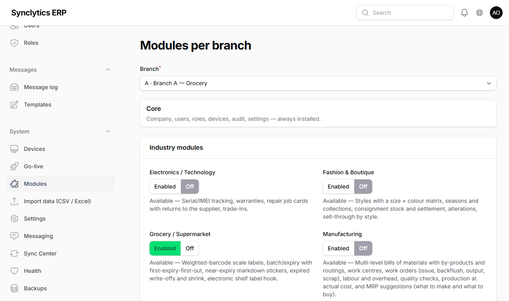

# 8. Installing and setting up modules

Modules add the features of a type of business. They are **already part of the software** — "installing" a module means three things:

1. your **licence** includes it (Chapter 6);
2. it is **switched on for each branch** that needs it;
3. its **set-up checklist** below is done.

A branch runs **one industry module** (Pharmacy, Grocery, Restaurant, …), plus any company-wide features and add-ons such as Sales & Distribution. A supermarket with a pharmacy counter is set up as two branches at the same address, so each keeps its own stock, staff and figures.

## 8.0 Industries

When a company runs more than one kind of business, each kind is an **industry**: for example *Pharmacy* with the branches Pharmacy Osu and Pharmacy Tema, and *Grocery* with Grocery Spintex.

**Why:** each industry has its own staff, products and figures. Separating them keeps a pharmacist's screens free of grocery items, and gives the owners each industry's results on its own as well as the whole company's.

- **An industry appears by itself** when its module is switched on for a branch (8.1). The branch then belongs to it. *Company → Industries* lists the industries, and new ones can be added there.
- **Head office or a central warehouse** can belong to no industry (*company-level*). Only people with company-wide access see it.
- **The industry switcher** at the top of the back office (*All industries*, *Pharmacy*, *Grocery*, …) is shown to people who can see more than one industry.
  - With an industry chosen, every screen shows only that industry: branches, stock, prices, purchasing, sales, reports, and its own dashboard. The pharmacy dashboard shows prescriptions and expiring batches.
  - With *All industries*, the dashboard shows each industry's sales side by side.
- **Each industry has its own catalogue.**
  - When you create a product or price list, choose its industry; the industry chosen at the top is filled in for you.
  - That industry's tills sell only its products.
  - Products created before industries are *shared* (sold everywhere) until you give them an industry (Catalog → Products → edit → Industry).
- **Staff:**
  - give a person a role **at their branch** (People & access → Users → Grant access → Applies to: *Branch*). A pharmacist at Pharmacy Osu then sees that pharmacy only;
  - an **industry manager** gets the role with *Applies to: Industry*, and sees every branch of that industry, and nothing of the others.

**Check:** choose *Pharmacy* at the top. *Stock → Stock on hand* shows only the pharmacy branches, and *Catalog → Products* shows only pharmacy (and shared) products. Choose *All industries* to go back.

### Stock between branches and industries

- **Sister branches** (Pharmacy Osu and Pharmacy Tema), or head office and a branch: use a normal transfer (*Stock → Transfers*), or let the branch that needs stock ask for it (*Stock → Stock requests → Ask for stock*). The branch asked clicks **Send** (entering 0 for anything it cannot spare), or **Reject** with a reason. Sending creates the transfer; the asking branch receives it as usual.
- **Between two industries** (a grocery branch asking a pharmacy for bottled water) only a stock request works, and it needs two approvals before anything moves:
  1. a manager of the asking branch, other than the person who asked;
  2. a manager of the supplying branch.

  The supplier then clicks **Send** and, for each item, chooses **its own product** that matches (the two catalogues are separate). The goods leave at the supplier's cost and arrive as the asking branch's product, with the same batch numbers and expiry dates.

**Why:** each industry keeps its own stock and figures. Two approvals mean neither side's stock leaves or arrives without a manager knowing, and moving at cost means neither side makes a profit on the other.

**Who:** storekeepers, supervisors, pharmacists and managers can ask (*Ask another branch for stock*). Branch, warehouse and general managers can approve (*Approve stock requests between industries*). Sending needs the transfer permission at the supplying branch.

### Accounts by industry

The company keeps **one set of books** (one TIN, one VAT return), and each industry is a **profit centre**: everything a branch posts is labelled with its industry.

- **Finance → Reports → Profit by industry** shows each industry's income, costs and profit side by side. A *Company* column holds head office and shared costs.
- The **Industry** filter on the other reports (trial balance, profit and loss, balance sheet, account ledger, budget) shows one industry, or *Company* for head office lines. It starts on the industry chosen at the top of the screen.
- **Stock moved between industries** leaves one industry's stock and joins the other's at cost, so neither makes a profit on it.

**Why:** the owners see what each line of business earns, without the cost and paperwork of separate companies.

**Sharing head office costs (optional).** By default head office costs (rent, admin salaries, the accountant) stay in the *Company* column.
1. To share them, switch on **System → Settings → Finance → Share head office costs between industries by sales**.
2. At month end open **Profit by industry** with the *To* date in that month, and click **Share head office costs**. The window shows each industry's share of that month's sales.
3. Click **Post the journal**.

One journal moves each cost from *Company* to the industries in proportion to their sales, to the pesewa; the company's total profit does not change. A month can be shared only once. To redo it, reverse that journal (*Finance → Journals*) and share again.

**Note:** an industry's balance sheet on its own does not balance, because bank accounts, money owed and stock in transit sit partly at company level. Use *All industries* for the company's balance sheet.

### Separate books (an industry registered as its own company)

Choose this per installation, only when an industry is a **separate company at the Registrar-General**, with its own TIN and VAT return. Otherwise keep one set of books (above).

1. **Company → Legal entities → New legal entity:** the registered name, registration number, TIN, VAT number and address.
   - The first one is the **head office company**. Head office lines, and branches without a company of their own, are booked there.
   - Only one company can be head office at a time; ticking *Head office company* on another moves it.
2. **Company → Industries →** edit the industry → **Books (legal entity):** choose its company.
   - Its branches now post into that company's books.
   - Their receipts and invoices print that company's name and TIN.
   - Their sales go to GRA E-VAT under that TIN.
3. Do this **at the start of a financial year**. Balances from before (stock, money owed) stay in the old books; ask your accountant to move them with a journal on the first day.

**What changes:**
- **Every entry balances inside each company.** When one company pays for another, for example head office paying the pharmacy's electricity, the system records what the pharmacy now owes head office on **Due from / to group companies**, in both sets of books. Stock sent between the companies at cost is recorded the same way.
- **Finance → Reports → Books:** choose a company for its own trial balance, profit and loss, balance sheet and ledger. *Whole group (consolidated)* adds them together, and what they owe each other cancels out.
- **VAT return:** each company files its own. Choose it under *Books*.
- **Settling up:** when one company pays the other, enter a journal with each company's bank line (*Company* on lines without a branch). The amount owed clears by itself.
- **Ledger check** (*Finance → Reports → Ledger check*) also proves that each entry balances in every company's books, and that both sides agree on what they owe each other.

**Why:** a separately registered company must keep its own books and file its own returns. Recording what they owe each other automatically means no entry is ever missed or one-sided.

## 8.1 Switching a module on or off

1. **System → Modules.**
2. Choose the **Branch**, then for each module choose **Enabled** (or **Off**; a planned module offers **Reserved**).
3. Type the **Reason for change** and click **Save modules**.

**Why:** modules are per branch so that, for example, only the pharmacy branch shows medicine screens. Every change is recorded in the audit log.

| Status shown | Meaning |
|---|---|
| **Available** | Released: can be switched on now. |
| **Planned · Phase N** | Not built yet. You may **reserve** it for a branch; it switches on by itself when that phase is released. Nothing is shown as working before it exists. |

**Only modules you have bought are shown.** The set-up wizard, this screen and the industry choices list only the modules in your licence, and the industry switcher and dashboards list only industries switched on at a branch.

**Why:** staff never see, or try to set up, a business type the company has not bought. To add one, ask SyncLytics for a new licence key (Chapter 6); the module then appears here, ready to switch on. If a licence renewal drops a module, its screens are hidden but its records are kept, and they come back if it is added again.

**Note:** switching a module **off** hides it and stops new work. It **never deletes** data; switching it on again brings everything back.

**Who can do it:** the owner and the IT Admin (permission *Manage modules*).

**Check:** after switching a module on, the module's menu appears in the back office (you may need to refresh the page), and its buttons appear on that branch's tills after their next catalog refresh (within 60 seconds, or press *Refresh* on the till).

## 8.2 Available modules and their checklists

### Online Storefront (built-in online shop)

1. Switch it on for the branch that will fulfil online orders.
2. **Online → Channels → New channel**, type *Built-in online shop*: choose the fulfilling branch, the stock warehouse, the price list and the shop's web address (`/shop/<address>`).
3. Set **safety stock** on products that sell fast in the shop too.
4. Click **Activate**.

**Why:** safety stock is held back from the shop so walk-in and offline sales do not oversell online.

**Check:** open `https://<your-domain>/shop/<address>` — your products appear with prices and availability.

### Grocery / Supermarket

1. Products with use-by dates: tick **Batches and expiry dates** (works in any shop, but essential for grocery).
2. **Weighed items:** give each its **scale code (PLU)** and sell it in **KG** (3 decimals). Set the label scale to print EAN-13 labels: `21` · item code (5 digits) · weight in grams (5 digits) · check digit.
3. **System → Settings → Grocery:** check the scale label prefixes, and the markdown rules (default 30 % off at 7 days left, 50 % at 3 days).
4. Electronic shelf labels (optional): enter their gateway address in System → Settings → Grocery.

**Why:** the till reads the weight and item from the scale label, and sells the batch expiring first, so old stock does not go to waste.

**Check:** print a test label on the scale and scan it at a till: the item appears with its weight and price.

### Pharmacy

1. On each medicine (Catalog → Products → **Medicine**): **schedule** (OTC, Prescription only, Controlled), generic name, strength, form, FDA registration number, **active ingredients**. Switch on **Batches and expiry dates** (required for medicines).
2. **Pharmacy → Drug interactions:** add the interactions you want the till to warn about.
3. **System → Settings → Pharmacy:** the Pharmacy Council premises licence number and the superintendent pharmacist, printed on the controlled-drug register.
4. Give pharmacists the **Pharmacist** role (and technicians **Pharmacy Technician**) at the branch.

**Why:** every prescription-only or controlled medicine sale needs a pharmacist's approval and records the prescription; controlled drugs go into the Controlled Drug Register.

**Check:** sell a POM medicine on a till: the till asks for the patient, the prescription and the pharmacist's PIN.

### Restaurant / Café / Bar

1. **Restaurant → Kitchen stations:** e.g. `KITCHEN`, `BAR`. Tick *Print tickets* for a station that has a printer instead of a screen.
2. **Restaurant → Floor plan:** each table with its number, area, seats and position.
3. **Restaurant → Modifiers:** groups of choices (e.g. *Spice: Mild / Hot*). A choice can be charged as a product.
4. On each **dish** (Catalog → Products → **Restaurant**): the station, the choices offered, and the **recipe** (ingredients per portion). Switch **Track stock** off for the dish itself; the ingredients are stocked products.
5. **System → Settings → Restaurant:** service charge rate and its product (create a product with SKU `SERVICE`, *Track stock* off), tips on/off, booking reminders and the SMS gateway address (only with your own SMS provider's details).
6. Give staff the **Waiter / Bartender** or **Kitchen Staff** role.
7. Set up the **kitchen screens** (Chapter 9).

**Why:** bills live on the server so every till, waiter tablet and kitchen screen shares the same tables. For a restaurant with unreliable internet, use a **branch server** (Chapter 10) so this keeps working during outages.

**Check:** open a table on a till, send a dish, and see it on the kitchen screen.

### Electronics / Technology

1. On serial-numbered products (Catalog → Products → **Serial numbers and warranty**): tick **Serial / IMEI numbers**, enter the **warranty** in months.
2. Stock already on hand: **Electronics → Serial numbers → Register numbers for stock on hand**.
3. Create a **labour** product (no stock) for repair charges.
4. Give technicians the **Repair Technician** role.

**Why:** every unit is then traced from receipt to sale, warranties are checked by number, and stolen or wrong units cannot be sold.

**Check:** add a serial-numbered product at a till: it asks for the number and refuses one that is not in stock there.

### Fashion & Boutique

1. **Fashion → Styles → New style:** code, name, tax, season, collection, sizes, colours and price. Then **Create sizes and colours** to make one product per size and colour, each with SKU and barcode.
2. **Consignment** (goods owned by a supplier): on the product, choose the consignor and their share.
3. **Alterations:** create a product with SKU `ALTERATION` and *Track stock* off (System → Settings → Fashion holds the SKU).
4. Give tailors the **Tailor** role.

**Check:** pick any variant of a style at the till: the size × colour grid opens with the stock at that till.

### Sales & Distribution (vans, routes, reps)

1. **Distribution → Vans → New van:** branch, van code (e.g. `V01`), name, registration, rep and the warehouse it is loaded from. The van is created as a warehouse **with its own till**.
2. Register the rep's phone as a **POS till** device on that van's till and enrol it (Chapter 9.4/9.5). It works **fully offline**.
3. Give the rep the **Van Sales Rep** role at the branch and a PIN; in **HR & payroll → Employees** set their **Commission %** if they earn commission.
4. **Routes:** Distribution → Routes → New route — the van, rep, weekdays and customers in visiting order.
5. **Targets:** Distribution → Rep targets — monthly sales target per rep.
6. **Returnable containers** (crates, bottles, gas cylinders): mark the container products as *returnable containers* (their price is the deposit) and choose the container on each product sold in them (Product → Returnable containers).
7. Daily: **Load van** in the morning; in the evening **Start end-of-day settlement**, count, submit, and a supervisor approves (Chapter 14 and `docs/distribution.md`).

**Why:** a van as a warehouse with its own till means every sale, receipt, shift and cash count works exactly as in a shop — offline too — and the daily settlement catches shortages the same day.

**Check:** load a van, sell from the phone, then settle: the van's stock in *Stock on hand* matches what is left on it.

### Manufacturing (factories, bakeries, workshops, food processing)

1. **Switch it on** for the branch that produces (System → Modules → Manufacturing). *Why:* the screens and work orders only work where the module is on.
2. **Work centres:** Manufacturing → Work centres → New — each machine or bench (e.g. `MIX` Mixer, `OVEN` Oven), its **cost per hour** (wages of the people there plus running costs such as power) and the hours a day it runs. *Why:* every minute worked there is charged to the product, so its cost is real; the hours show how full each machine is.
3. **Bills of materials:** Manufacturing → Bills of materials → New — the product made, how many one batch makes, the **materials** per batch (with any expected loss %), **by-products** (e.g. bran from milling), and the **operations** in order with their work centre and minutes. Then **Put in use**. *Why:* a BOM in use is locked so open orders and history stay true; to change it, start a **New revision**.
   - A material that has its own BOM is a **sub-assembly** (e.g. dough for bread): it is made on its own work order.
   - **Backflush** (default) means the material or time is charged automatically when output is reported; switch it off for items you issue by hand or time you record.
   - Tick **Quality check before stock** if output must be inspected first.
4. **Roles:** *Production Manager* (sets up, runs orders, checks quality), *Machine Operator* (runs orders), *Quality Inspector* (passes or fails output). *Why:* the person who makes the goods is not the one who passes them.
5. **Daily:** Manufacturing → **Production planning (MRP)** shows what to make and what to buy; **Raise work order**, then on the work order **Release → Report output → (Quality check) → Finish**. Print the **Job card** for the shop floor.

**Why:** production at actual cost (the owner's choice) means each product enters stock at what its materials, labour and machines really cost, and the accounts show work in progress until it is finished.

**Check:** make a small order of a product, then look at *Stock on hand*: the materials went down, the product went up, and the work order's *Actual cost* section shows the cost per unit.

### Services & Packages (salons, spas, gyms, clinics, consultancies)

1. **Services:** on each service (Catalog → Products → **Services**) enter the **duration** in minutes and switch **Track stock** off. Optionally a **commission** rate of its own.
2. **Staff:** in **HR & payroll → Employees**, switch on **Takes appointments** for each person who does services, and set their **Commission %**. Give them the **Stylist / Therapist** role (or another role with *appointments*).
3. **Prepaid packs** (e.g. *5 massages for GHS 800*): a product with *Track stock* off and, under **Services → Prepaid pack**, the services it covers and the number of sessions, and how many days it is valid.
4. **Memberships and subscriptions:** create a product to invoice them as (e.g. *Gym membership*, *Track stock* off), then **Services → Membership plans → New plan**: price per period, how often it is billed (monthly, every 3 or 6 months, yearly) and any sessions included each period.
5. **System → Settings → Services:** the calendar's start and end times and time steps, appointment reminders (hours before), and the SMS gateway address (leave empty to use the restaurant one; only with your own SMS provider).
6. **Software licence keys** (optional): on the product tick **Hands out a licence key** (*Track stock* off), then **Services → Licence keys → Load keys** for each branch that sells it.

**Why:** the duration fills the appointment book; the person who did each service earns their commission, which payroll pays each month; packs and memberships let customers prepay and use their sessions at the till.

**Check:** book an appointment in **Services → Staff calendar**, check it out at a till with **Appointments (F10)**, and see the commission under **Services → Commissions**.

**Note:** memberships are invoiced by **head office** each day (01:30) for every period that has started; the invoices go on the customer's account (Sales → Invoices) and are paid like any invoice.

## 8.3 Company-wide features (licence options)

| Feature | What it adds | Set-up |
|---|---|---|
| **Finance** | Chart of accounts, automatic postings from sales, purchases, stock and payroll; supplier bills; bank reconciliation; month-end; reports | Chapter 7, step 12; your accountant reviews the chart and opening balances |
| **HR & payroll** | Employees, clock-in at tills, leave, loans, monthly payroll with PAYE and SSNIT, payslips | Chapter 7, step 12; payroll profile checked with your accountant |

## 8.4 Planned modules

These appear as **Planned** and can be reserved: **Manufacturing** (bills of materials, production at actual cost), **Logistics & Delivery**, **Assets & Maintenance**, **Projects & Tasks**, **Helpdesk**. This guide gets a checklist for each as it is released.
