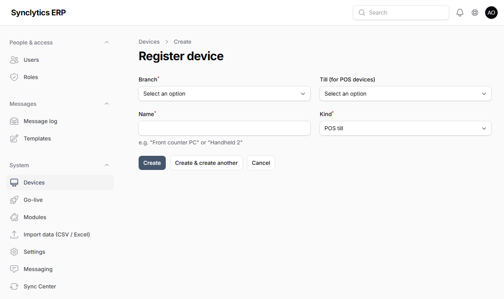
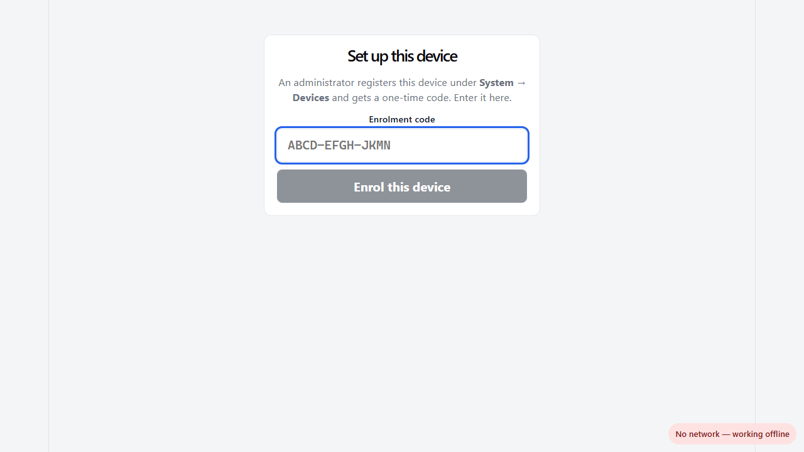

# 9. Setting up tills and other devices

## 9.1 How devices are set up

Every till, handheld and kitchen screen is set up the same way:

1. **Register** it in the back office: **System → Devices → New device**. You get a **one-time enrolment code** (valid 24 hours by default).
2. On the device, open the till app address in Chrome or Edge and **enter the code**.
3. People **sign in** on it (cashiers with username and PIN; kitchen screens need no sign-in).

**Why:** only devices you registered can sell or see your data. Each device creates its own security key when it is enrolled, so a copied browser cannot pretend to be your till. A lost device is switched off with one click (**Revoke**).

### Register a device

**System → Devices → New device**:

| Field | What to enter |
|---|---|
| Branch | Where the device is used |
| Till (for POS devices) | The till it sells on (e.g. *Till 1*). Each selling device needs a till. |
| Name | Something you will recognise: *Front counter PC*, *Waiter tablet 2*, *Handheld 1* |
| Kind | **POS till** (tills and waiter tablets) or **Handheld scanner** (warehouse). **Kitchen display** (kitchen or bar screen) is offered only at a branch running the Restaurant module. |



Click **Create**. The code is shown **once**: write it down or keep the page open while you set up the device. If it expires, use **New code** on the device's row.

## 9.2 The till app address

| Setup | Address to open on the device |
|---|---|
| A (on the server PC itself) | `https://localhost/pos/` |
| B (Windows server on the shop network) | `https://<server-address>/pos/` (e.g. `https://192.168.1.10/pos/`). Trust the server first (4.9). |
| B/C (Ubuntu server on the network, no domain) | `https://<server-address>/pos/`. Trust the server first (4.9). |
| D (cloud, with HTTPS) | `https://<your-domain>/pos/` |
| E (branch server) | the **branch server's** address, as in B |

## 9.3 Trust the server's address

Browsers allow a web app to use its **security functions** (the till's own signing key, the offline PIN check), to **work offline** and to **install as an app** only when it comes from a secure address: `https://…` or `localhost`. **This is required**: without it the till cannot even enrol.

- **A server without an internet name** (Windows or Ubuntu): it is reached over `https` with its own certificate. Each device trusts it once, as in **4.9**. Nothing else is needed.
- **Setup D and servers with an internet name:** nothing to do. The certificate is a public one.
- **Only for a server you set up by hand without https** (not recommended): each till, tablet, handheld and kitchen screen must be told once that the plain `http://` address is trusted:

1. In Chrome, open `chrome://flags/#unsafely-treat-insecure-origin-as-secure` (in Edge: `edge://flags/#unsafely-treat-insecure-origin-as-secure`).
2. In the box, type the server address **without** `/pos/`, e.g. `http://192.168.1.10`.
3. Set the option to **Enabled** and click **Relaunch**.

**Why:** the till proves it is your device by signing with a key it creates and keeps itself, and checks PINs offline; browsers only offer these functions to trusted addresses.

**Check:** the till app shows *Set up this device* and enrolling with the code works.

**Note:** This is safe on your own shop network. Never use plain `http://` over the internet; use HTTPS (Chapter 5).

## 9.4 Till PC (Windows)

1. Install **Google Chrome** or use **Microsoft Edge**. Set the PC's clock to update automatically (as in 4.1, step 2).
2. Do 9.3 if your setup needs it.
3. Open the till address (9.2).
4. **Install it as an app:** in Chrome, menu **⋮ → Cast, save and share → Install page as app…**; in Edge, menu **… → Apps → Install this site as an app**. A *POS* icon appears on the desktop and Start menu; use it from now on.
   **Why:** the app opens full-screen without the address bar and starts even when the server is off.
5. Enter the **enrolment code** and click **Enrol this device**:

   

6. A cashier signs in with **username and PIN**, counts the drawer and **opens the shift**.

**Check:** sell an item and print the receipt. Then pull out the network cable (or switch off Wi-Fi): the top shows *working offline*, and you can still sell. Plug it back in: the yellow banner disappears as the sale is sent.

## 9.5 Tablet (Android)

1. Update Chrome from the Play Store. Do 9.3 if needed (Chrome on Android has the same flags page).
2. Open the till address, then Chrome menu **⋮ → Add to Home screen → Install**.
3. Enrol and sign in as on a PC.

**Tip:** waiter tablets in a restaurant are registered as **POS till** devices on a till of their branch.

**Van reps:** register the rep's Android phone as a **POS till** on the **van's till** (each van has one, created with the van). Allow the app to use the phone's **location** when asked, so visits record where they happened. On the phone the till shows **Route (F3)**, **Take order** and **Empties returned**. Install it as an app (step 2) so it opens without signal.

## 9.6 Choosing light or dark

Every till, handheld and kitchen screen has a **Theme** switch at the bottom left: **System** (follows the device's own setting), **Light** or **Dark**. The choice is remembered on that device. Dark is easier on the eyes in a dim bar or kitchen and saves battery on phones.

## 9.7 Receipt printer and cash drawer

1. Install the printer's **Windows (or Android) driver** from the manufacturer, and print a Windows test page.
2. In the printer's **Printing preferences**, choose paper **80 mm** (or 72 mm) receipt roll. For a cash drawer connected to the printer, switch on the driver's **cash drawer / open drawer before printing** option.
3. Make it the **default printer** on that till PC.
4. The first time you click **Print receipt**, in the browser's print window choose the printer, set **Margins: None**, **Scale: 100**, and untick **Headers and footers**. The browser remembers it.
5. **Print without the print window** (recommended): edit the desktop shortcut of the till app (right-click → **Properties**), and at the end of **Target** add a space and `--kiosk-printing`. Start the till from that shortcut.

**Why:** `--kiosk-printing` sends receipts straight to the default printer, which is faster and avoids mistakes at busy times.

**Check:** a sale prints a full-width receipt and the drawer opens.

### The desktop till app (silent printing, cash drawer, scale)

For a Windows till PC with a receipt printer, a cash drawer or a weighing scale, install **SES Labs Till** (`SES Labs Till_<version>_x64-setup.exe`, from SyncLytics) instead of using the browser:

1. Install the receipt printer's Windows driver (or note the IP address of a network receipt printer).
2. Trust the server on this PC (4.9). Then run the SES Labs Till setup. On first start it asks for the **server address**: exactly what you type in a browser to open the back office, without `/admin`. For a cloud server that is its name, e.g. `https://erp.clientdomain.com`, **never its IP address** (the security certificate is for the name, so the IP is refused). For a server in the shop it is the address used in 4.9, e.g. `https://192.168.1.10`.
3. **Receipt printer:** choose it from the list (or type `tcp://<printer-ip>:9100` for a network printer); tick **Open the cash drawer** if the drawer is plugged into the printer; **Print a test receipt**.
4. **Scale:** choose its COM port and speed (usually 9600), then **Read the scale** with something on it.
5. **Save and open the till.** The app first checks that the server answers. If it does not, it says so and stays on this page: correct the address and save again. (**Use this address anyway** keeps an address that cannot be reached yet, for example when the server is not switched on.) Then enrol and sign in as with any till (9.1).

Receipts then print straight away without a print window, the drawer opens after cash sales, and items sold by weight show a **Weigh** button. **Printer and scale set-up** on the receipt screen opens these settings again.

**Why:** the app sends the receipt to the printer in the printer's own language (ESC/POS), which is faster and more reliable than a browser print window, and can talk to the drawer and scale, which a browser cannot.

**Note:** the app only opens your SES Labs server — no other website — so the printer and drawer cannot be reached from anywhere else.

**When the till starts:** it opens the server straight away if it answers. If the server has worked on this PC before but cannot be reached now (internet down), the till still opens and sells offline. If the saved address has **never** worked, the set-up page comes back with a message, so a wrong address can always be corrected.

#### Starting the desktop till again from scratch

Uninstalling the app keeps its settings (the server address, printer and scale), so a reinstall comes back with the same settings. To clear them:

1. Close SES Labs Till (also from the system tray, if it shows there).
2. Open **PowerShell** (Start → type *PowerShell*) and run these two lines:

   ```powershell
   Remove-Item "$env:APPDATA\app.seslabs.till" -Recurse -Force -ErrorAction SilentlyContinue
   Remove-Item "$env:LOCALAPPDATA\app.seslabs.till" -Recurse -Force -ErrorAction SilentlyContinue
   ```

3. Open SES Labs Till again (or reinstall it). It starts at the set-up page with empty fields.

**Why:** the first folder holds the till's settings; the second holds what the till app saved for working offline. Clearing both makes the PC behave like a new till. Then delete the old entry under **System → Devices** in the back office and enrol the till again (9.1).

**Note:** sales not yet sent to the server are in the second folder. Clear it only when the till shows nothing waiting to send, or when the till never worked.

## 9.8 Barcode scanner

1. Plug it in (USB) or pair it (Bluetooth).
2. Open Notepad and scan a product: the number appears and the cursor moves to a **new line**.
3. If it does not move to a new line, scan the **"Add Enter / CR suffix"** setting barcode from the scanner's manual.

**Why:** the till adds the product when the scanner "presses Enter" after the code.

## 9.9 Handheld (warehouse)

1. Register a device of kind **Handheld scanner** for the branch.
2. On the phone: Chrome, do 9.3 if needed, open the till address (9.2), enrol with the code.
3. Storekeepers sign in with **username and PIN**. They need a warehouse role (Storekeeper, Warehouse Manager…), not till access.

**Note:** the handheld needs its branch's server to be reachable (it does not queue work offline). For warehouses with weak internet, use a branch server (Chapter 10).

## 9.10 Kitchen screen (Restaurant)

1. Register a device of kind **Kitchen display** for the branch.
2. On the screen's PC or tablet: Chrome, do 9.3 if needed, open the till address, enrol with the code.
3. Choose the **station** it shows (e.g. *KITCHEN* or *BAR*). No one signs in.
4. Press **F11** (PC) for full screen.

**Check:** send a dish from a till: it appears on the screen within a few seconds.

## 9.11 Counting stock with a handheld

During a stock count (Chapter 14.4) storekeepers scan the bin, then each product, and type the quantity. Counts from several handhelds go into the same count.

## 9.12 Label scale (Grocery)

Set the scale to print **EAN-13** labels starting with `21` (see Chapter 8, Grocery). The scale's own software holds each item's **PLU** (5-digit code) and price per kg; keep its PLU codes the same as the products' **scale codes**.

## 9.13 When a device is lost, stolen or replaced

- **Lost or stolen:** **System → Devices → Revoke** at once. Its access and every sign-in on it end immediately.
- **Replacing a till that still has unsent sales:** on the old till press **Export unsent sales** (in the yellow banner). In the back office: **System → Sync Center → Import till file**. Then register and enrol the new device.
- **Re-installing the same device:** register it as a new device (it gets the next receipt series letter, so receipt numbers never repeat).
