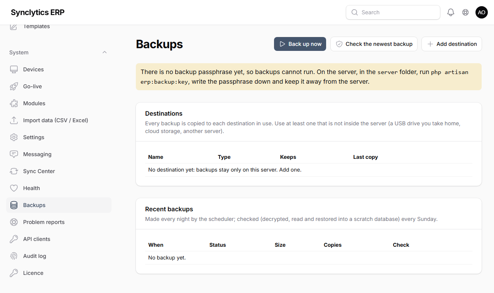

# 12. Daily running, backups, updates and moving

## 12.1 Every day

| Who | What | Where |
|---|---|---|
| Cashiers | Open the shift with the float; close it with the cash count | Till |
| Supervisor | Look at the **Review queue** and resolve items | Sales → Review queue |
| Manager | Check no till shows a red banner (*refused*) or a long yellow queue | Tills; System → Devices (*Last seen*) |
| IT / owner | Check **System → Health** is all green (backup made last night, scheduler running) | System → Health |
| Head office | Check branch servers synced recently (setup E) | System → Sync Center |

**Every month:** verify the audit log (**System → Audit log → Verify chain**), check stock (`php artisan erp:stock-check`), take the USB backup drive home if you use one, and every three months practise a full restore on a spare PC (12.3).

## 12.2 Backups (automatic, encrypted)

**Why:** a theft, fire, failed disk or ransomware attack can destroy the server. A backup kept **somewhere else** is the only way to get your sales, stock and accounts back.

The server makes a backup **every night at 02:00** by itself. Each backup holds everything needed to start again: the **database**, the **`.env` settings** (with the keys that unlock stored secrets and seal the audit log) and the **uploaded files**. It is **encrypted** with your backup passphrase, so a lost USB drive or a leaked cloud folder reveals nothing. Every Sunday the newest backup is **checked**: decrypted, read, and — where the database user may create a scratch database — fully restored into it and compared, without touching your live data.

### The backup passphrase

The installers create it and show it once. Otherwise, in the `server` folder run `php artisan erp:backup:key`.

**Warning:** write the passphrase on paper and keep it **away from the server** (with the owner, or in a safe). Without it no backup can be restored.

### Where backups go

The server keeps the last 7 itself. Add at least one place **outside the server** under **System → Backups → Add destination** (a test file is written and removed before it is saved):

| Destination | What to fill in | Good for |
|---|---|---|
| **Folder** — USB drive, second disk, network share | The folder, e.g. `E:\Backups` (Windows) or `/mnt/usb/backups` | Shops: rotate two USB drives, one always at home |
| **S3-compatible storage** — Backblaze B2, Wasabi, AWS | Endpoint, region, bucket, access key and secret (from your storage account; give the key access to that bucket only) | Cloud copies at low cost |
| **Google Drive** | OAuth client ID and secret, a refresh token, and the Drive folder ID (from a Google Cloud project in **your** Google account — your IT person sets this up once) | Businesses already on Google Workspace |
| **Another server (SFTP)** | Address, port, user, password or private key, folder | Head office or a hosting account |

**Keep the newest …** says how many backups each destination keeps; older ones there are deleted automatically.



**Check:** **Back up now**, then the backup shows ✓ for each destination, and **Check the newest backup** reports *Readable* or *Restore drill passed*. **System → Health** then shows *Backups OK*.

**Note:** on Windows set `BACKUP_PG_BIN=C:\SESLabs\pgsql\bin` (the installer does this). For the full restore drill the database user needs permission to create a scratch database: the installers give it; on an existing server an administrator runs `ALTER ROLE erp CREATEDB;` in PostgreSQL.

## 12.3 Restoring from a backup

Use this after a disaster, or to practise on a spare PC.

1. Install the server software on the new machine with the installer or script (Chapter 4 or 5) — it creates an empty company you will replace.
2. Copy the newest `.synbak` backup file to it (from the USB drive, cloud storage or **System → Backups → Download** on the old server if it still works).
3. Put your **backup passphrase** in the new server's `.env` as `BACKUP_PASSPHRASE=…`, then in the `server` folder:
   ```
   php artisan erp:backup:restore C:\path\ses-labs-hq-20261029-020000.synbak
   ```
   It checks the backup, asks for confirmation, and replaces the data.
4. The backup's settings are saved next to `.env` as `.env.from-backup`. Copy `APP_KEY` and `ERP_AUDIT_KEY` from it into `.env` (they must match the backup), then `php artisan optimize`.
5. Restart the server (Task Scheduler on Windows, or reboot).

**Check:** `php artisan erp:audit-verify` reports the chain intact, `php artisan erp:stock-check` passes, and yesterday's sales are in **Sales → Till sales**. If this is a new machine, re-activate the licence (Chapter 6.6).

**Note:** tills keep any sales made since the backup in their queue and send them when the server is back, so they are not lost.

## 12.4 Updating the software

SES Labs sends you a new release ZIP. Update outside trading hours.

1. **Take a backup** (run the backup task now) and check it.
2. Stop the server: Windows — Task Scheduler → *End* both SES Labs tasks; Ubuntu — `sudo systemctl stop caddy`.
3. Extract the new ZIP **over** the existing folder (`C:\SESLabs` or `/var/www/seslabs`). Your `.env` and `storage` are kept.
4. In the `server` folder:

   ```
   composer install --no-dev --optimize-autoloader
   php artisan migrate --seed --force
   php artisan optimize
   ```

   (Ubuntu: then `sudo chown -R www-data:www-data storage bootstrap/cache`.)
   If you install from source code, also rebuild the till: in `pos`, `npm install` and `npm run build:server`.
5. Start the server again (Windows — *Run* both tasks; Ubuntu — `sudo systemctl start caddy` and `sudo systemctl restart php8.4-fpm`).
6. **Tills** download the new version by themselves. It takes effect when the till app has been **closed completely and opened again** (do this at the end of the day; sometimes it needs two restarts).

**Why `migrate --seed`:** it adds new tables and new permissions safely; it never removes your data or changes your own settings.

**With branch servers:** update **head office first**, then each branch server.

## 12.5 Moving to a new server

1. Install the new server (Chapter 4 or 5) without creating keys, tables or the company, as in 12.3 step 1.
2. Take a fresh backup on the old server **after closing trading** and stop the old server.
3. Restore it on the new server (12.3).
4. Point the devices to the new address: if the address changed, open the new till address on each device and enrol it again (System → Devices → New code), after its queue has been sent.
5. Re-activate the licence within 14 days (Chapter 6.6).
