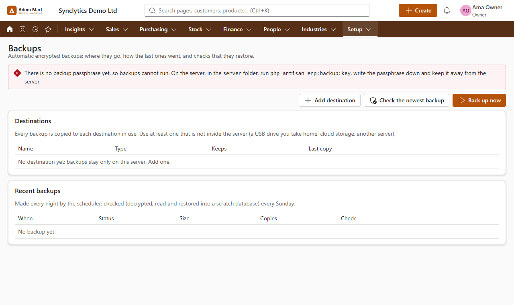

# 12. Daily running, backups, updates and moving

## 12.1 Every day

| Who | What | Where |
|---|---|---|
| Cashiers | Open the shift with the float; close it with the cash count | Till |
| Supervisor | Look at the **Review queue** and resolve items | Sales → Review queue |
| Manager | Check no till shows a red banner (*refused*) or a long yellow queue | Tills; System → Devices (*Last seen*) |
| IT / owner | Check **System → Health** is all green (backup made last night, scheduler running) | System → Health |
| Head office | Check branch servers synced recently (setup E) | System → Sync Center |
| Owner or branch manager | **Close the day** before leaving | Cash → Close the day |

**Till shifts** (Sales → Till shifts): each shift's *Expected cash* is only what should be in the drawer (float, cash sales, pay-ins, less pay-outs and drops); *Sales total* is everything the shift sold (less returns), with cash, each MoMo network, card, vouchers, NHIS and on-account on hover, and the *returns refunded* by how the money went back. A drawer or MoMo phone that is over by exactly a refund usually means the refund was keyed but never paid out: check that return under Sales → Sales. The till shows the same list when the shift closes. **Why:** cash is only part of the day; the total tells you what the shift really sold.

**Shift report** (the printer button on a closed shift): one A4 page with the branch's name, address and phone under the company. At the top, the **grand total sold** (every payment method, less returns refunded), the number of sales, the average sale, returns, and the cash expected, counted and over / short. Then who opened and closed it and when, the sales by payment method (sold, refunded, net and the grand total row), the cash drawer, the MoMo / card / voucher checks, the drawer's pay-outs and drops and coupons (left out when there were none), and lines for the teller and the manager to sign. **Why:** the manager sees at a glance what the shift sold and whether the money is right, and files a signed copy.

**Finding sales and payments** (the filter button on each list): **Sales → Till sales** by **teller**, **total** (from / up
to), **how it was paid** (cash, mobile money, card… — a sale paid two ways shows under both) and the days it was sold;
click the *Teller*, *Total* or *Paid by* heading to sort (*Paid by* sorts by the method that paid most of each sale).
The same filters are on **Till shifts** (teller, days, over / short), **Mobile money** payments (cashier, amount, days),
**Customer payments** (method, who received it, amount, days), **Invoices**, **Online orders** and **Quotes & orders**
(total, days, who entered it) and **Till drawer** (who). **Export** downloads exactly the filtered list. **Why:** to answer
questions like "what did Ama take by mobile money last week?" in a few clicks, and to give the accountant just that list.

**Close the day** (Cash → *Close the day*; owner, general manager and branch manager): one screen per branch shows whether the day is wrapped up — ✓ every till closed and counted, the cash counted and any shortage by cashier, cash handed over and banked (when you use cash control), every sale received from the tills, medicine sales signed off (pharmacies), approvals waiting, and last night's backup. Enter the cash **taken to the bank** with the **deposit slip number** and the **bank account**, and what was **kept in the safe**, then **Close the day**. The deposit goes into the books as money moved from the tills' cash to that bank account (with cash control, each handover's deposit is recorded on the Cash desk instead). Once the bank statement is imported (Finance → Bank reconciliation), **Recent days** shows for each deposit *on the statement ✓*, *on the statement — match it*, or *NOT on the bank statement — check with the bank*; a deposit missing for more than two days also shows as a check on the next close. A red ✗ (e.g. a till still open) needs a sentence saying why before the day can be closed; amber ! items are reminders. Closing again later (after the till was closed) updates the record. **Recent days** lists the last two weeks: who closed, cash counted, over / short, banked, slip, safe. The daily summary says, per branch, who closed the day or *not yet*. **Why:** one look tells the owner the day is finished and the money is where it should be; a missing deposit or an open till is noticed the same evening, not at the month-end.

**Every month:** verify the audit log (**System → Audit log → Verify chain**), check stock (`php artisan erp:stock-check`), take the USB backup drive home if you use one, and every three months practise a full restore on a spare PC (12.3).

**You are told when something is wrong.** Every hour the server checks itself; when a check turns red — a backup failed or is more than 26 hours old, the weekly restore check failed, the backup passphrase is missing, the disk or memory is nearly full, the server is overloaded, the licence is read-only — everyone who looks after the system settings (owner, IT Admin) gets a notification on the bell and an e-mail, once a day per problem, until it is fixed. **System → Health** also shows the server's **load** and **memory** (on Linux servers). **Why:** a backup that quietly stopped is only found when it is needed; now it is found the next morning.

**The daily summary** (System → Settings → *Daily summary*, off until you switch it on): each evening at the time you choose (default 20:00), the owner and general manager (anyone with *receive the daily summary*) get the day in one message — sales by branch against the same day last week, cash / mobile money / card, cash over or short at the till closes, low, expired and expiring stock, today's losses and unusual ones, and what is waiting for approval. On the bell, by e-mail (on by default) and, if WhatsApp Business is set up, a short WhatsApp. **Why:** the owner sees the whole business in one minute, wherever they are.

**Today — the owner's phone view** (top of the menu; anyone with *receive the daily summary*): the day on one screen that reads well on a phone and updates every minute — sales against the same day last week, cash / mobile money / card, till closes and cash over or short, what needs attention (server health, refused till work, approvals, expiring stock; tap to open), and per branch the sales, tills still open, who closed the day and whether the deposit is on the bank statement. **Yesterday** is one tap away. On the phone, open the back office, go to **Today**, then the browser menu → **Add to Home screen**: it opens like an app. **Why:** the owner sees the business from anywhere in ten seconds, without the full back office.

**The new back office.** Signing in now opens it, at `https://<your server>/office/`. It is the same back office in a Windows-style frame, built with Microsoft's Fluent design. **Classic back office** (under your name) goes back to the old screens, and **New back office** in the classic one's menu (under your photo) comes back.

**To-do** (the list icon at the start of the menu, with a red number) shows everything waiting for your decision.
- **Till requests** come first: Approve (after confirming it is you) or Decline (say why; the cashier sees it) right there.
- After them, the purchase orders, stock adjustments, returns, expense claims, leave, access requests and the rest are listed with their number, who asked, the amount and how long they have waited. **Open** shows each one so you can approve or turn it down.
- The list refreshes by itself.

**Why:** nothing that needs you gets missed, and a cashier waiting at the till gets an answer in seconds.

There are two ways to show the menu. Each person chooses under their name at the top right; you can switch at any time and nothing else changes.
- **Across the top** (the default): areas such as Sales and Stock on a coloured bar; each opens its pages in columns.
- **At the side**: a slim coloured strip of icons, with **Create** at the top.

What's there:
- **One search box** (Ctrl+K) finds pages of the menu and records: customers, products, invoices and more.
- **Create** starts a new sale, invoice, product and so on.
- Three icons start the menu:
  - the **house** for Home;
  - the **clock** for the pages you opened lately;
  - the **star** for your favourite pages. Press it on any page to add that page, or take it off. The star is filled when the page is already a favourite, and your favourites follow you to every computer.
- **Classic back office** (under your name) goes back to the old screens.

**Home** shows the business at a glance:
- **Reminders:** what waits for you; anything needing a decision shows big.
- **Tiles:** big shortcuts to the pages you use most.
- **Key performance indicators:** this period against the one before, with the change.
- **KPI meter:** a dial for the figure you choose.
- **Top 15 items sold**, and the **monthly trend** of sales and buying.
- **Shortcuts:** your favourites, quick ways to add things, and the pages you opened lately.

**Viewing** (top right) chooses the period: today, this week, month, quarter or year. **Personalize** chooses which panels show and which tiles. **Layout** chooses two or three columns. To move a panel, drag the small bar at its top, or use its **⋯** menu. Your arrangement is kept for you on every computer. Each chart can switch to a table (the small icons at its top right).

**Why:** everyone sees first what needs them, and the figures that matter, without opening a report.

**Till sales (rebuilt).** **Sales → Till sales** lists every sale and return, newest first.
- **Search** by receipt, teller or customer.
- Choose **Today**, **7**, **30** or **90 days**, or **All**.
- **Filters** narrows by branch, teller, how it was paid, amount, dates, or returns only. Each filter in use shows as a small chip; its **×** takes it off.
- The cards above the list show how many sales, their total and how they were paid.
- Press a heading to sort by it.
- Press a sale to see it in full, with **Print copy** and, for a walk-in who left a phone number, **Save as customer**.
- **Classic version** (top right) opens the old screen.

**Till shifts (rebuilt).** **Sales → Till shifts** shows each shift: the till, who opened it, the sales, the float, the cash expected, counted and over or short, and the mobile money and card checks.
- A shift **left open** overnight shows in red: close it on the till.
- Choose the period or **Open now**; **Filters** narrows by branch, teller, over or short, dates, or vaults waiting for the manager's count.
- Press a shift to see its full report on screen, with **Shift report** to print it.
- **Correct the count** fixes a mistyped count: type the right amount and why. The difference goes to the books and the original stays visible.
- **Close shift** closes a shift that no till can close any more, for example after a till was reinstalled.
- **Count the vault** (only when each teller has their own vault and a manager recounts it): appears on a closed shift *waiting for the manager's count*. Type how many of each note and coin are in the tray; the total adds up as you type, but the teller's figure is never shown. **Why:** a count you cannot compare with anything is an honest count. If yours differs from the teller's, the boxes clear and you count once more from the start; that second count is booked, and the over or short is worked out from it.

**Till drawer (rebuilt).** **Sales → Till drawer** lists money in and out of the drawers besides sales: expenses paid out (press **Open** to see the receipt photo), pay-ins, cash drops and drawers opened without a sale, with who did it and who approved it.

**Products (rebuilt).** **Stock → Products** lists what you sell and keep in stock, with the price on your standard price list and the stock on hand in the branches you may see.
- **Find a product** by its SKU, name or shelf, or scan its barcode into the search box. **Filters** narrows by industry, category, for sale or not, medicine schedule, or out of stock.
- **Tick products** (the tick at the top ticks the page; then **Tick all … that match** takes every product the search and filters pick) for **Print labels**, **Export prices**, and under **Change**: category, brand or tax, the unit, batches and expiry, the medicine schedule, the industry, or **Work out cost from selling price**. Products that cannot be changed are listed with the reason; the others are changed. **Why:** one product that cannot change does not stop the rest.
- **Press a product** to see it on one page: its details, units and barcodes, prices (and the pricing rule that sets them, with a warning when a price is below the cost), the stock in each warehouse, batches with their expiry dates, and the latest stock movements.
- **New product** and **Edit** open the product form, one section at a time: the product itself, then the sections of the modules your company uses (medicine, serial numbers, returnable containers, consignment, health check, services and packs, restaurant), barcodes and units, and prices.
  - **+** next to Category, Brand or a unit adds one that is missing, without leaving the form. One already there under that name is picked instead. **Why:** no second copy of the same category.
  - Barcodes: scan them into the box (or type and press Enter); each shows as a tag with **×** to take it off.
  - **Write description (AI)** drafts an online-shop description; you edit it, and it is saved with the product.
  - If something cannot be saved (for example a scale code used by another product), the reason shows at the top and nothing is saved.
  - **Classic form** (top right) opens the old form.
- The file imports under **More** still open the current pages inside the new back office.

**Stock on hand (rebuilt).** **Stock → Stock on hand** shows every product in every warehouse you may see, with the quantity and when it last moved.
- **Find stock** by SKU, name or a scanned barcode. **Filters** narrows by warehouse, category, and in stock, out of stock (0) or negative. A negative quantity means more was sold than was recorded coming in: count it.
- **Stock sheet** makes the list to count from: PDF to print or CSV for Excel, with or without the system quantities (leave them out for a blind count).
- **Opening stock / adjustment** records a first count, or a change with its reason (damaged, expired, theft, found…). It is one row in the stock ledger with your name; nothing is overwritten. **More → Update stock from CSV** loads many at once.
- Press a row to open the product.

**Stock ledger (rebuilt).** **Stock → Stock ledger** lists every movement of stock, newest first: sales, returns, deliveries, transfers, counts and adjustments, with who did it and why.
- Choose the period, search a product, or filter by kind, warehouse, category, brand, person or dates.
- On a product's page, **All movements of this product** opens the ledger for that product only.
- Nothing in the ledger ever changes: a mistake is put right by a new movement. **Why:** the stock on hand can always be checked against it.

**Stock adjustments (rebuilt).** **Stock → Stock adjustments** lists them with their status: drafts, **Waiting for approval** (counted on a card), posted and cancelled. Search a number or reference, choose the period, or filter by status, type (adjustment or disposal), reason and warehouse.
- **New stock adjustment** opens the form described in chapter 14 (section 14.3): each line shows what the warehouse holds now, what it will hold after, and the value. **Details** on a line holds the batch, expiry, unit cost, its own reason, a note and **Add a photo** (on a phone or tablet this opens the camera).
- Press an adjustment to see it: who prepared, submitted and posted it, every line before and after, and the value. The buttons are what may be done next: **Edit** (a draft), **Submit for approval**, **Post** or **Approve and post**, **Send back to draft** or **Cancel** (both ask the reason), **Export** (the voucher to sign, or the lines as CSV) and **Add lines from CSV**.

**Stock counts (rebuilt).** **Stock → Stock counts** lists the counts with their status (being counted, waiting for approval, posted, cancelled) and the value of the differences once posted. **Start a count** chooses the warehouse (or one bin) and whether it is blind. On the count: **Enter counts**, **Count sheet** (PDF or CSV), **Import counted quantities (CSV)**, **Submit for approval**, **Approve and post** (by someone else) and **Cancel count**. How to run a count is in chapter 14 (section 14.4).

**Export on the rebuilt lists.** Till sales, Till shifts, Till drawer, Products, Stock on hand, the Stock ledger, Stock adjustments and Stock counts each have **Export**, as every list of the classic back office does.
- **Excel**, **CSV** or **PDF** of what the list shows: its search, filters and order, all pages, not only the one on screen.
- A PDF holds about 800 rows; for a longer list **Export to PDF** is greyed out and says so. Narrow the list (for example to a date range), or use Excel or CSV, which take everything. **Why:** a PDF is laid out in the server's memory, and a very long one would stop it.
- Every export is recorded in the audit log with your name and what was exported.

Pages that have not been rebuilt yet open inside the new frame without their own menus. Over the next updates the daily screens are rebuilt one area at a time, and then everyone signs in to the new back office.

**Why:** a faster, clearer screen that looks and behaves like a Windows program, introduced step by step so nothing stops working.

**The SyncLytics support account** is switched on and off only by SyncLytics support (**System → Settings → Security → The SyncLytics support account may sign in**). **Why:** support looks after the technical side; a stolen owner sign-in must not be able to lock support out. The owner is told each time support signs in, and everything it does is in the audit log.

### Who did what, and from which computer

**System → Audit log** lists every change and every sign-in: who, when, what changed, and where from.

| Column | What it shows |
|---|---|
| **IP address** | The address the server saw. For a cloud server it is the shop's internet router, the same for every PC in that shop. For a server in the shop it is the PC's own address. |
| **Computer** | The name you gave the computer (see below), the browser and system (e.g. *Edge 141 on Windows*), and for the **desktop till app** (version 0.25 or later) also the **computer name**, its **MAC address** (network card) and its **address on the shop network**. |

Open a row for the details; click the IP address to see roughly where it is (town and internet provider, on ipinfo.io). The **Computer** filter shows everything one computer did; the **Sign-ins** filter shows back-office sign-ins, sign-outs and failed attempts, and till sign-ins.

**Name your computers: System → Computers.** Every computer is listed the first time someone signs in to the back office from it, with who used it last, when and from which address. Click **Name it** and type a name you will recognise, such as *Front desk PC* or *Manager's laptop*. From then on the audit log shows that name. **What it did** opens its audit log. A computer you do not recognise means someone signed in from a computer you did not expect: change that person's password.

**Lists, one line per row:** every list keeps each row on one line, so it stays easy to read. Where a value has more to it — the payment methods behind a shift's sales total, who else sold in a shift, a long name or note — it is underlined with dots: hover over it (or tap it on a tablet) for the details. The record's own page and its prints still show everything. **Why:** totals and names line up and can be compared at a glance; the details are one hover away.

**Renamed accounts:** records keep the name a person had when they did something, so renaming an account never rewrites history. Where the account has been renamed since, a small ⇄ icon shows beside the name; hover over it for today's name. **People & access → Users → the person → Name history** lists every change of name and username, when and by whom. Give every person their own account; do not rename one person's account for someone else, or their work will look like the new person's.

**Why browsers show less:** for your security, a web browser never tells a website the computer's name or MAC address. So the system gives each browser its own lasting ID instead (kept like a cookie). Clearing the browser's data or using another browser makes it a new, unnamed computer in the list. The desktop till app does report the computer's name and MAC address, also when the back office is opened in it (on its set-up page: **Open the back office**). These are what the computer says about itself: good for telling computers apart, not proof that nobody pretended.

## 12.2 Backups (automatic, encrypted)

**Why:** a theft, fire, failed disk or ransomware attack can destroy the server. A backup kept **somewhere else** is the only way to get your sales, stock and accounts back.

The server makes a backup **every night at 02:00** by itself. Each backup holds everything needed to start again: the **database**, the **`.env` settings** (with the keys that unlock stored secrets and seal the audit log) and the **uploaded files**. It is **encrypted** with your backup passphrase, so a lost USB drive or a leaked cloud folder reveals nothing. Every Sunday the newest backup is **checked**: decrypted, read, and — where the database user may create a scratch database — fully restored into it and compared, without touching your live data.

### The backup passphrase

The installers create it and show it once. Otherwise, in the `server` folder run `php artisan erp:backup:key`.

**Warning:** write the passphrase on paper and keep it **away from the server** (with the owner, or in a safe). Without it no backup can be restored.

### Where backups go

The server keeps the last 7 itself. Add at least one place **outside the server** under **System → Backups → Add destination** (a test file is written and removed before it is saved):

| Destination | What to fill in | Good for |
|---|---|---|
| **Folder** — USB drive, second disk, network share | The folder, e.g. `E:\Backups` (Windows) or `/mnt/usb/backups` | Shops: rotate two USB drives, one always at home |
| **S3-compatible storage** — Backblaze B2, Wasabi, AWS | Endpoint, region, bucket, access key and secret (from your storage account; give the key access to that bucket only) | Cloud copies at low cost |
| **Google Drive** | OAuth client ID and secret, a refresh token, and the Drive folder ID (from a Google Cloud project in **your** Google account — your IT person sets this up once) | Businesses already on Google Workspace |
| **Another server (SFTP)** | Address, port, user, password or private key, folder | Head office or a hosting account |

**Which are included:** a **folder** (a USB drive you take home, a second disk, a network share) is always included. **S3-compatible storage, Google Drive and another server (SFTP)** are the **off-site backup** add-on on the licence (System → Licence → *Paid add-ons*); without it, those types show *(paid add-on)* and cannot be saved. Copies a company set up before 7 November 2026 keep working without the add-on. **Why:** every client can always keep a copy away from the server on a drive; copies to the cloud are a service SyncLytics supports and charges for.

**Keep the newest …** says how many backups each destination keeps; older ones there are deleted automatically.



**Check:** **Back up now**, then the backup shows ✓ for each destination, and **Check the newest backup** reports *Readable* or *Restore drill passed*. **System → Health** then shows *Backups OK*.

**Note:** on Windows set `BACKUP_PG_BIN=C:\SESLabs\pgsql\bin` (the installer does this). For the full restore drill the database user needs permission to create a scratch database: the installers give it; on an existing server an administrator runs `ALTER ROLE erp CREATEDB;` in PostgreSQL.

## 12.3 Restoring from a backup

Use this after a disaster, or to practise on a spare PC.

1. Install the server software on the new machine with the installer or script (Chapter 4 or 5) — it creates an empty company you will replace.
2. Copy the newest `.synbak` backup file to it (from the USB drive, cloud storage or **System → Backups → Download** on the old server if it still works).
3. Put your **backup passphrase** in the new server's `.env` as `BACKUP_PASSPHRASE=…`, then in the `server` folder:
   ```
   php artisan erp:backup:restore C:\path\ses-labs-hq-20261029-020000.synbak
   ```
   It checks the backup, asks for confirmation, and replaces the data.
4. The backup's settings are saved next to `.env` as `.env.from-backup`. Copy `APP_KEY` and `ERP_AUDIT_KEY` from it into `.env` (they must match the backup), then `php artisan optimize`.
5. Restart the server (Task Scheduler on Windows, or reboot).

**Check:** `php artisan erp:audit-verify` reports the chain intact, `php artisan erp:stock-check` passes, and yesterday's sales are in **Sales → Till sales**. If this is a new machine, re-activate the licence (Chapter 6.6).

**Note:** tills keep any sales made since the backup in their queue and send them when the server is back, so they are not lost.

## 12.4 Updating the software

SyncLytics sends you a new release. Update outside trading hours.

**The simple way (recommended):**
- **Windows:** run the new `SESLabs-server-setup-<version>.exe` on the server and choose the same folder.
- **Ubuntu:** `sudo bash install.sh --zip <new release>.zip` with the same options as the first time.

Either one **takes a backup first** with the version still installed. If that backup fails, it stops and changes nothing. Then it replaces the software, keeps your `.env`, uploads, backups and keys, updates the database, prepares the caches, applies the speed settings and restarts the services. Tills update by themselves (step 6 below).

**Why the backup first:** if anything goes wrong during the update, that backup puts the business back exactly as it was.

**By hand** (only if SyncLytics support asks you to):

1. **Take a backup** (run the backup task now) and check it.
2. Stop the server: Windows — Task Scheduler → *End* both SES Labs tasks; Ubuntu — `sudo systemctl stop caddy`.
3. Extract the new ZIP **over** the existing folder (`C:\SESLabs` or `/var/www/seslabs`). Your `.env` and `storage` are kept.
4. In the `server` folder:

   ```
   composer install --no-dev --optimize-autoloader
   php artisan migrate --seed --force
   php artisan optimize
   php artisan filament:optimize
   ```

   **Why the last two:** they prepare the settings, routes, screens and icons once, so pages do not rebuild them on every request.

   (Ubuntu: then `sudo chown -R www-data:www-data storage bootstrap/cache`.)
   If you install from source code, also rebuild the till: in `pos`, `npm install` and `npm run build:server`.
5. Start the server again (Windows — *Run* both tasks; Ubuntu — `sudo systemctl start caddy` and `sudo systemctl restart php8.4-fpm`).
6. **Tills** download the new version by themselves (they look every 30 minutes) and switch to it at the **sign-in screen**: the next time someone signs out or the cashier changes, the till reloads once and shows the sign-in screen again. **Why:** nobody is in the middle of a sale there, so nothing is interrupted. Tills from before 29 October 2026 need one last full close and reopen of the till app (twice) to get this.

**Updating to 0.34.2 or later from an older version:** use the simple way above. It switches on PHP's code cache (OPcache) and other speed settings, which older Windows installations did not have, and pages then open several times faster. *System → Health* shows *PHP code cache: On* afterwards. The first update to 0.34.2 also adds database indexes; on a large database this takes a few minutes, so let it finish.

**Optional on older installations:** in `server\.env` set `LOG_LEVEL=warning` (the log no longer records every detail) and `CACHE_STORE=file` (one less database round-trip for each till request), then run `php artisan optimize` again. New installations have both already.

**Why `migrate --seed`:** it adds new tables and new permissions safely; it never removes your data or changes your own settings.

**With branch servers:** update **head office first**, then each branch server.

## 12.5 Moving to a new server

1. Install the new server (Chapter 4 or 5) without creating keys, tables or the company, as in 12.3 step 1.
2. Take a fresh backup on the old server **after closing trading** and stop the old server.
3. Restore it on the new server (12.3).
4. Point the devices to the new address: if the address changed, open the new till address on each device and enrol it again (System → Devices → New code), after its queue has been sent.
5. Re-activate the licence within 14 days (Chapter 6.6).

## 12.6 Trying changes on the build PC (preview)

To look at a new version before it goes to a client, on the PC with the source code:

```
node pos/scripts/preview.mjs
```

It builds the till into the server, brings the local database up to date, and starts the server: the back office at **http://127.0.0.1:8010/admin** and the till at **http://127.0.0.1:8010/pos/** — one address, nothing else to set up. In the Claude app, the same is the **ERP preview** entry in the browser pane. Stop it with **Ctrl+C**. **Why:** one command shows exactly what the client will get, without the separate development server on port 5173.

