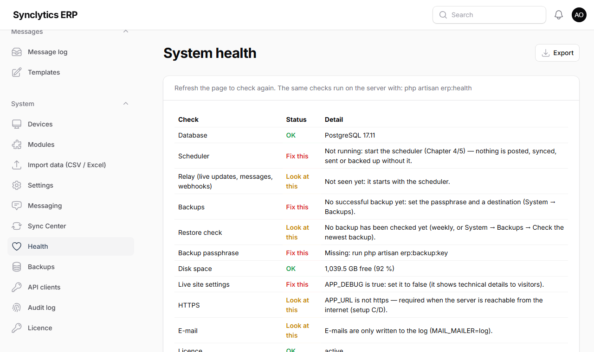

# 13. Troubleshooting

Find the symptom, then try the fixes in order.

## Installation

| Symptom | Cause and fix |
|---|---|
| `php` is not recognised | PHP is not on the path. Repeat 4.3 step 6, then **close and reopen** PowerShell. |
| `could not find driver` or `pdo_pgsql` missing | The extension is not switched on. Check `php.ini` (4.3 step 5) and that `extension_dir = "ext"`. Run `php -m` to confirm. |
| PHP does not start: *VCRUNTIME140.dll missing* | Install the Visual C++ Redistributable (4.3 step 1). |
| `SQLSTATE[08006] … password authentication failed for user "erp"` | `DB_PASSWORD` in `.env` differs from the one in 4.2/5.3. Fix `.env`, then `php artisan optimize`. |
| `SQLSTATE[08006] … Connection refused` | PostgreSQL is not running. Windows: Services → *postgresql-x64-17* → Start. Ubuntu: `sudo systemctl start postgresql`. |
| `composer install` fails with a PHP extension message | Switch on the extension it names in `php.ini` (Windows) or install `php8.4-<name>` (Ubuntu). |
| `ERP_AUDIT_KEY is missing` | Run `php artisan erp:audit-key` (only on a new installation — never replace an existing key). |
| The page shows *500 Server Error* | Look at the end of `server/storage/logs/laravel.log` for the reason. After changing `.env`, always run `php artisan optimize`. |
| Ubuntu: *Permission denied* in the log | `sudo chown -R www-data:www-data storage bootstrap/cache` |
| Uploading a CSV file does nothing, or *failed to upload* | PHP cannot write its temporary upload file. Windows: check `upload_tmp_dir` in `php.ini` points to an existing folder (4.3 step 5) and restart the server task. |
| `/pos/` says the till app is not installed | Build it: in `pos`, `npm install` then `npm run build:server` (4.7). |

## Back office

| Symptom | Cause and fix |
|---|---|
| Lost the authenticator phone | Use a **recovery code**. If those are lost too, another owner/IT Admin resets the person's two-factor sign-in. |
| A menu is missing | The module is off for your branches (Chapter 8), your licence does not include it (Chapter 6), or your role does not allow it (ask the owner). |
| *This is managed at head office* | You are on a branch server; change master data at head office (Chapter 10). |
| Everything is read-only, with a red banner | Licence expired, withdrawn or not checked in for 44 days (Chapter 6.4). Renew; nothing is lost. |
| Passkey button does nothing | Passkeys need HTTPS or `localhost`. Use the authenticator app. |
| Pages are slow | Open **System → Health**. *PHP code cache* must say *On* (if not, update with the simple way, Chapter 12.4). *Slow pages* lists what was slow, how often and how many database reads it made: send it to SyncLytics support. Run `php artisan erp:load-test --force` outside trading hours for a full speed check (it leaves nothing behind). |

## Tills

| Symptom | Cause and fix |
|---|---|
| Till shows *working offline* but the server is up | Network or Wi-Fi between till and server. Open `https://<server-address>/up` on the till's browser. On Windows servers, check the firewall rule (4.8, step 8). |
| The browser warns *Your connection is not private* | The device does not trust the server's certificate yet (4.9), or the server's address changed since installation (run the installer again, then 4.9 on each device). |
| The till does not work at all when the server is off | Offline was never enabled on that device: setups B/C/E need 9.3; then open the till once while the server is on. |
| Enrolling a till fails on a network address (`http://192.168…`) | The browser does not trust the address yet: do 9.3 on that device. |
| Cashier cannot sign in offline | They must have signed in on **this** till while it was online within the offline period (System → Settings → Offline till sign-in lasts). |
| *PIN locked* | Too many wrong PINs. A manager resets it: People & access → Users → the person → **Set POS PIN**. |
| Red banner: items refused | A supervisor opens **Sales → Review queue** (*sync failed*) to see why, fixes it, then presses **Retry refused** on the till. |
| *The price … changed. Refresh the till* | The price changed at head office while the item was in the cart. Remove the line and add it again. |
| *Open a shift on this till before selling* | Open the shift (count the float). |
| *The till clock is ahead of the server* | Set the till's clock to automatic (Windows Settings → Time). |
| Receipt is tiny or cut | Printer paper size 80 mm, margins *None*, scale 100 %, headers off (9.7). |
| Scanner types the code but nothing happens | The scanner does not send Enter (9.8). |
| Desktop till: *Could not reach …* on the set-up page, or a blank window | The server address is wrong. Use the server's name exactly as in the browser (`https://erp.clientdomain.com`), not its IP address. Correct it and click **Save** (9.7). Old app versions open the saved address with no way back: clear the settings as in 9.7, *Starting the desktop till again from scratch*. |
| Till did not pick up a new version | Close the till app completely and open it again (twice if needed). |

## Branch servers and online stores

| Symptom | Cause and fix |
|---|---|
| Sync Center: *Sync request time … off* | Server clocks differ by more than 5 minutes; set automatic time on both. |
| Changes *failed — update this node* | Update the branch server to the same version as head office (12.4). |
| A branch seems out of step | Sync Center → **Full resync from this peer**, then `php artisan erp:stock-check`. |
| Online store not updating | Is the scheduler running (4.8 / 5.9)? Is the channel **Active**? Look at the channel's failed updates and **Retry failed updates**. |
| No SMS arrive | Check the SMS gateway address in Settings and that the phone number is on the booking. Test your provider separately. |

## Products imported twice

If a product file was imported more than once with **Products — create new** before version 0.35 (when one import did both), each product may exist two or three times. On the server, in the `server` folder:

```bash
php artisan erp:merge-duplicate-products
```

This only **shows** what it would do: for each product, the copy created first is kept, and the later copies (same name, industry and unit, from a later import) are listed. Then:

```bash
php artisan erp:merge-duplicate-products --apply
```

Barcodes on the later copies move to the kept product; a later copy that was never used is removed; one that has stock, sales or orders is switched off instead (it keeps its history). Every step is in the audit log. Two different products with the same name in one file stay two products.

**Why on the server:** removing products is permanent, so it is a deliberate step by the person looking after the server, after the automatic backup the update takes.

## Health checks

**System → Health** shows the state of the server at a glance: database, scheduler, live updates, last backup and its check, disk space, live-site settings, HTTPS, e-mail, licence, PHP's code cache, slow pages, and anything stuck (messages, webhooks, GRA E-VAT, sync). Each line says what to do. Below the checks, **Slow pages** lists every page and till call that took over a second in the last 7 days, worst first.



The same checks run with `php artisan erp:health` (useful for monitoring tools: it fails when something needs fixing).

### Individual checks (run in the `server` folder)

| Command | What it checks |
|---|---|
| `php artisan about` | PHP, database and settings in use |
| `php artisan erp:audit-verify` | The audit log is complete and untouched |
| `php artisan erp:stock-check` | Stock levels match the stock ledger |
| `php artisan erp:gl-check` | The accounts agree with sales, stock, customers and suppliers (Finance) |
| `php artisan license:status` | Licence state, limits and last check-in |
| `php artisan erp:load-test --force` | Speed: posts test sales and times the heavy reports, searches and the till catalogue on your real data, then undoes everything. Lines over a second are marked *SLOW* |

## Getting help from SyncLytics

| | |
|---|---|
| **Hotline (support)** | 024 563 6889 |
| **Office** | 055 668 6975 · 050 693 8589 |
| **E-mail** | info@synclyticsenterprisesystems.com |
| **Website** | synclyticsenterprisesystems.com |
| **Address** | Puff Cl, Race Course St, Tabora, Accra (GhanaPost GPS GC-027-0884) |

The quickest way is **Report a problem** in the back office (top right) or on the till: it attaches the technical details for you.

Otherwise send: what you were doing, the exact message (a screenshot helps), the time it happened, and the last lines of `server/storage/logs/laravel.log`. **Never** send your `.env` file, passwords, PINs or recovery codes.
