# 14. Exporting and importing data, stock adjustments and stock takes

## 14.1 Exporting (downloading) anything you can see

Every list in the back office (products, customers, invoices, stock on hand, sales, audit log…) and every report page (financial reports, aged debts, shrink, commissions, timesheets, the staff calendar…) has an **Export** button at the top right:

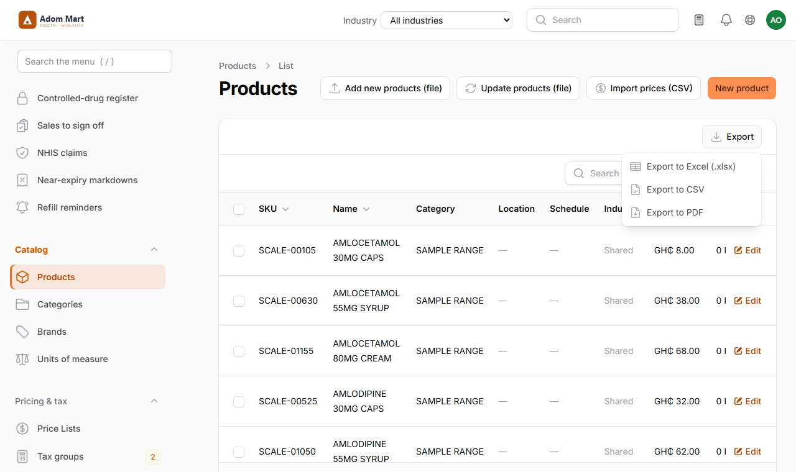

| Choice | What you get | Use it for |
|---|---|---|
| **Export to Excel (.xlsx)** | An Excel workbook (numbers stay numbers; opens in Excel, Google Sheets, LibreOffice, Numbers) | Working with the figures: sorting, totals, sending to your accountant |
| **Export to CSV** | A plain `.csv` file | Loading into another program |
| **Export to PDF** | An A4 PDF with your company name, the title, the filters in use, who printed it, the date and page numbers | Printing, filing, e-mailing |

- The file contains **what is on screen**: the same columns, search, filters and sort — but **all pages**, not only the page you are looking at. Filter first (e.g. one branch, one month), then export.
- Amounts appear as on screen (with the currency); dates in your local time.
- A PDF holds up to 5,000 rows per table. For more, use CSV.

**Why:** every export is recorded in the audit log (who, what, how many rows), because exported files leave the system. When the licence is read-only, exports are blocked like printing.

**Note:** A CSV opens in Excel by double-clicking it. Accents and the cedi sign show correctly. A cell starting with `=`, `+`, `-` or `@` that is not a number gets a leading apostrophe so that Excel never runs it as a formula — this protects you from "CSV injection".

## 14.2 Importing data from CSV files

**System → Import data (CSV / Excel)** — or the **Import … (CSV)** buttons on Products, Customers, Suppliers, Stock adjustments and stock counts.

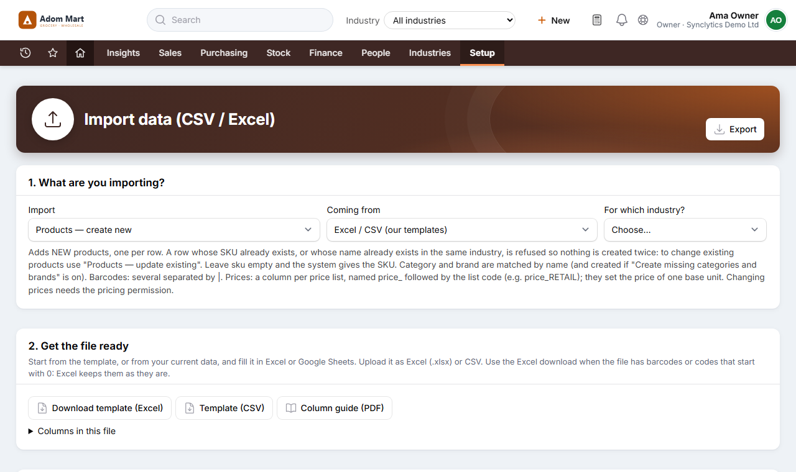

### What you can import

| Import | What a row does | Matched by |
|---|---|---|
| **Products (create and update)** | Creates a product (leave SKU empty: the system gives it one), or updates an existing one by its SKU. Prices per list in columns `price_RETAIL`, `price_WHOLESALE`… | SKU |
| **Prices (price list update)** | Sets one price (list, unit, from-quantity, optional dates for a promotion) | SKU + list + unit + quantity + dates |
| **Customers** | Creates or updates a customer, optionally with credit limit and terms | Code, else phone number |
| **Suppliers** | Creates or updates a supplier | Code |
| **Opening stock** | The go-live quantity and cost of a product in a warehouse (one row per batch, with its expiry, for batch-tracked products) | Warehouse + SKU (+ batch) |
| **Stock adjustment lines** | Increase, decrease or "set to" lines in a stock adjustment | SKU or barcode |
| **Stock count results** | Counted quantities in an open stock count | SKU or barcode (+ bin) |
| **Chart of accounts (migration)** | Adds an account from the old books (QuickBooks types accepted) | Code, else name |
| **Opening trial balance (migration)** | One line of the opening journal on the go-live date | Account code or name |
| **Customer / supplier balances owed (migration)** | What a customer owed you / you owed a supplier on the go-live date | Code, phone or name |
| **Loyalty points / gift cards (migration)** | Points and unspent cards brought over from the old system | Customer; card number |

**Reorganising the catalogue:** Catalog → Products: tick products → **Change category, brand or tax**. Catalog → Categories (or Brands): **Move products** moves all of them to another one — the way to merge two duplicates — and **Delete** removes one that nothing uses. Every product moves, however many there are, and each product's history records the move. **Why:** history stays intact; only empty lists can go.
**Missing category, brand or unit?** On the product form, click **+** next to the list to add it without leaving the page (also suppliers on purchase orders and bills, customers on orders, departments on staff).
**Changing a product's unit (e.g. Pack or Strip to Tablet):** open the product and click **Change the unit**, choose the new unit and one of:
- **Convert by pack size** — say how many of the new unit are in one of the current unit (10 tablets in a strip). Stock in every store and batch is multiplied by it, the cost per tablet is the strip cost divided by it (the stock value does not change), the tablet price starts at the strip price divided by it (change it if you like), and reorder levels follow. The strip stays as a selling unit (× 10) with its price and barcode, so you can still sell whole strips.
- **The label was wrong** — the numbers stay (30 Pieces become 30 Packs); prices, barcodes and stock stay.

Many products at once: tick them on the product list → **Change the unit** (same pack size for all), or **System → Import data → Unit changes** with one row per product (`sku`, `new_unit`, `per`, `mode`) when pack sizes differ. A product on an open document (a draft order, a transfer on the way, an open count) is refused until that is finished. **Why:** the stock history is never rewritten: the change is recorded as stock leaving in the old unit and coming back in the new one, so every figure still adds up, and past receipts and documents keep showing what they showed.

**Imported twice by mistake?** The system remembers each file: importing exactly the same file again is stopped with when and by whom it was imported. Tick **Import it again** only if you really mean to add it a second time. After an import the page empties, ready for the next file.

**How far it has got:** a long file shows a card at the bottom right — *Checking products.csv — 150 of 2,000* and about how long is left. Keep the page open until it finishes. **Why:** you can see it is working, so nobody clicks again or closes the page half-way.

**Medicines in the products file:** `drug_schedule` says what kind of medicine a product is: `otc` (over the counter), `pom` (prescription only: a pharmacist approves it at the till) or `controlled` (pharmacist approval, and it goes in the controlled-drug register). Common words also work (POM, prescription, CD, controlled); `none` means not a medicine. With it: `generic_name`, `strength`, `dosage_form`, `fda_reg_no`, `active_ingredients` (separated by `|`, for allergy and interaction warnings), `daily_use` (refill reminders) and `nhis_price` (what the NHIS pays for one base unit; `none` = not covered). *Download current data* includes them, so you can fill the column in Excel and upload it with **Products — update existing**. **Why:** the till can only ask for a pharmacist, and the register can only list controlled drugs, when the system knows which products they are.

The migration imports are explained in Chapter 17.2. **Coming from** (QuickBooks, another till system, or our templates) matches the old system's column names for you.

### Step by step

1. **Choose what you are importing.** The page explains what a row does and lists every column (**Columns in this file**), with an example.
   Products have **two separate imports**:
   - **Products — create new** adds new products only. A row whose SKU already exists, or whose name already exists in the same industry, is refused, so importing the same file twice cannot create duplicates. Tick **Allow names that already exist** only for genuinely different products with the same name.
   - **Products — update existing** changes existing products only, found by their SKU: start from **Download current data**, change what you need, and import it. Empty cells and missing columns stay as they are. It never creates a product, so importing it twice is harmless.

   **Why two:** with one import, a row without an SKU always made a new product, so re-importing a file to "update" it created a second copy of everything.
   For **products**, a company with several industries also chooses **For which industry?** (for example *Pharmacy*, or *Shared by all industries*). New products go into that industry's catalogue, and **Download current data** gives that industry's products only. Check and Import stay refused until you choose. An `industry` column in the file can name a different industry for single rows.

   **Why:** each industry's tills and screens show only its own products. A product list imported to the wrong industry would show at the wrong shops.

   **Products already in the wrong industry:** Catalog → Products, tick them (the tick at the top selects the page; *Select all* selects every product in the list), then **Move to industry**. Stock and prices stay; SKUs given by the system take the new industry's series (e.g. `100123` becomes `PHARMA-000124`), while SKUs from your old system stay as they are.
2. **Get the file ready:**
   - **Download template (Excel)** — the headings and one example row (also as **CSV**); or
   - **Download current data to edit (Excel)** — your existing products, prices, customers or suppliers in exactly the import layout (also as **CSV**). Change what you need in Excel and import it back;
   - **Column guide (PDF)** — what to put in each column, to print.
3. Fill it in Excel or Google Sheets and save it, as Excel (.xlsx) or as CSV (Excel: *File → Save As → CSV UTF-8 (Comma delimited)*).

   **Barcodes:** before typing or pasting barcodes in Excel, select the barcode column and choose *Format Cells → Text*. **Why:** otherwise Excel treats a barcode as a number. It drops the zeros in front (`0012345678905` becomes `12345678905`) and shortens long ones (`6.00107E+12`), so the scanner would no longer find the product. The Excel downloads already have codes as text. On import, zeros Excel dropped are put back when the barcode's check digit proves them, and a shortened barcode is refused with a message.
4. **Choose the file**, then **Check file (nothing is saved)**. Every row goes through exactly the same checks as the screens — then everything is undone. You see each row's result and a list of errors.

   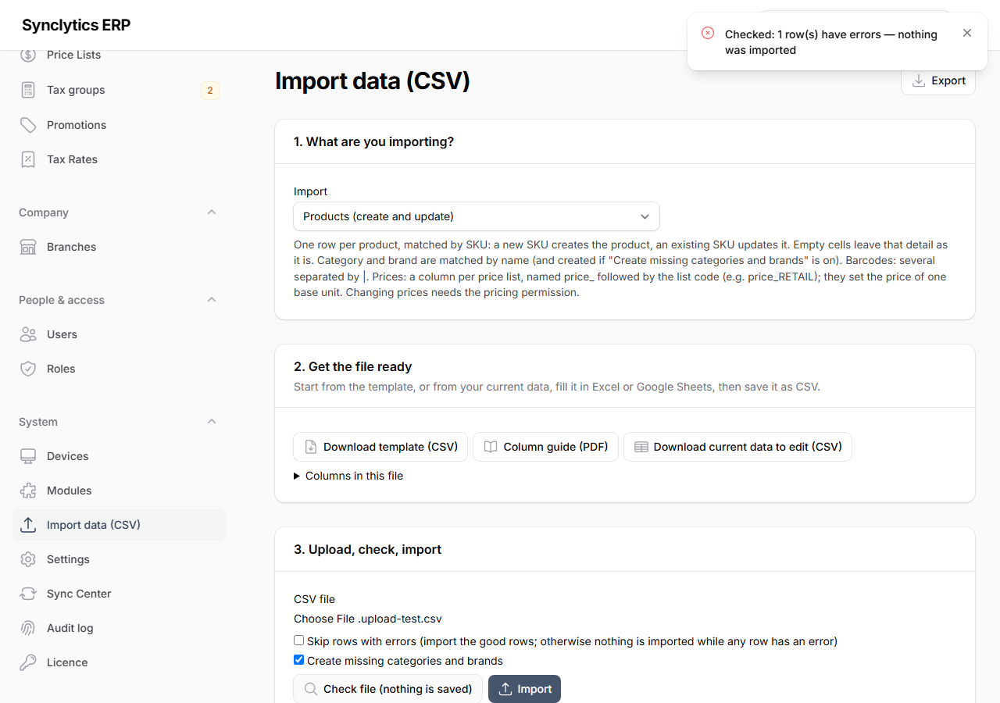

5. Fix the errors (**Download error report (CSV)** gives the failed rows with the reason in the first column), and check again.
6. **Import.** By default a file is imported **all or nothing**: if any row has an error, nothing is imported. Tick **Skip rows with errors** to import the good rows and get the others in the error report.

**Why the check first:** a mistake in a file can change hundreds of products at once. The check shows you exactly what would happen, and what would be refused, before anything changes.

### Rules worth knowing

- **Empty cells leave a detail unchanged** when updating. To change only prices, a file with just `sku` and `price_RETAIL` is enough.
- **Headings** are matched loosely: `Unit cost`, `unit_cost` and `UNIT COST*` are the same column. Columns the import does not know are listed and ignored.
- **Units** (`base_unit`, `unit`) can be the code or the name: `TAB`, `Tablet`, `Strips` and `Cont.` all work.
- **Yes/no columns** accept yes, no, y, n, true, false, 1, 0.
- **Numbers** may have thousands separators (`1,250.50`). **Dates**: `2026-10-31` or `31/10/2026`.
- **Location** (products file): where the product is kept, e.g. `Shelf B2`. It shows on the product, the stock sheet and the till's search list.
- **Barcodes and serial numbers**: several in one cell, separated by `|`. In CSV downloads a code starting with 0 appears as `="0123…"`, which is how Excel is told to keep the zeros; leave it like that.
- **Large files** (thousands of products) take a few minutes to check and import. Wait for the result; do not click again. The tills and the rest of the back office keep working meanwhile: the file goes in 50 rows at a time. *All or nothing* still holds: the whole file is checked first and imported only if no row has an error. (Opening balances and stock adjustments go in as one piece, since their rows make one document.)
- Each row is checked with **your permissions**: changing prices needs the pricing permission, credit limits need the credit permission.
- Every import is listed under **Import history** on the same page and recorded in the audit log under your name.

**Warning:** Only import customers who agreed to be on your records, and never use real customer data in a test system.

## 14.3 Stock adjustments

**Stock → Stock adjustments.** A stock adjustment changes stock outside sales and purchases — breakage, theft, expiry, samples, items found, or correcting a mistake. One adjustment covers one warehouse and has as many lines as you need.

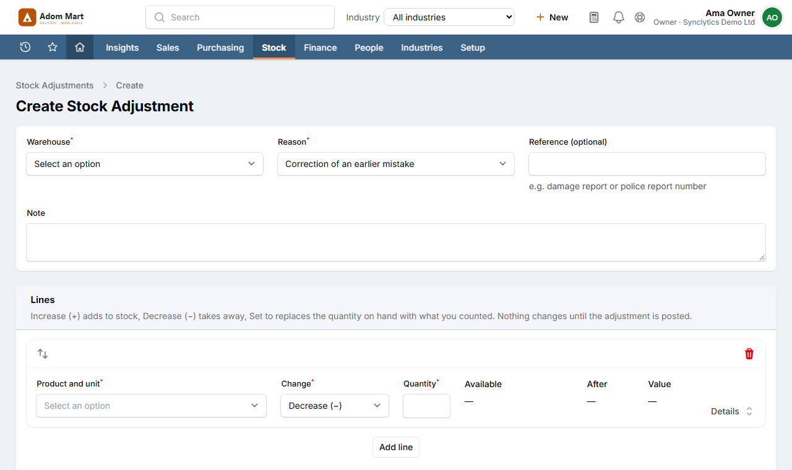

1. **New stock adjustment:** the warehouse, the **reason** (damaged, expired, theft / missing, found / surplus, own use / sample, correction…) and an optional **reference** (e.g. a damage report number).
2. **Lines** — for each product, one of:
   - **Increase (+)** — adds to stock (give the unit cost if you know it; otherwise the average cost is used);
   - **Decrease (−)** — takes away from stock;
   - **Set to counted quantity** — the new quantity on hand; the system works out the difference when you post.
   Batch-tracked products need the batch number; serial-numbered products need one serial number per unit (the box appears only for those products).
   Each line is numbered and fits on one row: the product, the change, the quantity, what the store holds now (**Available**), what it will hold (**After**, in red if it would go below zero) and the line's **Value** at average cost. The total value shows under the lines, with a note when a manager must approve it (above GHS 500 by default). The batch number, expiry date, unit cost, a different reason, a note and a **photo of the goods** are behind the **Details** drop-down at the end of the line; it opens by itself for batch-tracked products (all medicines). A warning shows when the same product (and batch) is on two lines. **Why:** you see the effect of each line before saving, and most lines need only the product and quantity.
3. Save. The adjustment is a **Draft**: you can still change it, or **Add lines from CSV**.
4. **Post** — the changes go into the stock ledger.

**Approval:** an adjustment worth more than the limit in **System → Settings → Stock** (default GHS 500 at average cost) must be **submitted for approval** and **approved and posted by a manager other than the person who prepared it**.

**Why:** stock adjustments are where stock losses are hidden. A second person checking large adjustments, a reason on every line and a permanent record of who did what are the standard controls.

The adjustment page shows each line's stock **before**, the **change** and **after**, and the value. **Export → Adjustment voucher (PDF)** prints it with a signature line for the approver.

**Note:** a posted adjustment cannot be changed or deleted. To correct it, post another adjustment. The quick **Opening stock / adjustment** button on *Stock on hand* still exists for a single product.

**Photos of damaged or expired goods:** under **Details** on a line, **Photo of the goods** (a phone photo, up to 5 MB). The adjustment shows *Photos: Line 1 · Line 3* to open them; only people who may see that store's stock can. **System → Settings → Stock → Photos on stock adjustment lines**: *Optional* (default), *Required for damaged, expired, spoiled and missing stock* (the adjustment cannot be submitted or posted without them), or *Not used*. **Why:** a photo settles questions about a write-off months later, and makes "it was damaged" harder to say without proof.

## 14.3a Barcode and shelf labels

**Catalog → Products**: tick the products → **Print labels** (or **Print labels** on one product, or on a delivery under **Purchasing → Goods received** for what came in).

1. **Label:** *Shelf label* (name and price large, barcode small) or *Barcode sticker* (barcode large, name and price small).
2. **Print on:** an A4 label sheet — 24 (3 × 8, e.g. Avery L7159), 21 (3 × 7, L7160) or 65 small (5 × 13, L7651) — on any office printer, or a **label printer** (50 × 25, 38 × 25 or 58 × 40 mm; Zebra, Xprinter and similar, installed as a printer on the computer).
3. **Prices from** the price list, **labels per product**, and on a used A4 sheet **leave empty at the start** the labels already peeled off.
4. **Give products without a barcode an in-store barcode first** (people who may edit products): an EAN-13 starting with *20* (System → Settings → Stock → *In-store barcodes start with*), added to the product so the tills scan it.
5. **Labels ready → Open the labels**: a page with the labels; **Print**. In the print window set **Margins: none** and **Scale: 100%**, and choose the label printer when using one.

**Tip:** print one sheet on plain paper first and hold it against a label sheet to check the alignment.

**Why:** products with a clear price and a barcode that scans sell faster and with fewer mistakes at the till; items that came without a barcode no longer need typing.

## 14.4 Stock takes (counting stock)

There are two ways to bring the system in line with what is on the shelves.

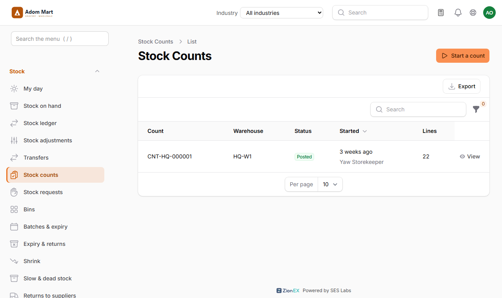

### A. A stock count (recommended for full or regular counts)

1. **Stock → Stock counts → Start a count** for a warehouse (or one bin). The system freezes what it expects at that moment. Leave **blind** on so counters do not see the expected figure.
2. Open the count and use **Count sheet**:
   - **PDF** to count on paper (SKU, barcode, product, unit, bin, and an empty *Counted* column; signature lines for the counter and the checker);
   - **CSV** to fill in Excel or on a tablet.
3. Enter the counts: scan with a handheld (Chapter 9), type them on the count page, or fill the CSV's `counted_qty` column and use **Import counted quantities (CSV)**. Rows left empty are **not counted** (not set to zero).
4. **Submit**, then a manager **approves and posts**. The differences become stock movements, with their value.

### B. Update stock from a stock sheet (quick corrections)

1. **Stock → Stock on hand → Stock sheet (before a count)**: choose the warehouse and category, whether to show the system quantities (leave them out for a blind count), and PDF or CSV. This is the **current stock standing**.
2. Or, to update stock with a file: **Stock → Stock adjustments → Update stock from a CSV file**, choose the warehouse and reason, and **Stock sheet — current stock standing (CSV)**. Its `qty` column holds the system quantity; type the **new** quantity where it differs.
   - **Batches and expiry dates:** a product tracked by batch (most medicines) has **one row per batch**, with its `batch_no`, `expires_on` and quantity. Type the batch's new quantity; **add a row** (copy one and change `batch_no`, `expires_on`, `qty`) for a batch found that the system does not know; change `expires_on` to **correct a wrongly typed expiry date**. A new batch needs its expiry date.
   - The `location` (where the product is kept) and `bins` columns are for information: change a location on the product (or the products file), and move stock between bins on the Bins screen.
3. Import it. Rows whose quantity did not change are skipped; the others become **Set to** lines in a new draft adjustment (for a batch: an increase or decrease of the difference, worked out when you import). A corrected expiry date applies at once and is in the audit log.
4. Open the adjustment, check it, and post it (with approval above the limit).

**Why two ways:** a stock count freezes the expected figures and compares them (best for full counts while trading continues); the stock sheet route is quicker for a few corrections.

**Tip:** count when the shop is closed, or count one area (bin or category) at a time. Sales during a count are still recorded normally.

### C. Cycle counting (a few products every day)

**Stock → My day** lists, for each store, the products to count today and **Start today's count** turns them into a blind stock count (way A). How many a day: **System → Settings → Stock → Cycle count: products per store per day** (default 20; 0 = off).

- The system ranks products by the value that left the store in the last 90 days: the top 80% (A) are counted every 30 days, the next 15% (B) every 60, the rest (C) every 120. Products never counted come first.
- A product with a difference in two of its last three counts is **often wrong** and is counted twice as often.

**Why:** in a busy pharmacy a full stock-take means closing; a few products a day catches mistakes (and theft) within weeks, and the products that matter most are checked most.

**My day** also shows the store's low stock, expired and expiring batches, negative stock, products never counted, adjustments waiting for a manager, and transfers and orders on the way — each opens the page where it is dealt with.

### D. Losses, slow stock and checks

- **Stock → Shrink:** stock lost (damaged, expired, spoiled, stolen, count shortages) at cost for a period and store — by reason, by product, the **last six months** month by month, **by category**, **recorded by** whom, and products **lost again and again** (three times or more).
- **Stock → Slow & dead stock:** what has not sold in a store for 60, 90 or 180 days (or, if never sold, since it came in), with its value at cost. For each product a suggestion: **Move** it to the store where it sells (a draft transfer in one click, to check and dispatch), ask the supplier to take it back where they do (Expiry & returns), or mark it down.
- **Stock → My day → Checks:** losses in the last 30 days **larger than usual** for that store (three times the usual loss line and at least GHS 100), products **written off three times or more**, and **possible duplicate products** (same name). These point at what deserves a second look; they are not a verdict.

**Why:** most stock losses are small and repeated; seeing them by month, by product and by person shows where to look, and stock that does not sell ties up money that could buy what does.

## 14.5 Minimum stock and reordering

Every product that keeps stock has a **minimum** in each store. When stock (plus what is already on order or on its way) falls to it, **Purchasing → What to order** suggests topping it up to the **maximum** and turns the suggestions into draft purchase orders, one per supplier.

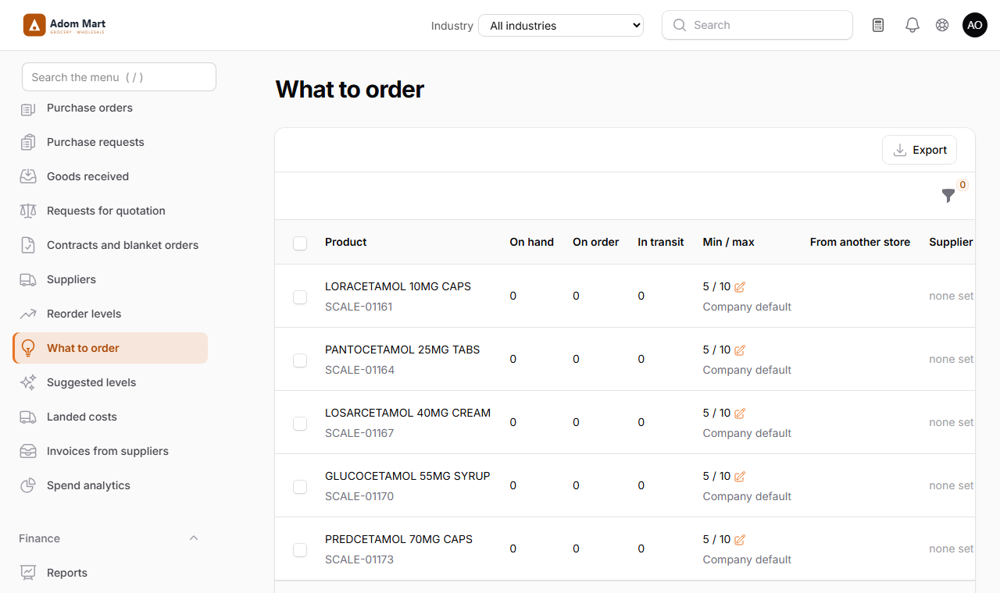

**Why:** running out of a medicine loses the sale and the patient; a minimum on every product means nothing is forgotten, without anyone having to type 2,000 figures.

- **The default** (System → Settings → Stock → *Default minimum stock*, 5): 5 of the unit the product is **bought** in — for example 5 packs of 100 tablets — and orders up to twice that (10 packs). New and existing products all get it. 0 switches it off.
- **Your own figure:** **Purchasing → Reorder levels → Own figure for a product**: choose the store (or every store), the product, the unit and the minimum and maximum. It replaces the default in that store. **Use the default** on the row goes back. Many at once: the products file (Catalog → Products → Update products) has `min_qty` and `max_qty` columns, in the buying unit; type `default` to go back.
- **Smart levels from sales** (Settings → Stock → *Smart reorder levels*): every Monday the system works out each product's minimum and maximum per store from the last 12 weeks of sales, the supplier's delivery time and a safety margin. With **Suggest** (the default) they wait on **Purchasing → Suggested levels**: tick the ones you agree with and click **Accept**. With **Update automatically** they are applied by themselves — but a figure you typed is never changed.
- **Slow movers** (setting, off by default): products that have not sold in a store for 180 days get no default minimum there, so dead stock is not reordered.
- **Low stock:** the dashboard shows how many products are at or below their minimum (click it to open What to order); buyers get a notification each morning; and with *Show stock left on the till* on, the till marks such items **Low** in amber.

**Changing a line before ordering:** on *What to order*, every value you can change has a **pencil** beside it — click the value. **Supplier** (the product's own suppliers come first, with their last price; the unit follows the supplier), **Order** (unit and quantity) and **Cost** (when the supplier has no price yet) change that line until the orders are made; **Min / max** (if you may set reorder levels) saves the product's levels for that store at once. The product then says *changed by you*; **Undo my changes**, in any of those small windows, puts the line back. **Why:** you change exactly the value you are looking at, without scrolling to a button at the end of the row. **Move before buying:** when another store of the business has more of an item than its own maximum, What to order shows it in **From another store** (e.g. *36 PC from Branch A*) and orders only the rest (the **Order** column then says *nothing — moved instead* when the move covers it all). Tick those lines and **Ask other stores to send**: each store with stock to spare gets one stock request, which it sends as an ordinary transfer. Stores of a different industry are not suggested (their requests need two approvals). Switch it off under System → Settings → Stock → *Suggest moves between stores before buying*. **Why:** stock sitting above one store's maximum is money already spent; moving it costs nothing. Long lists show 25 lines a page (choose 50 or 100 at the bottom); lines you ticked stay ticked when you move to another page, and **Create draft purchase orders** includes them all. Filter by **Supplier** to order one supplier at a time (or *No supplier set up* to find what still needs one). Tick the lines and **Create draft purchase orders**.

**Why:** the suggestion is a starting point. A cheaper supplier this week, a bigger pack or a slow month are things only the buyer knows.

**Tip:** set the supplier's *delivery lead time* (Purchasing → Suppliers) and their unit and cost on the supplier's products list — smart levels and what-to-order use them.

### Buying in packs, selling in units

Medicines are bought by the box (or carton) and sold by the tablet or strip. Stock is always kept in the **base unit** (e.g. TAB); each pack says how many base units it holds.

1. **The product** (Catalog → Products): under **Barcodes and units**, add each pack: *Strip* × 10, *Box* × 100, *Carton* × 1200, with its barcode. Mark each **Sold**, **Bought** or both (a carton only *Bought*; a tablet only *Sold*). **Usually bought in:** *Box*. **Why:** purchase orders then offer the box first, and never the tablet.
2. **The supplier** (Purchasing → Suppliers → Products supplied): their **pack** (one supplier may sell a box of 100, another a box of 50: add each supplier's own pack), their code, the **cost per pack**, the **minimum order** and **in multiples of** (e.g. 5 boxes at a time; 0 = any). **Why:** the order says exactly what the supplier sells, and the cost is per pack, as on their invoice.
3. **Purchase orders** offer only units that are bought, the usual one first, each with what it holds: *PARA500 · Paracetamol 500 mg — BOX × 100 (= 100 TAB) · usual buying unit*. Under the quantity: *Supplier sells at least 5, in multiples of 5*. An order below the minimum or off the multiple is refused, with the next right quantity (e.g. *in multiples of 5 BOX (e.g. 10)*).
4. **What to order** suggests whole packs, at least the minimum, rounded up to the supplier's multiple (e.g. 300 tablets needed, boxes of 24, multiples of 5 → 15 boxes).
5. **Receiving** is in the ordered pack (*Received now: 15 BOX*); stock goes up by 1 500 TAB. For medicines with batches, **Scan the pack code**: the square GS1 code on the box fills in the **batch number and expiry** (check them against the box). **Why:** no typing, and no expiry dates typed wrongly.

## 14.5a Suppliers: approval, documents, bank checks and scorecards

**Why:** buying only from suppliers you have checked keeps fake medicines and unlicensed sellers out, and a second person
checking bank details stops the commonest supplier fraud (a message asking you to pay into a "new account").

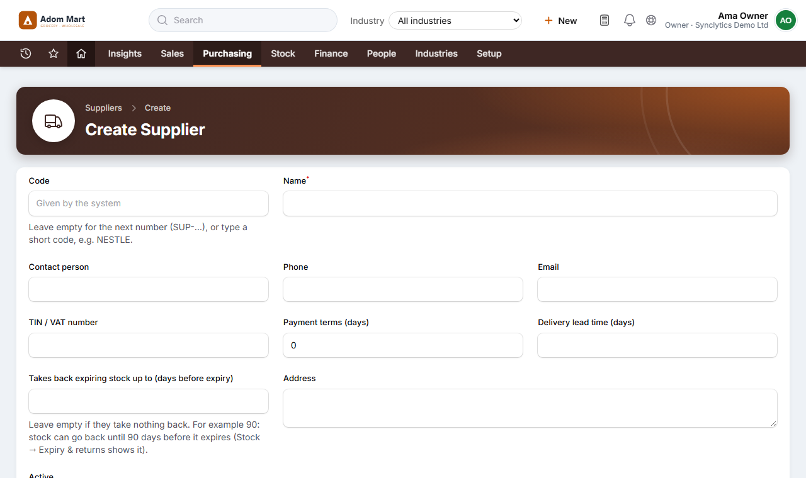

**Supplier controls** (System → Settings → Purchasing → *Supplier controls: approval, documents and bank checks*) are
**off** until you switch them on, so a one-person business can keep ordering straight away. Switch them on once two or
more people buy and pay. Suppliers you already had stay approved.

With the controls on:
1. **Adding a supplier** (Purchasing → Suppliers → New): fill in the TIN, what they supply (goods, services or works —
   it sets withholding tax later) and how they are paid. The supplier shows *Waiting for approval*.
2. **Documents** (open the supplier → *Documents* → *Add a document*): a scan or photo and its expiry date. Which ones
   every supplier needs is set under *Documents every supplier must have on file* (default: TIN certificate and business
   registration; a pharmacy adds `fda_licence` and `pharmacy_council`). Someone else presses *Checked against the
   original*.
3. **Approve**: someone with *Approve suppliers* (General Manager, Finance Manager) — never the person who added it —
   presses **Approve** on the supplier list. Only then can purchase orders go to it.
4. **Expiry:** the buyers get a notice on the bell before a document expires (30 days by default) and when it has
   expired. A supplier whose required document has expired gets no orders until a new one is added.
5. **Bank details:** a new or changed account or MoMo number shows *Not yet* checked. Someone else calls the supplier
   **on a number you already had** (never one from the message announcing the change), then presses **Verify bank
   details**. Until then no transfer or MoMo payment can be recorded to that supplier.

**Block** a supplier (with the reason buyers will see) to stop new orders, whatever the setting; **Unblock** when settled.

**Scorecard** (on the supplier list: the *Score* column and the *Scorecard* button): worked out from the last 12 months,
nobody types a rating — on time (40 %), fill rate (30 %), goods sent back for faults (20 %; expiry returns are not the
supplier's fault and are left out), and price changes on bills (10 %), with the average lead time. **A** from 85, **B**
from 70, **C** from 50, else **D**. **Why:** it shows which supplier to order from first, and gives you facts when you
negotiate.

## 14.5b Landed costs: freight, duty and clearing on what you buy

**Why:** a carton bought for GHS 240 that cost GHS 48 to bring to the shop really cost GHS 288. Without spreading the
freight, your stock looks cheaper than it is and your margins look better than they are.

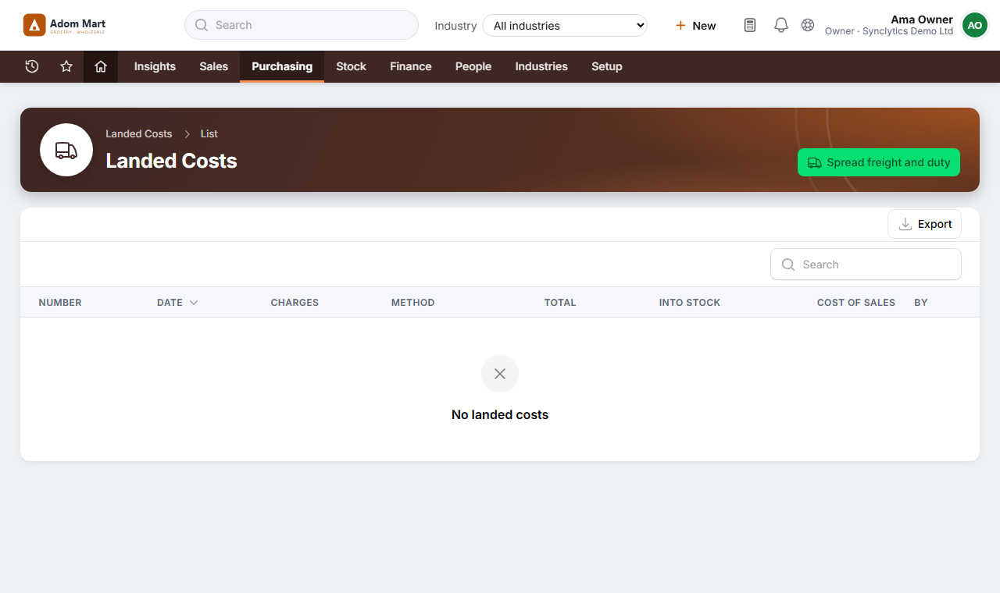

1. **Enter the charge as a supplier bill** (the transport company, the clearing agent or customs): an expense line to
   the account **Freight, duty and clearing to spread** (1360). It waits there.
2. **Purchasing → Landed costs → Spread freight and duty:** choose the deliveries (goods received) it belongs to, how to
   spread it — **by value** (usual: a dearer item carries more) or **by quantity** (bulky goods of similar size) — and
   the charges (kind, description, amount before VAT). **Post.**
3. What it does, to the pesewa: each delivery line gets its share. The part for goods **still in the warehouse** raises
   their cost (the average cost per piece goes up); the part for goods **already sold** goes to cost of sales, since
   it is too late to put it in stock. The books move the total out of *to spread*, which comes back to zero.
4. **Per product** on a landed cost shows each product's share and its cost per unit before and after.
5. **Finance → Reports → Ledger check:** *Stock at cost* includes the part that went into stock, so it still agrees with the stock account. That is why the figure can be higher than the deliveries alone add up to.

A posted landed cost is never edited. A mistake is corrected with another one with a **negative** amount.

## 14.5c Requests for quotation: asking several suppliers for prices

**Why:** asking three suppliers for the same list, and comparing their answers fairly, usually saves more than any
discount you could ask one supplier for. Quotes are **sealed**: nobody in the company sees a price before the closing
time. That way no supplier can be told what to beat.

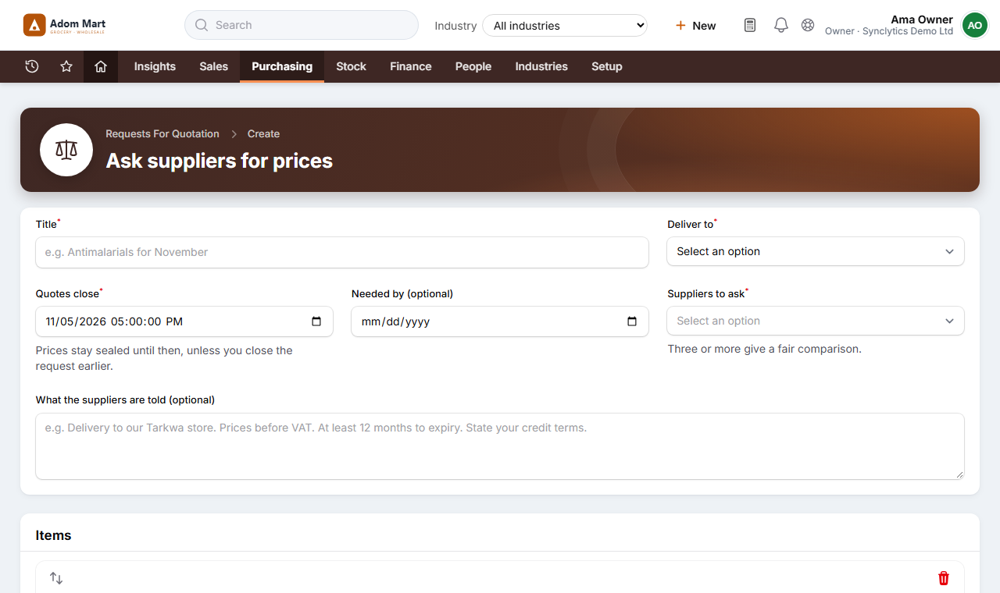

1. **Purchasing → Requests for quotation → Ask for quotes.** Give a title, the store to deliver to, the closing time,
   the suppliers to ask (three or more is fairest), what you want to tell them (delivery place, minimum expiry, payment
   terms) and the items with quantities. You can also open a **purchase request** and press **Ask for quotes**. The
   request then shows *Asking suppliers for prices*.
2. **Send to a supplier** (on the request): by e-mail, by WhatsApp from this computer, or by WhatsApp sent by the
   system. Each supplier gets **their own link**, with no password. *Supplier links* shows every link, so you can send
   them another way. *Seen* tells you when a supplier opened it.
3. On their link the supplier enters, for each item, a **price before VAT** and how much they can supply. They also
   give their delivery time, credit days and how long the prices hold. They can change their offer until the closing
   time, or decline. If a supplier answers on paper or by phone, enter it with **Enter a quote**. It shows *Entered by*
   your name.
4. At the closing time the prices open. You can open them earlier with **Close and compare**. Suppliers can then no
   longer change anything, and the early opening is recorded. The **Comparison** shows each item's price from each
   supplier, with ★ for the cheapest. It also gives a **score out of 100** for each supplier:
   - price: 50 points;
   - delivery time: 20 points;
   - credit days: 10 points;
   - past performance: 20 points, from the supplier's scorecard (a new supplier gets half).
5. **Award:** choose who supplies each item. It may be one supplier for everything, or different suppliers for
   different items. Choose *Do not buy now* to leave an item out. If an item does not go to the cheapest price, or a
   supplier's prices have expired, **write the reason**: it stays on the record. Each supplier chosen gets a **draft
   purchase order** at their prices, expected after their delivery time. The order then goes for approval as usual.

**Cancel** gives a purchase request back to the buyers. Suppliers who did not win see "not awarded this time" on
their link.

## 14.5d The supplier portal: suppliers confirm orders, send invoices and see payments

**Why:** it saves phone calls. The supplier tells you the delivery date before the day and warns the store when goods
are on the way. Invoices arrive as files instead of paper that gets lost, and suppliers stop calling to ask whether
they have been paid.

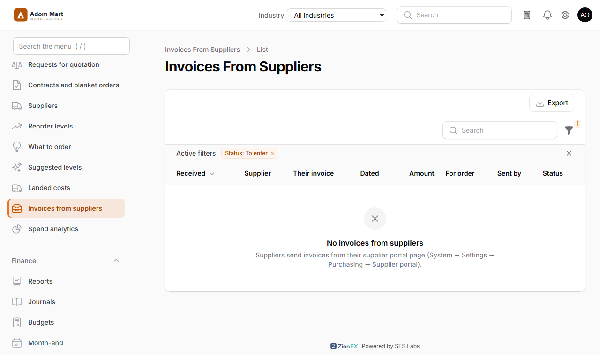

The portal is **off** until you switch it on: **System → Settings → Purchasing → Supplier portal**.

1. **Purchasing → Suppliers → Portal link** on the supplier. Send it by e-mail or WhatsApp, or choose *just show me the
   link*. The link is the supplier's own page, with no password. Send it **only to the supplier's own e-mail or
   number**. Tick *Make a new link* if it reached the wrong person: the old link stops working at once. A blocked
   supplier's link stops working too.
2. **What the supplier sees and does on their page:**
   - **Requests for quotation:** your open requests to them, with a link to quote.
   - **Orders:** your approved orders from the last six months, each with a PDF.
     - **Confirm the order** with the date they will deliver. The buyers get a notice, and the order shows *Supplier
       confirmed*.
     - **Goods on the way:** their delivery note or waybill number. The store gets a notice to expect the goods, and
       the order shows *On the way*.
   - **Their account with you:** what you owe them, bill by bill, and payments from the last 12 months. Each payment
     shows the tax kept back and a link to its **withholding tax certificate**.
   - **Send an invoice:** the invoice number, date, total with VAT, the order it is for, and the PDF or photo. The same
     invoice number cannot be sent twice.
3. **Purchasing → Invoices from suppliers** (for accounts) lists what came in. **Open the invoice**, enter it under
   **Finance → Supplier bills** as usual (matched to the goods received), then press **Mark entered** and choose the
   bill. If something is wrong, press **Turn back** with the reason, for example "prices differ from the order". The
   supplier sees the reason on their page.

Everything a supplier does on the portal is recorded under their name: for example, *Kofi (Kofi Wholesale, supplier
portal)*.

## 14.5e Buying services and non-stock items, with departments

**Why:** a business also buys things it does not sell: repairs, servicing, cleaning, stationery and equipment. Ordering
them the same way as stock means someone approves the spending first, and the bill is checked against what was really
delivered. The **department** (cost centre) shows who spent the money.

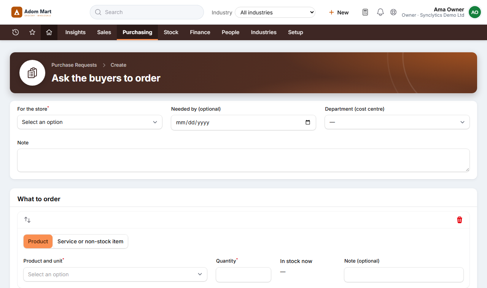

1. On a **purchase request** or **purchase order** line, choose **Service or non-stock item** instead of *Product*.
   Then describe it (e.g. *Servicing of the generator*), choose the **kind of spending** (the expense account, e.g.
   repairs), the unit (JOB, HOUR, MONTH…) and, if you want, the **department**. On a request, give an **estimated
   price**. It is used for the budget check, and the buyer later puts in the real price.
2. The order is submitted and approved as usual.
3. When the work is done or the items are handed over, press **Confirm delivered** on the order. Nothing goes into
   stock, and goods received and the handheld do not show these lines.
4. **Finance → Supplier bills → Services and non-stock items on orders:** bill what was confirmed. You cannot bill more
   than was confirmed, and the price is checked against the order like stock. The cost goes to the order line's
   account and department in the books. *Other charges* can also carry a department.

**Departments** are the ones under HR → Departments.

## 14.5f Budget check before buying

**Why:** the budget you set under Finance → Budgets is only useful if people see it *before* they spend.

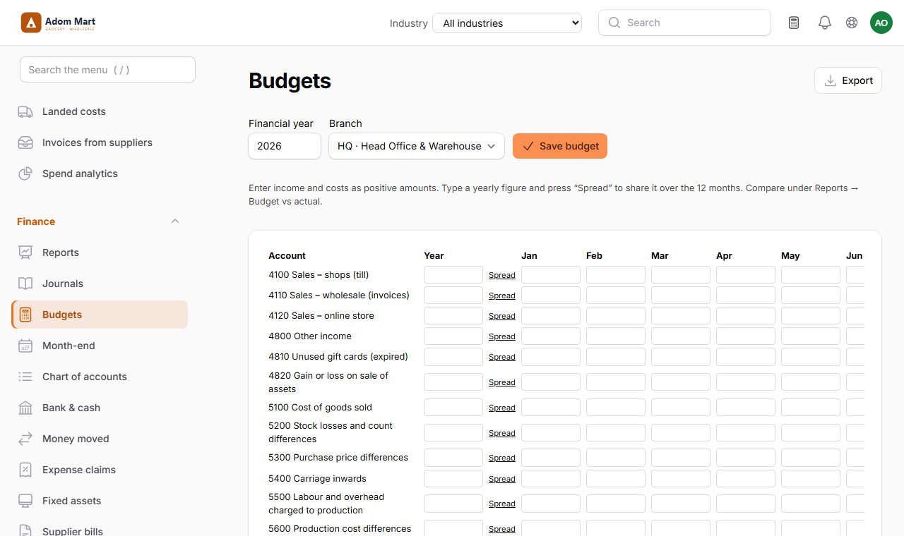

**System → Settings → Purchasing → Budget check on service and non-stock buying.** It is **off** until you choose:
- **Warn and record:** a request shows a **Budget** box: the year's budget for the branch and kind of spending, what is
  already spent, what is already ordered and not yet billed, this request, and what is left. An order that goes over
  is marked **Over budget** when it is submitted, with the figures, and this is recorded.
- **Over budget needs a second approval:** the same, and an order over budget is approved only by someone with
  **Approve orders over budget** (General Manager, Finance Manager).

Only service and non-stock lines are checked; stock is not spending until it is sold. A kind of spending with no
budget counts as over, so set budgets first.

## 14.5g Contracts and blanket orders

**Why:** prices agreed for the year are only worth having if every order uses them. A blanket order also stops buyers
ordering more than was agreed.

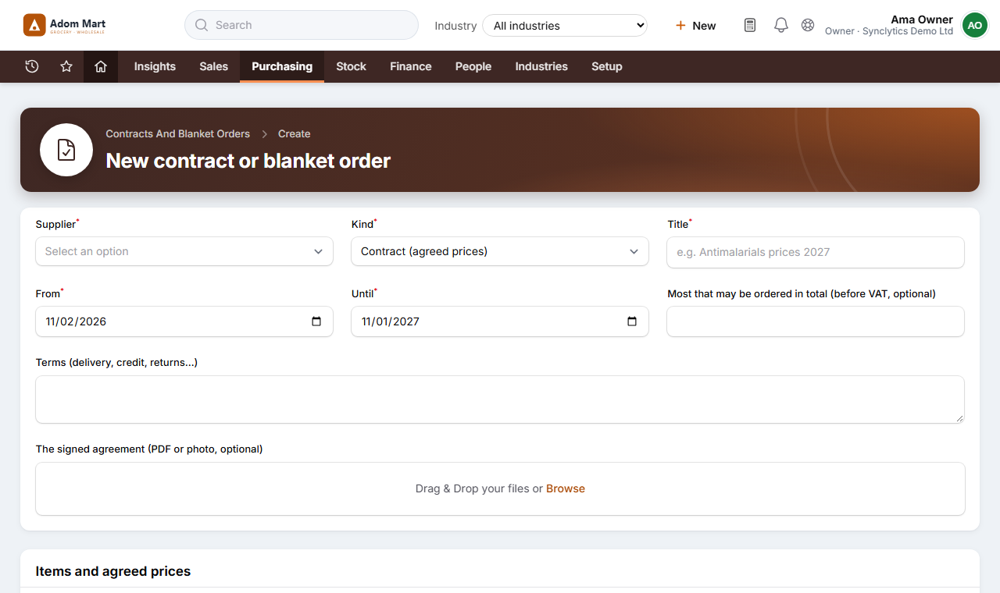

1. **Purchasing → Contracts and blanket orders → New agreement:**
   - the supplier;
   - **Contract** (agreed prices) or **Blanket order** (agreed prices plus how much may be ordered);
   - the dates;
   - optionally, the most that may be ordered in total;
   - the terms, and a scan of the signed agreement;
   - each item (a product, or a service) with its **agreed price before VAT**. On a blanket order, add the most of
     each item that may be ordered.
2. **Put in force:** someone with *Approve purchase orders*, other than the person who made it.
3. From then until its end date:
   - an order to that supplier with no price typed **takes the agreed price**;
   - a higher price is **refused** (a lower one is fine);
   - each order counts against the limits, and an order that would pass them is refused with what is left.
4. **Order against it** (on the agreement): enter the quantities now. A draft purchase order is made at the agreed
   prices, and you submit it as usual. The agreement shows **Ordered so far** and what is **Left** of each item.
5. The buyers get a notice on the bell before it ends (30 days by default: the same setting as supplier documents) and
   when it has ended. **Close** it when it is finished.

## 14.5h Spend analytics

**Why:** knowing where the money goes is the first step to spending less. It shows which suppliers to negotiate with,
which categories cost most, and whether people buy without approval.

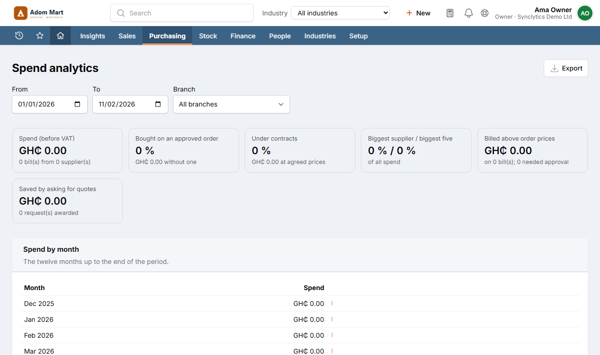

**Purchasing → Spend analytics** (for people who see supplier bills or approve orders). Choose the dates and, if you
want, a branch. It counts posted supplier bills before VAT, by bill date:
- **Spend**, the number of bills and the number of suppliers.
- **Bought on an approved order**, in %. Spend without an order skipped approval. Rent and utilities usually have none.
  Goods received without an order are worth asking about.
- **Under contracts**, in %: the spend at agreed prices (14.5g).
- **Biggest supplier / biggest five**, as a share of spend. One supplier taking most of it is a risk if they let you
  down; many tiny ones waste effort.
- **Billed above order prices**, and how many bills needed approval for it.
- **Saved by asking for quotes**: for each item awarded on a request for quotation (14.5c), the average of the other
  prices quoted minus the price chosen. Also how many quotes each request got, and how many suppliers answered.
- Tables **by month** (the last twelve), **by supplier**, **by category** (the product's category for goods, the
  account for services and charges), **how it was bought**, and **services and charges by department**.

**Export** gives every table as Excel, CSV or PDF.

## 14.6 Purchase orders from a file, ordering again and sending to the supplier

**From a file:** **Purchasing → Purchase orders → Order from a file**.

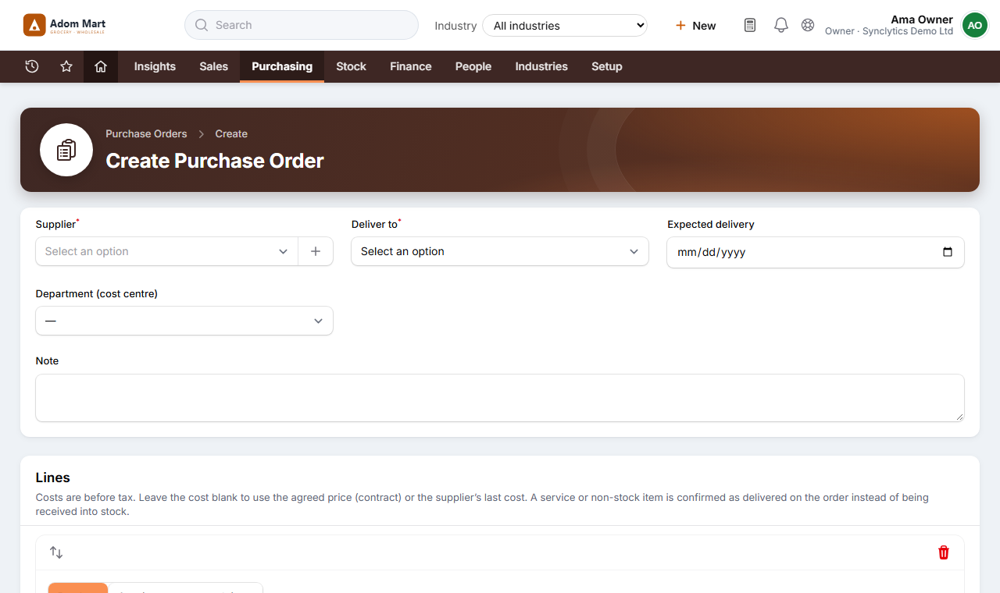

1. Choose **An Excel or CSV list** or **A supplier's pro-forma invoice** (a photo or PDF, read by the AI — it must be switched on under System → Settings → AI).
2. Choose the supplier (for a pro-forma you may leave it empty: the system finds it from the paper) and the store to deliver to, then the file.
3. The system makes a **draft** purchase order and opens it. Check every line and cost, change what is needed, and **Submit for approval** as usual.

The list needs a heading row with a product column — **SKU** (or the supplier's code), **Barcode** or **Product** name — and **Qty**; **Unit** and **Cost** are optional (without a cost, the supplier's last price is used). Lines that match no product, have no quantity or have no cost at all are **left out and listed** on screen, never guessed.

**Why:** suppliers send their price list or pro-forma; typing 80 lines again wastes an hour and invites mistakes.

**Ordering again:** on any purchase order that is not a draft, **Order again** makes a new draft with the same supplier, store and lines, at the supplier's latest prices.

**Sending to the supplier:** once an order is **approved**, **Send to supplier** sends it:
- **E-mail** — with the order attached as a PDF (needs the e-mail settings, 16.1);
- **WhatsApp from this computer** — WhatsApp opens with the message and a link to download the order; you press send. Works without any WhatsApp provider;
- **WhatsApp (sent by the system)** — only when a WhatsApp Business provider is set up (16.3).

The order then shows **Sent to supplier** with when, how and to whom; **Send again** sends it once more. The download link works for 30 days, only for that order. The wording is under **Messages → Templates → Purchase order sent to a supplier**.

**Why:** the supplier gets a clean, numbered order straight away, and everyone can see that it went and how.

## 14.7 Expired and near-expiry stock: disposals and returns to suppliers

**Stock → Expiry & returns** lists every batch in stock that has expired or expires soon, earliest first. For each batch it shows the days left (red once expired, amber under 30 days), the quantity, its value at cost, the store, the supplier it came from and whether that supplier still takes it back. Controlled drugs are marked.

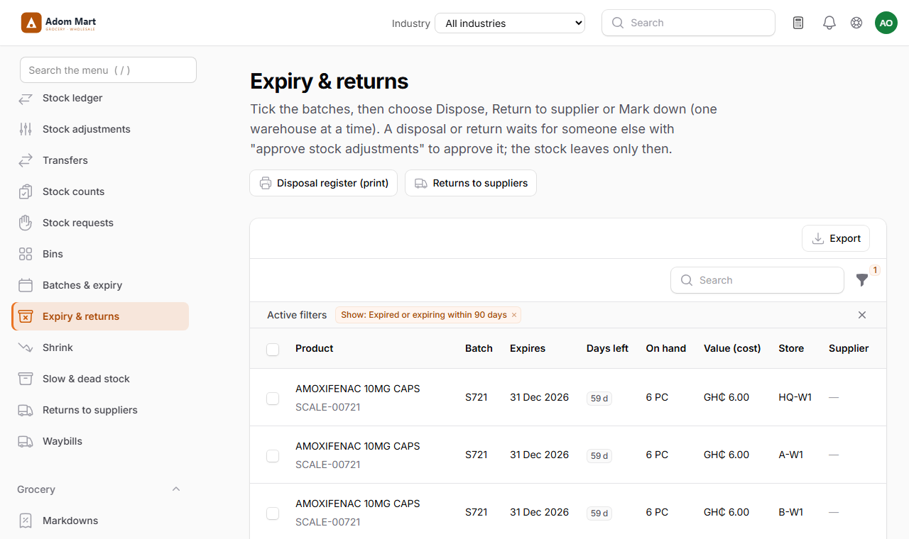

**Why:** expired medicines must leave the shelf and be destroyed (or returned) with a record. Doing it batch by batch from a list stops anything being missed, and the record satisfies an FDA inspection.

1. Use **Show** to choose what to list: *Expired*, *Expiring within 30 days*, *within the warning period* (default 90 days, **System → Settings → Stock**) or every batch. Filter by store, supplier, **controlled drugs only** or **only what the supplier still takes back**. Search by product, SKU or batch.
2. **Tick** the batches (or tick the box at the top for all of them). Tick one store at a time.
3. Choose what to do:
   - **Dispose** — for stock that will be destroyed. Give the reason (expired or damaged), how it is disposed of (incineration, destroyed under FDA supervision, an approved waste company…), the date and the **witness** (name and role). If your company asks for it, attach the **disposal certificate** (photo or PDF).
   - **Return to supplier** — choose the supplier (filled in when the system knows it), what the supplier gives (**credit note**, **replacement stock**, **cash / MoMo / bank refund** or **nothing**) and the reason.
   - **Mark down** — for stock that can still be sold at a lower price (needs the markdown permission). Print the stickers from **Stock → Batches & expiry**.
4. The disposal or return is **prepared** and waits for approval. Keep the packs aside, marked "not for sale". Everyone allowed to approve is told.
5. **Someone else** with *approve stock adjustments* opens it and clicks **Approve and post** (disposal, in **Stock → Stock adjustments**) or **Approve and send** (return, in **Stock → Returns to suppliers**). Only then does the stock leave the system. Nobody can approve what they prepared, whatever the value.

**Why two people, always:** expired stock is an easy place to hide theft ("it expired" when it was sold privately). A second person checking every disposal and return, whatever its value, is the standard control for pharmacies.

**Evidence (System → Settings → Stock → Evidence kept when stock is disposed of):**

| Setting | The person preparing must give |
|---|---|
| Reason only | the reason |
| Method and witness (default) | the reason, the method and a witness |
| Method, witness and certificate | the above and an uploaded certificate |

Controlled drugs always need a witness, whatever the setting.

**Printing:** each disposal has **Disposal record (print)** with signature lines for the pharmacist, the witness and the approver; each return has a **Return note (print)** for the supplier's representative to sign. **Disposal register (print)** on *Expiry & returns* lists every approved disposal for a store and period — keep it in the premises file.

**After a return is sent:** when the supplier settles, open the return and click **Record the supplier's settlement**: their credit note number, the delivery note of the replacement stock (receive the replacement as a normal delivery) or, for a refund, the amount and where the money went (refunds need the *pay suppliers* permission). A refund smaller than the value at cost books the difference as a stock loss.

**What happens in the accounts (automatic):** a disposal is a stock loss at average cost. A return moves the stock to *Goods returned to suppliers (awaiting credit)*; a credit note or replacement reduces what you owe the supplier; *nothing* is a stock loss; a refund clears it when the money is recorded.

**Each supplier's return window:** on the supplier (**Purchasing → Suppliers**), **Takes back expiring stock up to (days before expiry)** — for example 90 if they accept stock until 90 days before it expires. Leave it empty if they take nothing back. *Expiry & returns* then shows "can still go back" while there is time.

**Correcting an expiry date, adding or moving a batch** (**Stock → Batches & expiry**, choose the store):
- **Correct expiry** on a batch (in *All batches on hand* or *Expired*): type the right date and why. The stock stays in the batch; the change and the reason are in the audit log. Use it for a date typed wrongly at receiving, or one that is missing.
- **Add or move a batch** (top right):
  - *Stock of a batch the system does not have* — found on the shelf, or never entered: the product, batch number, expiry and quantity (and the cost if you know it);
  - *Stock recorded under the wrong batch number*: choose the batch it is wrongly under, then type the right batch number, its expiry and the quantity to move.

  Either way a **draft stock adjustment** opens: check it and post it as usual (a manager approves it above the limit).

**Why a wrong batch number is moved, not renamed:** the batch number is how every server and every delivery recognises the batch. Moving the stock keeps the history true and lets the next delivery of that batch join it.

**Many at once:** the stock sheet import (14.2) also corrects dates and adds batches.

**Stop selling before expiry:** **System → Settings → Stock → Stop selling a batch this many days before it expires** (default 0 = sell until the expiry date). With 30, the till takes the next batch, or refuses the sale if only stock with less than 30 days is left. Expired stock is never sold.

**The dashboard** (Pharmacy) shows how many batches have expired and how many expire within the warning period; click either to open *Expiry & returns*.
