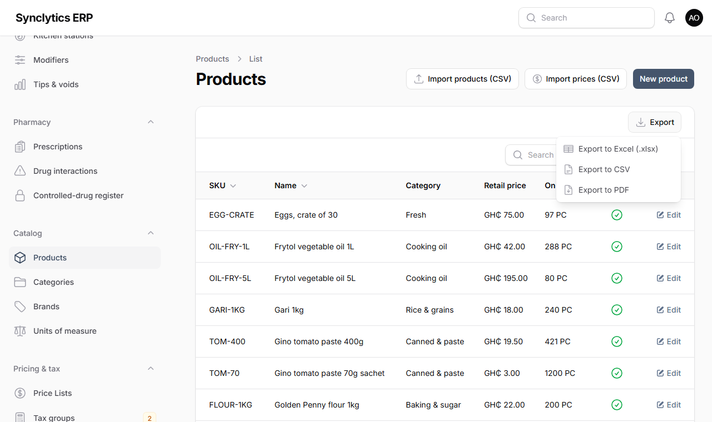
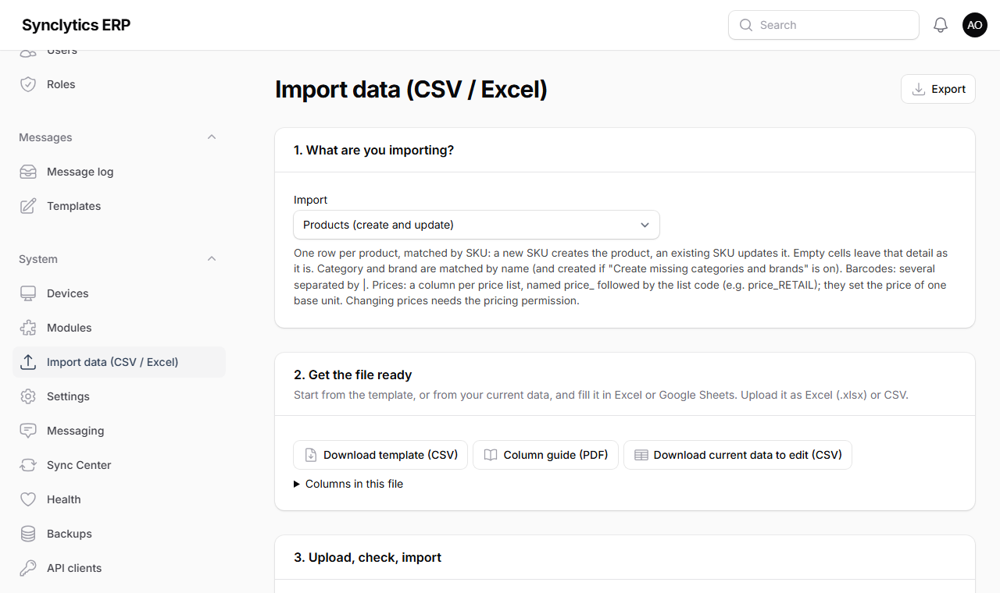
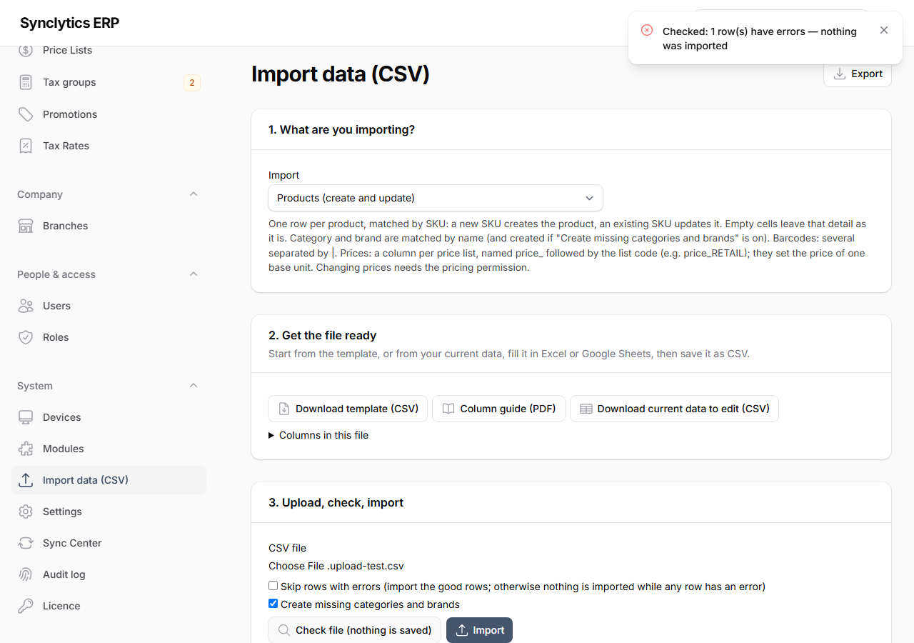
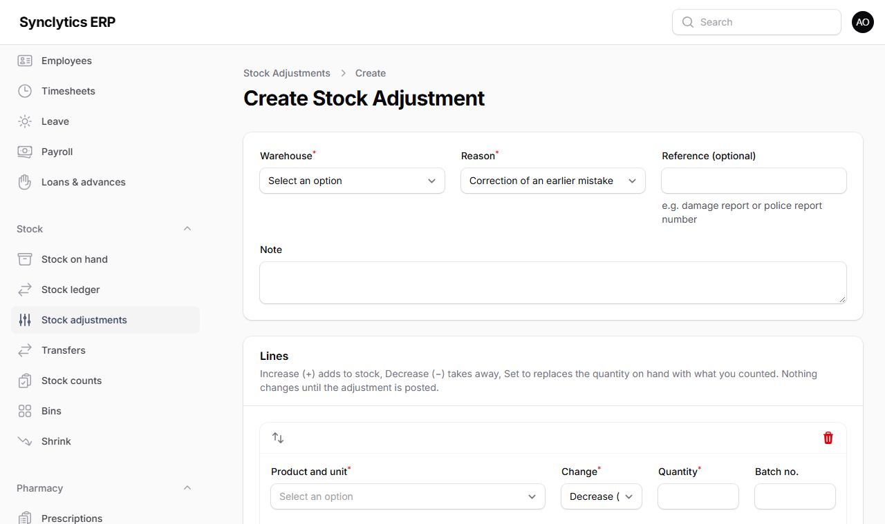

# 14. Exporting and importing data, stock adjustments and stock takes

## 14.1 Exporting (downloading) anything you can see

Every list in the back office (products, customers, invoices, stock on hand, sales, audit log…) and every report page (financial reports, aged debts, shrink, commissions, timesheets, the staff calendar…) has an **Export** button at the top right:

| Choice | What you get | Use it for |
|---|---|---|
| **Export to Excel (.xlsx)** | An Excel workbook (numbers stay numbers; opens in Excel, Google Sheets, LibreOffice, Numbers) | Working with the figures: sorting, totals, sending to your accountant |
| **Export to CSV** | A plain `.csv` file | Loading into another program |
| **Export to PDF** | An A4 PDF with your company name, the title, the filters in use, who printed it, the date and page numbers | Printing, filing, e-mailing |

- The file contains **what is on screen**: the same columns, search, filters and sort — but **all pages**, not only the page you are looking at. Filter first (e.g. one branch, one month), then export.
- Amounts appear as on screen (with the currency); dates in your local time.
- A PDF holds up to 5,000 rows per table. For more, use CSV.

**Why:** every export is recorded in the audit log (who, what, how many rows), because exported files leave the system. When the licence is read-only, exports are blocked like printing.

**Note:** A CSV opens in Excel by double-clicking it. Accents and the cedi sign show correctly. A cell starting with `=`, `+`, `-` or `@` that is not a number gets a leading apostrophe so that Excel never runs it as a formula — this protects you from "CSV injection".

## 14.2 Importing data from CSV files

**System → Import data (CSV / Excel)** — or the **Import … (CSV)** buttons on Products, Customers, Suppliers, Stock adjustments and stock counts.

### What you can import

| Import | What a row does | Matched by |
|---|---|---|
| **Products (create and update)** | Creates a product (leave SKU empty: the system gives it one), or updates an existing one by its SKU. Prices per list in columns `price_RETAIL`, `price_WHOLESALE`… | SKU |
| **Prices (price list update)** | Sets one price (list, unit, from-quantity, optional dates for a promotion) | SKU + list + unit + quantity + dates |
| **Customers** | Creates or updates a customer, optionally with credit limit and terms | Code, else phone number |
| **Suppliers** | Creates or updates a supplier | Code |
| **Opening stock** | The go-live quantity and cost of a product in a warehouse | Warehouse + SKU |
| **Stock adjustment lines** | Increase, decrease or "set to" lines in a stock adjustment | SKU or barcode |
| **Stock count results** | Counted quantities in an open stock count | SKU or barcode (+ bin) |
| **Chart of accounts (migration)** | Adds an account from the old books (QuickBooks types accepted) | Code, else name |
| **Opening trial balance (migration)** | One line of the opening journal on the go-live date | Account code or name |
| **Customer / supplier balances owed (migration)** | What a customer owed you / you owed a supplier on the go-live date | Code, phone or name |
| **Loyalty points / gift cards (migration)** | Points and unspent cards brought over from the old system | Customer; card number |

The migration imports are explained in Chapter 17.2. **Coming from** (QuickBooks, another till system, or our templates) matches the old system's column names for you.

### Step by step

1. **Choose what you are importing.** The page explains what a row does and lists every column (**Columns in this file**), with an example.
   Products have **two separate imports**:
   - **Products — create new** adds new products only. A row whose SKU already exists, or whose name already exists in the same industry, is refused, so importing the same file twice cannot create duplicates. Tick **Allow names that already exist** only for genuinely different products with the same name.
   - **Products — update existing** changes existing products only, found by their SKU: start from **Download current data**, change what you need, and import it. Empty cells and missing columns stay as they are. It never creates a product, so importing it twice is harmless.

   **Why two:** with one import, a row without an SKU always made a new product, so re-importing a file to "update" it created a second copy of everything.
   For **products**, a company with several industries also chooses **For which industry?** (for example *Pharmacy*, or *Shared by all industries*). New products go into that industry's catalogue, and **Download current data** gives that industry's products only. Check and Import stay refused until you choose. An `industry` column in the file can name a different industry for single rows.

   **Why:** each industry's tills and screens show only its own products. A product list imported to the wrong industry would show at the wrong shops.

   **Products already in the wrong industry:** Catalog → Products, tick them (the tick at the top selects the page; *Select all* selects every product in the list), then **Move to industry**. Stock and prices stay; SKUs given by the system take the new industry's series (e.g. `100123` becomes `PHARMA-000124`), while SKUs from your old system stay as they are.
2. **Get the file ready:**
   - **Download template (Excel)** — the headings and one example row (also as **CSV**); or
   - **Download current data to edit (Excel)** — your existing products, prices, customers or suppliers in exactly the import layout (also as **CSV**). Change what you need in Excel and import it back;
   - **Column guide (PDF)** — what to put in each column, to print.
3. Fill it in Excel or Google Sheets and save it, as Excel (.xlsx) or as CSV (Excel: *File → Save As → CSV UTF-8 (Comma delimited)*).

   **Barcodes:** before typing or pasting barcodes in Excel, select the barcode column and choose *Format Cells → Text*. **Why:** otherwise Excel treats a barcode as a number. It drops the zeros in front (`0012345678905` becomes `12345678905`) and shortens long ones (`6.00107E+12`), so the scanner would no longer find the product. The Excel downloads already have codes as text. On import, zeros Excel dropped are put back when the barcode's check digit proves them, and a shortened barcode is refused with a message.
4. **Choose the file**, then **Check file (nothing is saved)**. Every row goes through exactly the same checks as the screens — then everything is undone. You see each row's result and a list of errors.

   

5. Fix the errors (**Download error report (CSV)** gives the failed rows with the reason in the first column), and check again.
6. **Import.** By default a file is imported **all or nothing**: if any row has an error, nothing is imported. Tick **Skip rows with errors** to import the good rows and get the others in the error report.

**Why the check first:** a mistake in a file can change hundreds of products at once. The check shows you exactly what would happen, and what would be refused, before anything changes.

### Rules worth knowing

- **Empty cells leave a detail unchanged** when updating. To change only prices, a file with just `sku` and `price_RETAIL` is enough.
- **Headings** are matched loosely: `Unit cost`, `unit_cost` and `UNIT COST*` are the same column. Columns the import does not know are listed and ignored.
- **Units** (`base_unit`, `unit`) can be the code or the name: `TAB`, `Tablet`, `Strips` and `Cont.` all work.
- **Yes/no columns** accept yes, no, y, n, true, false, 1, 0.
- **Numbers** may have thousands separators (`1,250.50`). **Dates**: `2026-10-31` or `31/10/2026`.
- **Location** (products file): where the product is kept, e.g. `Shelf B2`. It shows on the product, the stock sheet and the till's search list.
- **Barcodes and serial numbers**: several in one cell, separated by `|`. In CSV downloads a code starting with 0 appears as `="0123…"`, which is how Excel is told to keep the zeros; leave it like that.
- **Large files** (thousands of products) take a few minutes to check and import. Wait for the result; do not click again. The tills and the rest of the back office keep working meanwhile: the file goes in 50 rows at a time. *All or nothing* still holds: the whole file is checked first and imported only if no row has an error. (Opening balances and stock adjustments go in as one piece, since their rows make one document.)
- Each row is checked with **your permissions**: changing prices needs the pricing permission, credit limits need the credit permission.
- Every import is listed under **Import history** on the same page and recorded in the audit log under your name.

**Warning:** Only import customers who agreed to be on your records, and never use real customer data in a test system.

## 14.3 Stock adjustments

**Stock → Stock adjustments.** A stock adjustment changes stock outside sales and purchases — breakage, theft, expiry, samples, items found, or correcting a mistake. One adjustment covers one warehouse and has as many lines as you need.

1. **New stock adjustment:** the warehouse, the **reason** (damaged, expired, theft / missing, found / surplus, own use / sample, correction…) and an optional **reference** (e.g. a damage report number).
2. **Lines** — for each product, one of:
   - **Increase (+)** — adds to stock (give the unit cost if you know it; otherwise the average cost is used);
   - **Decrease (−)** — takes away from stock;
   - **Set to counted quantity** — the new quantity on hand; the system works out the difference when you post.
   Batch-tracked products need the batch number; serial-numbered products need one serial number per unit.
3. Save. The adjustment is a **Draft**: you can still change it, or **Add lines from CSV**.
4. **Post** — the changes go into the stock ledger.

**Approval:** an adjustment worth more than the limit in **System → Settings → Stock** (default GHS 500 at average cost) must be **submitted for approval** and **approved and posted by a manager other than the person who prepared it**.

**Why:** stock adjustments are where stock losses are hidden. A second person checking large adjustments, a reason on every line and a permanent record of who did what are the standard controls.

The adjustment page shows each line's stock **before**, the **change** and **after**, and the value. **Export → Adjustment voucher (PDF)** prints it with a signature line for the approver.

**Note:** a posted adjustment cannot be changed or deleted. To correct it, post another adjustment. The quick **Opening stock / adjustment** button on *Stock on hand* still exists for a single product.

## 14.4 Stock takes (counting stock)

There are two ways to bring the system in line with what is on the shelves.

### A. A stock count (recommended for full or regular counts)

1. **Stock → Stock counts → Start a count** for a warehouse (or one bin). The system freezes what it expects at that moment. Leave **blind** on so counters do not see the expected figure.
2. Open the count and use **Count sheet**:
   - **PDF** to count on paper (SKU, barcode, product, unit, bin, and an empty *Counted* column; signature lines for the counter and the checker);
   - **CSV** to fill in Excel or on a tablet.
3. Enter the counts: scan with a handheld (Chapter 9), type them on the count page, or fill the CSV's `counted_qty` column and use **Import counted quantities (CSV)**. Rows left empty are **not counted** (not set to zero).
4. **Submit**, then a manager **approves and posts**. The differences become stock movements, with their value.

### B. Update stock from a stock sheet (quick corrections)

1. **Stock → Stock on hand → Stock sheet (before a count)**: choose the warehouse and category, whether to show the system quantities (leave them out for a blind count), and PDF or CSV. This is the **current stock standing**.
2. Or, to update stock with a file: **Stock → Stock adjustments → Update stock from a CSV file**, choose the warehouse and reason, and **Stock sheet — current stock standing (CSV)**. Its `qty` column holds the system quantity; type the **new** quantity where it differs.
   - **Batches and expiry dates:** a product tracked by batch (most medicines) has **one row per batch**, with its `batch_no`, `expires_on` and quantity. Type the batch's new quantity; **add a row** (copy one and change `batch_no`, `expires_on`, `qty`) for a batch found that the system does not know; change `expires_on` to **correct a wrongly typed expiry date**. A new batch needs its expiry date.
   - The `location` (where the product is kept) and `bins` columns are for information: change a location on the product (or the products file), and move stock between bins on the Bins screen.
3. Import it. Rows whose quantity did not change are skipped; the others become **Set to** lines in a new draft adjustment (for a batch: an increase or decrease of the difference, worked out when you import). A corrected expiry date applies at once and is in the audit log.
4. Open the adjustment, check it, and post it (with approval above the limit).

**Why two ways:** a stock count freezes the expected figures and compares them (best for full counts while trading continues); the stock sheet route is quicker for a few corrections.

**Tip:** count when the shop is closed, or count one area (bin or category) at a time. Sales during a count are still recorded normally.
