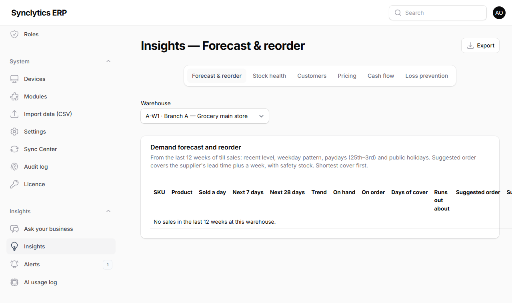
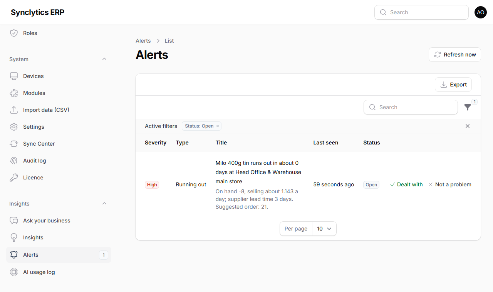
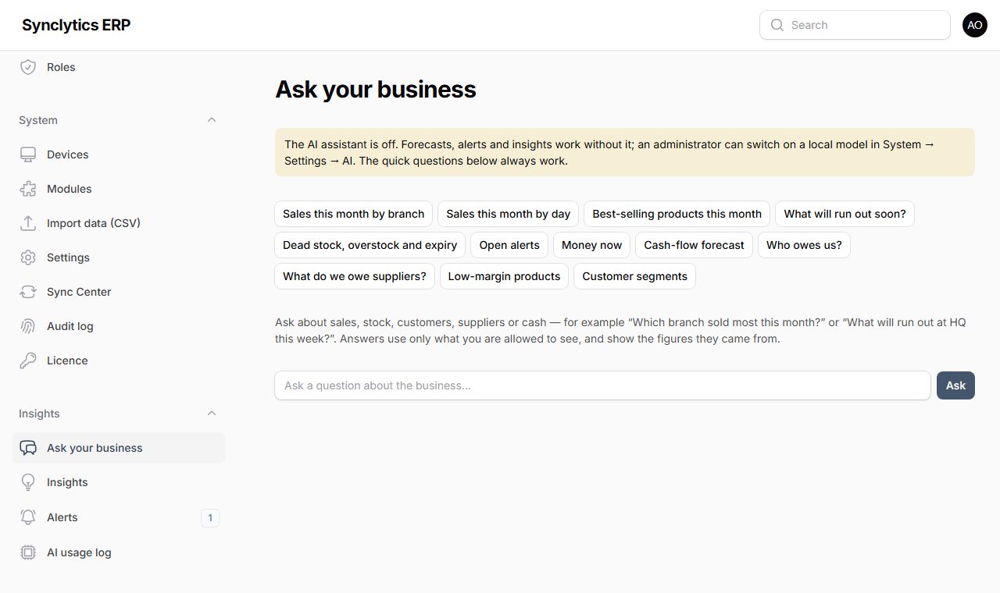

# 15. Insights, alerts and the AI assistant

## 15.1 What works straight away (no AI needed)

The **Insights** menu works on every installation, offline too. It is ordinary arithmetic on your own sales and stock — nothing is sent anywhere and nothing needs installing.

| Page | What it shows | Who sees it |
|---|---|---|
| **Insights → Forecast & reorder** | Expected sales of every product for the next 7 and 28 days, days of stock left, the day it runs out, and a suggested order quantity and min/max | Managers (*See insights*) |
| **Insights → Stock health** | Dead stock (no sale for 90 days), overstock, batches that will expire before they sell, and transfers between branches | Managers |
| **Insights → Customers** | Customer segments (champions, loyal, at risk…), regulars who have stopped coming, products bought together | Company-wide managers |
| **Insights → Pricing** | Products with a low margin or sold below cost, markdown suggestions, how much each promotion lifted sales | Company-wide managers |
| **Insights → Cash flow** | Money expected in and out, week by week, for 8 weeks | Company-wide managers |
| **Insights → Loss prevention** | For each cashier: refunds, refunds without a receipt, discounts, drawer over/short, kitchen voids, and a risk score | Owner, general, finance and branch managers |
| **Insights → Alerts** | A to-do list built every night from all of the above | Managers |



**How the forecast works (in plain words):** it looks at the last 12 weeks of till sales, gives the most recent weeks the most weight, and adjusts for the day of the week, for **paydays** (the 25th to the 3rd, when shops in Ghana are busier) and for **public holidays** (fixed holidays, Easter and Farmers' Day; Eid dates change each year and show up through your own history). The suggested order covers the supplier's **lead time** (set it on the supplier) plus a week, with a little safety stock.

**Why:** you see trouble — a best-seller running out, yoghurt that will expire, a till with too many refunds — before it costs money.

**Note:** The risk score is a reason to look (receipts, CCTV), never proof. Cashiers with fewer than 20 receipts in the period are listed but not scored.

### Alerts



1. Every night at 04:30 the scheduler refreshes the alerts (it must be running — Chapter 4/5). To refresh now: **Insights → Alerts → Refresh now**.
2. For each alert choose **Dealt with** (say what you did) or **Not a problem** (it stays quiet for 30 days).
3. An alert closes by itself when its cause goes away (e.g. the stock arrived).

## 15.2 The AI assistant — off unless you switch it on

The owner chose **no cloud AI for now**, so the AI assistant is **off**. Three features need it:

- **Ask your business** (the copilot): questions in plain language, answered from your reports.
- **Scan an invoice** on Supplier bills: a photo of a supplier invoice fills in the bill form.
- **Write description (AI)** on a product: a draft text for the online shop.



Without AI, *Ask your business* still offers **quick questions** (sales by branch, what will run out, who owes us…) answered straight from the reports.

You can switch on a **local model**: it runs on your own server, so nothing leaves your network and there is no monthly bill.

### Requirements for a local model

| | Minimum | Better |
|---|---|---|
| Memory (RAM) | 16 GB | 32 GB |
| Disk space | 15 GB free | 30 GB |
| Graphics card | Not required (slower) | NVIDIA with 8 GB or more |

**Why:** the model is a large file held in memory while it answers. On a small server answers take 20–60 seconds; with a graphics card a few seconds.

### Installing Ollama (the program that runs local models)

**On Windows:**

1. Download the installer from **https://ollama.com/download** and run it (Next → Install). It starts by itself and sits next to the clock.
2. Open **Command Prompt** and download the two models (this takes a while, about 5 GB each):
   ```
   ollama pull qwen2.5:7b
   ollama pull qwen2.5vl:7b
   ```
   *Why two:* the first answers questions and writes text; the second reads photos of invoices.
3. Check it works: `ollama run qwen2.5:7b "Say hello"` — it should answer.

**On Ubuntu:**

```
curl -fsSL https://ollama.com/install.sh | sh
ollama pull qwen2.5:7b
ollama pull qwen2.5vl:7b
```

The installer sets Ollama to start with the server.

**Note:** Ollama listens only on the server itself (`127.0.0.1:11434`). Keep it that way: do not open port 11434 in the firewall.

### Switching the assistant on

1. **System → Settings → AI**.
2. **AI assistant:** *Local model (Ollama on your server)*.
3. Leave **Ollama address** as `http://127.0.0.1:11434` (Ollama on the same server). If Ollama runs on another computer in your office, put its address here.
4. The model names must match what you downloaded (`qwen2.5:7b` and `qwen2.5vl:7b`).
5. Save, then open **Insights → Ask your business** and ask "Which branch sold most this month?".

**Check:** the answer appears with the table it came from. The question is listed in **Insights → AI usage log**.

### If you later choose Claude (cloud AI)

Only with the owner's decision, because data then leaves your servers:

1. Get an API key from Anthropic (the owner's own account).
2. Put it in the server's `.env` as `ANTHROPIC_API_KEY=...`, then run `php artisan optimize`. *Why `.env`:* keys are never stored in the database or shown on screen.
3. **System → Settings → AI:** choose *Claude*, and set **Cloud AI budget per month (USD)**. With a budget of 0 Claude is never used; when the month's budget is spent it stops until the 1st.
4. Keep **Keep personal data on your server** on (recommended): questions about customers or staff are then answered by the local model only (or shown without AI wording if there is none). In every case names, phone numbers and e-mail addresses are replaced by placeholders such as *[Customer 1]* before anything is sent, and put back when the answer arrives.

## 15.3 Using the AI features safely

- **The AI never changes anything.** It reads reports; it cannot post, approve, order or pay. An invoice scan only fills in a form: you check each line against the paper and press **Create**, and the bill then follows the normal approval rules.
- **Answers show their figures.** Every copilot answer comes with the tables it used. If a figure looks wrong, the table shows where it came from.
- **People only see what they may see.** A branch manager's questions use only their branch; money and customer figures for the whole company need a company-wide role.
- **Everything is logged.** *Insights → AI usage log* lists every question, what was sent (as the model saw it, with names masked), the answer and the cost.
- Photos of invoices: the local model reads JPG and PNG photos (not PDFs — take a photo or screenshot). Claude can read PDFs.

## 15.4 Troubleshooting

| Message | What to do |
|---|---|
| *The AI assistant is off* | Switch it on (15.2), or use the quick questions |
| *The local AI model is not reachable* | Start Ollama (Windows: open it from the Start menu; Ubuntu: `sudo systemctl start ollama`) and check the address in Settings → AI |
| *The local AI model answered with an error: model not found* | Download the model named in Settings (`ollama pull <name>`) |
| Answers are very slow | Normal without a graphics card; use a smaller model such as `qwen2.5:3b` (less accurate) |
| *This month's cloud AI budget is used up* | Wait for the 1st, raise the budget, or switch to the local model |
| No alerts ever appear | Check the scheduler is running (Chapter 4/5) or press **Refresh now** |
