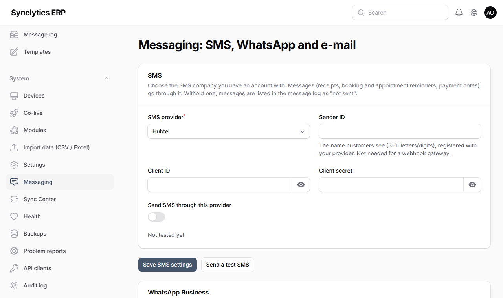
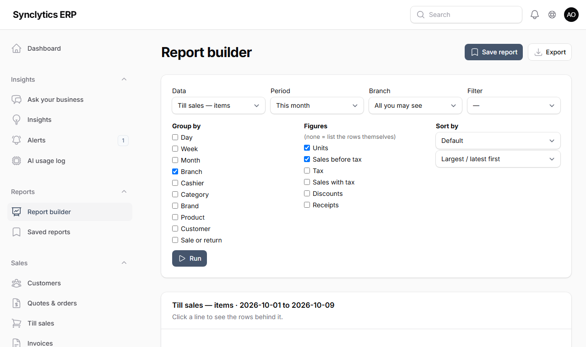

# 16. Messages, reports and connecting other systems

## 16.1 E-mail (any mail server)

The system sends e-mail for scheduled reports, invoices to customers (when you switch that on) and digital receipts. It uses **any SMTP mail server** you already have: Google Workspace or Gmail, Zoho Mail, Microsoft 365, or your web host's mail.

1. Get the SMTP details from your mail provider: server name, port, user name and password.
   - **Gmail / Google Workspace:** server `smtp.gmail.com`, port `587`; the password must be an **app password** (Google account → Security → 2-Step Verification → App passwords), not your normal password.
   - **Zoho:** `smtp.zoho.com`, port `587`.
   - **Your web host:** see its "e-mail accounts" page (often `mail.yourdomain.com`, port `587` or `465`).
2. Open the server's `.env` file (Chapter 4/5) and set:
   ```
   MAIL_MAILER=smtp
   MAIL_HOST=smtp.gmail.com
   MAIL_PORT=587
   MAIL_USERNAME=reports@yourcompany.com
   MAIL_PASSWORD=<the app password>
   MAIL_FROM_ADDRESS=reports@yourcompany.com
   MAIL_FROM_NAME="Your Company"
   ```
3. In the `server` folder run `php artisan optimize`.
4. **System → Messaging → Send a test e-mail** to your own address.

**Why:** the password lives only in `.env` on the server — never in the database or on screen. `MAIL_MAILER=log` (the default) writes e-mails to the log file instead of sending them, which is safe for testing.

## 16.2 SMS — choose your provider

You can use **Hubtel**, **Arkesel**, **mNotify**, or **any other SMS company** through a small "webhook" bridge. Use the one you already have an account with.

1. Open an account with the provider (their website) and buy SMS credit.
2. Register a **sender ID** (the name customers see, 3–11 letters, e.g. `DemoShop`). In Ghana sender IDs must be approved (your provider handles it with the NCA); it can take a few days.
3. Copy the keys from the provider's dashboard:

| Provider | What you need |
|---|---|
| Hubtel | Client ID and Client secret (Hubtel dashboard → Programmable SMS → API keys) |
| Arkesel | API key (Arkesel dashboard → SMS API) |
| mNotify | API key (mNotify dashboard → API) |
| Other (webhook) | The address of your gateway. It receives `{"to", "message", "reference"}` as JSON; an optional shared secret signs it (`X-Signature`). |



4. **System → Messaging → SMS**: choose the provider, type the sender ID and keys, tick **Send SMS through this provider**, **Save**.
5. **Send a test SMS** to your own phone.

**Note:** keys are stored encrypted with this server's key and never shown again — an empty box keeps the saved key. Each server that sends messages (normally head office) has its own settings.

## 16.3 WhatsApp Business (optional)

WhatsApp messages need a **WhatsApp Business account on Meta's Cloud API**; Meta charges per conversation. Businesses may only start a conversation with a **template approved by Meta**.

1. In Meta Business Manager create a WhatsApp Business app, add your business phone number and create a **permanent access token** (system user).
2. Create templates with the same wording as in **Messages → Templates** (WhatsApp lines); the placeholders become `{{1}}`, `{{2}}`… in order. Wait for approval.
3. **System → Messaging → WhatsApp Business**: Phone number ID and access token, tick **Send WhatsApp messages**, **Save**; **Send Meta's "hello_world" test**.
4. In **Messages → Templates**, put the approved template name on each WhatsApp line and switch it on.

When WhatsApp is on and a message has an active WhatsApp template, customers get WhatsApp instead of SMS.

## 16.3a Orders by WhatsApp (optional)

Customers send their list, or a photo of their prescription, to your WhatsApp Business number; staff turn it into an order and the customer is answered on WhatsApp.

1. In Meta's app settings (**App settings → Basic**) copy the **App secret** into **System → Messaging → WhatsApp Business → App secret**, and **Save**. **Why:** messages are accepted only when Meta signs them with this secret, so nobody else can post fake orders to your server.
2. The page then shows a **callback URL** and a **verify token**. In Meta (**WhatsApp → Configuration → Webhook**) enter both, press **Verify and save**, and subscribe to **messages**. **Why:** this tells Meta where to send your customers' messages.
3. **System → Settings → WhatsApp orders**: switch on **Take orders by WhatsApp**; change the **Automatic reply** if you like ({number} is the order's reference). **Why:** off by default, so nothing arrives until you are ready to answer.
4. Send a message from your own phone to the business number. It appears within seconds under **Online → WhatsApp orders** and you get the automatic reply.

**Every day:** open **Online → WhatsApp orders** (the number beside it is how many are waiting). Open one to read the message and see the photos (click a photo to see it full size). Then:
- **Reply** to ask something (which strength, a price);
- **Make the order**: the branch that fills it, picked up or delivered (with the address), and the items with quantities. Stock is held for it, the customer gets the items and the total, and it continues under **Online → Online orders** (**Mark ready** tells the customer it is ready; **Hand over** takes the payment);
- **Decline** with the reason the customer will read (e.g. *out of stock*, *a prescription is needed*).

**Note:** WhatsApp lets you reply freely for 24 hours after the customer's last message; after that, the customer must write again. Prescription medicines still need the pharmacist's check when handed over, as at the counter.

## 16.4 Which messages are sent, and their wording

**Messages → Templates** lists every message per channel. Edit the text, use the placeholders shown, and switch each one **on or off**.

| Message | Starts | Sent when |
|---|---|---|
| Receipt | On | The cashier presses **Send receipt** on the till (SMS, WhatsApp or e-mail) |
| Table booking / appointment confirmed and reminder | On | A booking or appointment is made, and before it starts |
| Invoice sent to the customer | **Off** | An invoice is issued (e-mail to the customer's address) |
| Payment received | **Off** | A customer pays on account |
| Scheduled report | On | A scheduled report runs (16.6) |
| Payment alert / Daily mobile money and card summary | On (sent only when *Payment alerts* are switched on, Chapter 7 Step 6) | A MoMo or card payment at a till, and the summary at its time. WhatsApp needs approved templates named `payment_alert` and `payment_summary` |
| Sign-in code (back office) | On | Someone whose sign-in method is *password and a code* signs in (WhatsApp needs an approved template named `signin_code` with one parameter, the code; otherwise e-mail). The code is never shown in the message log |
| Purchase order sent to a supplier | On | A buyer presses **Send to supplier** on an approved order (e-mail with the PDF, or WhatsApp with a download link; 14.6) |

**Messages → Message log** shows every message: to whom, the text, and whether it was **sent**, is **waiting** (the provider was down — it is retried automatically for a few hours), **failed**, or **not sent** because no provider is set up. **Try again** resends one.

**In the back office** the bell (top right) tells approvers when something waits for them: purchase orders, supplier bills with price differences, stock adjustments, deliveries over the tolerance, stock counts, van settlements and expense claims.

## 16.5 Digital receipts at the till

After a sale, under the receipt: choose **SMS**, **WhatsApp** or **E-mail**, type the number or address, **Send receipt**. Only the channels switched on in Messages → Templates appear. A sale made offline can be sent once the till is back online.

## 16.6 Reports you build yourself

**Reports → Report builder**:



1. **Data**: till sales (items, receipts or payments), stock on hand, stock movements, customer invoices, supplier bills or the general ledger.
2. **Period** and **Branch**; optionally a **Filter** (e.g. Category contains "drinks").
3. **Group by** (branch, day, month, cashier, category, product, customer…) and **Figures** (units, sales, tax, discounts, receipts, value…). With no figures you get the rows themselves, each with an **Open** link to the document.
4. **Run**. Click any line to see the rows behind it (**Back to the summary** returns).
5. **Export** as Excel, CSV or PDF, or **Save report**.

**Scheduling:** in **Save report** choose *Every day / week / month*, the time, the format (PDF, Excel, CSV) and the recipients: e-mail addresses (the file is attached), WhatsApp numbers (a short note) or people in the system (bell). Reports are sent by head office every 15 minutes when due. **Reports → Saved reports** lists them with the next run and the last result.

**Why:** a scheduled report runs *as the person who saved it*, so it never shows more than they are allowed to see.

## 16.7 Exporting to QuickBooks, Xero or Sage

If your accountant keeps the books in another program: **Finance → Export to QuickBooks / Xero / Sage**, choose the program and the period (normally last month), **Download the file**, and import it there:

| Program | Import it under |
|---|---|
| QuickBooks Online | Settings → Import data → Journal entries |
| Xero | Accounting → Manual journals → Import |
| Sage 50 / Pastel | File → Import → Audit trail transactions |

**Before the first import**, create the same account codes in the other program (or map them during import). The Xero file uses the tax rate "Tax Exempt" because tax is already in separate lines; rename it if your Xero uses another name.

## 16.8 Connecting other systems (the API)

For a developer connecting a website, a delivery partner or another program:

1. Optionally create a user just for that system with a narrow role (e.g. *Sales Rep*).
2. **System → API clients → New API client**: name, **scopes** (what it may do: read products, stock, customers, sales, invoices; create customers and orders; manage its webhooks), **Acts as** (that user), optionally **Only this branch**.
3. Copy the **key** shown once and give it to the developer securely. **New key** adds another (to rotate); **Revoke** stops every key at once.
4. The developer's documentation is at `https://<your server>/api/public/v1/openapi.json` (OpenAPI 3.1). Webhooks (product changed, sale, invoice, order confirmed or delivered) are signed with a secret shown once when they are added.

**Why:** a key acts as a person, so it can never see more than that person may in the back office; everything it does is in the audit log under "API: <name>".

## 16.9 Importing from Excel

**System → Import data** now also takes **Excel (.xlsx)** files (the first worksheet). After choosing the file you see a **preview** of the first rows. If your columns have other names (e.g. "Item code" instead of `sku`), **Match columns** lets you say which column is which. Then **Check file** and **Import** as in Chapter 14.

**Tip:** type dates in Excel as text like `2026-10-31` so they are read exactly.
