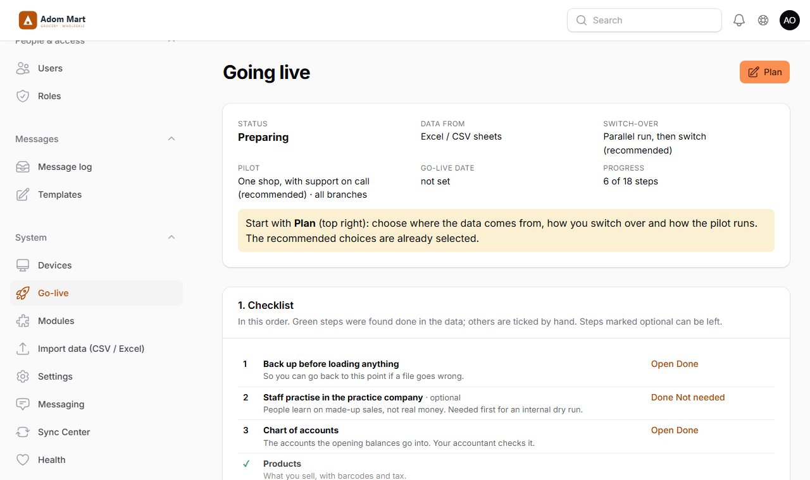
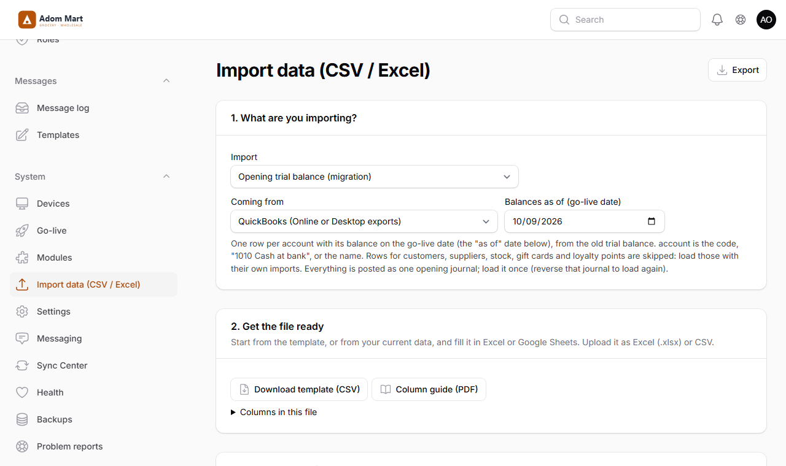

# 17. Going live

This chapter takes a business from its old way of working (another till system, QuickBooks, Excel sheets or paper) to running on SES Labs, safely. Everything here is on one page in the back office: **System → Go-live** (owner and general manager).

**Why a plan:** going live touches money, stock and every member of staff on the same day. A written plan, a checked set of figures and a way back make it a calm day instead of a risky one.

## 17.1 Make the plan

**System → Go-live → Plan** (top right). Choose:

1. **Where the data comes from** — tick every source you have:
   - **Excel / CSV sheets** — lists you keep yourself; use our templates.
   - **QuickBooks** — exports from QuickBooks Online or Desktop (lists and reports, saved as Excel or CSV).
   - **Another till (POS) system** — exports from Loyverse, Square, Lightspeed, Odoo and similar.
   - **Starting fresh** — nothing is brought over; you type in or import only products, prices and stock.
2. **How you switch over:**
   - **Parallel run, then switch (recommended)** — for one to two weeks both systems are used and each evening the day's totals are compared. **Why:** you see any difference while the old system still works.
   - **Switch fully on one day** — load the data on a quiet day (Saturday evening), use only the new system the next morning. Faster, but the go-live backup is your only way back.
   - **One till or branch first** — one till (or one branch) starts on the new system; the others follow after a week without problems.
3. **How the pilot runs:**
   - **One shop, with support on call (recommended)** — one real shop goes first. A **pilot report** is e-mailed every evening (17.6).
   - **Several shops at once** — two or three shops with different set-ups start together.
   - **Internal dry run first** — a whole simulated week in the **practice company** (17.3) before any real shop.
4. **Go-live date** — the opening balances are "as of" this date (normally the evening before the first day on the new system).
5. **Pilot branch(es)**, the **support e-mail address** (where problem reports and the pilot report go) and the **time of the pilot report** (default 19:00).

**Check:** the top of the page shows your choices and the checklist below them.

## 17.2 Bring the data over

The **checklist** on the Go-live page lists each step in order. A step turns green by itself when the data is there; **Open** takes you to the right import, already set to your source. Do them in this order — later steps need the earlier ones.

**Before you start:** take a backup (**System → Backups → Back up now**). **Why:** if a file goes wrong, you can return to this point.

| Step | From QuickBooks | From another till system | From Excel |
|---|---|---|---|
| Chart of accounts | *Account List* report | — | our template |
| Products | *Products and Services* list | the items export | our template |
| Prices | the same *Products and Services* file | the same items file | our template |
| Customers | *Customer Contact List* | the customers export | our template |
| Suppliers | *Vendor Contact List* | — | our template |
| Opening stock | *Products and Services* (Qty on hand) — or better, a fresh count | the stock / inventory export | our template |
| Opening trial balance | *Trial Balance* report on the go-live date | — | our template |
| What customers owe | *Customer Balance Summary* | customer balances | our template |
| What you owe suppliers | *Vendor Balance Summary* | — | our template |
| Loyalty points | — | customers export with points | our template |
| Gift cards and store credit | — | gift card export | our template |

For each file: **System → Import data**, choose the kind of import and **Coming from**. When you choose the file, the columns are matched for you (for example QuickBooks' *Product/Service Name* becomes *name*, *Sales Price / Rate* becomes *price*); check them, then **Check file**, fix what it reports, and **Import** (Chapter 14.2).

**Good to know:**

- **No SKU in the old system?** One is made from the name (*Malta Guinness 330ml* → `MALTA-GUINNESS-330ML`), the same way in the products, prices and stock files, so they match.
- **QuickBooks sub-items** (*Drinks:Malta 330ml*): the last part becomes the product name and the first its category.
- **Suppliers without a code** get one made from the name; customers are matched by code, phone number or exact name.
- **The opening trial balance skips** the lines for customers, suppliers, stock, gift cards and loyalty points: those come in through their own imports, with every customer's and supplier's detail. Whatever is left goes to *Opening balances (to clear)*.
- **Load the opening trial balance once.** To load it again, reverse the opening journal first (Finance → Journals).
- **A customer who is owed money** (a negative balance) gets it as **store credit** they can spend at the till.
- **Count the stock** rather than trusting the old system's quantities if you can: the opening stock is what everything else is measured against.

**Warning:** only bring over customers who agreed to be on your records.

## 17.3 Let staff practise: the practice company

**System → Go-live → Create the practice company.** It copies your branches, tills, settings, products, prices and stock into a separate company with made-up customers. Choose the staff who get a practice login.

- In the back office, staff sign in at their e-mail address with **+practice** (*kofi+practice@yourshop.com*) and **their usual password** (and their usual two-step code).
- At a till, enrol a spare PC or tablet to the practice company (System → Devices, signed in as the practice owner); cashiers use **their usual username and PIN**.
- A purple **PRACTICE** bar shows on every screen and receipt. **Nothing leaves the practice company:** no GRA reporting, no SMS, WhatsApp or e-mail to customers, no updates to online stores or other systems. Its books never mix with yours.

**Why:** people learn fastest by doing it, and mistakes there cost nothing.

Hand out the training material (17.7). When you want a clean start, **Archive the practice company** (its logins stop) and create a new one.

## 17.4 Check the figures

When everything is loaded: **System → Go-live → Check the figures**.

1. **Enter the old system's figures** on the go-live date: number of products, customers and suppliers; stock value at cost; what customers owe; what you owe suppliers; unspent gift cards; loyalty points. Take them from the old system's own reports (stock valuation, aged debtors, aged creditors).
2. Press **Post and check again**. The new system posts everything to the accounts and compares.

**Check:** every difference shows ✓ and **Opening balances (to clear)** is **0.00**. If it is not zero, something from the old trial balance is missing or was loaded twice — your accountant compares the two trial balances.

**Why:** a difference found now takes minutes to fix; found in a month, it takes days.

## 17.5 The switch-over

### A parallel run (recommended)

1. **Start the parallel run** (Go-live page). From now, every sale is rung up in **both** systems.
2. Each evening, **Enter a day of the old system** for each pilot branch: its total sales, cash and number of receipts. The new system's figures for the same day are filled in for you.
3. A difference above 1.00 needs an **explanation** (a sale rung up in only one system, a price that differs). The checklist's *Parallel run is clean* step turns green after three days in a row that agree or are explained.

### All on one day

Load everything on a quiet evening, check the figures (17.4), take the go-live backup and go live. Next morning only the new system is used.

### One till or branch first

The first till or branch goes live as above. When it has run a week without problems, tick **First till ran a clean week** and move the others over the same way.

### Going live

1. **Take the go-live backup** (Go-live page). **Why:** it is the exact point you can return to. It must be taken on the day you go live.
2. **Go live.** If a required step is still open, you are asked why you go live anyway; the answer is recorded.

From now on the new system holds the books. Keep the old system for **looking things up only** for at least three months.

## 17.6 During the pilot

- **Report a problem:** everyone has a **Report a problem** button (the life-buoy icon at the top of the back office; at the bottom of the till screen). It records what they wrote, the screen they were on and the system's recent errors, and e-mails support. Support and IT see the list under **System → Problem reports**, where they close each one with what was done.
- **The pilot report** is e-mailed every evening at the plan's time while the parallel run lasts and for 60 days after going live: sales per pilot branch, cash over/short, sales that reached the server late (a till was offline), the parallel-run difference, the problems reported today, and the health checks that are not green. **Show today's report** on the Go-live page shows it at any time.
- E-mail must work for both (Chapter 16.1). The support address can also be set in `.env` as `ERP_SUPPORT_EMAIL`.

## 17.7 Training material

Printable guides, in `docs/training/pdf/` of the release (rebuild them with `npm run training` in the `pos` folder):

| File | For | What it covers |
|---|---|---|
| `cashier-quick-card.pdf` | Cashiers | One sheet to keep at the till: selling, payments, returns, offline, end of shift |
| `supervisor-guide.pdf` | Supervisors | Approvals, the review queue, lock-outs, end of day |
| `storekeeper-guide.pdf` | Storekeepers | Receiving, transfers, counts, adjustments |
| `accountant-guide.pdf` | Accountants | Opening balances, weekly checks, month-end |
| `manager-owner-guide.pdf` | Owners and managers | Access, daily checks, going live |
| `video-scripts.pdf` | Whoever records training videos | Nine short videos, what to show and what to say |

Each guide ends with exercises to do in the practice company.

## 17.8 The rollback plan: going back to the old system

Decide in advance **who** may decide to go back (normally the owner), and keep the old system ready until the pilot is over.

**When to go back:** the tills cannot sell for more than an hour and support cannot fix it; or the figures are wrong in a way nobody can explain. A slow screen or a wrong price is fixed, not rolled back.

1. **Decide and record it:** **System → Go-live → Go back to the old system**, with the reason.
2. **Keep selling:** switch the tills back to the old system straight away. During a parallel run the old system is already up to date — that is the point of it.
3. **Keep what happened on the new system:** export today's sales (**Sales → Till sales → Export**) and any other documents created since going live, so they can be entered in the old system.
4. **Only if the new system's books must be put back** to the go-live point (for a second attempt later): the technician restores the **go-live backup** (shown on the Go-live page) as in Chapter 12.3. Everything entered after it is replaced — that is why step 3 comes first.
5. **Find the cause** with support (the problem reports and the pilot reports help), fix it, practise again in the practice company, and plan a new date.

**Check before the go-live day:** the people involved know this plan; the old system still opens; the go-live backup was copied off the server (System → Backups shows its copies).
